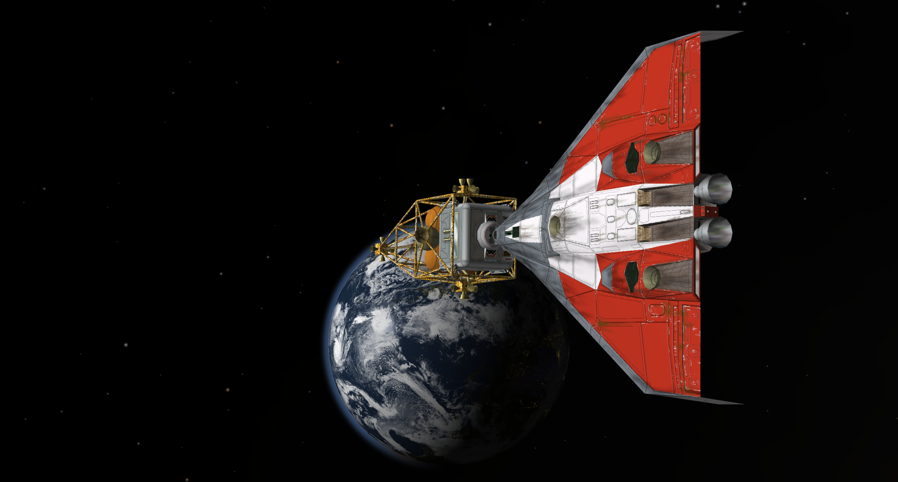
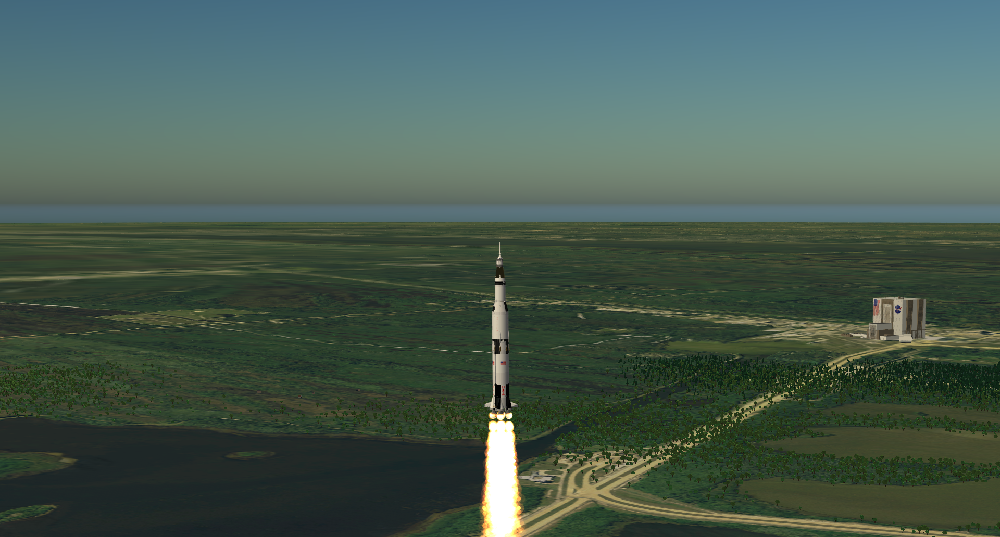
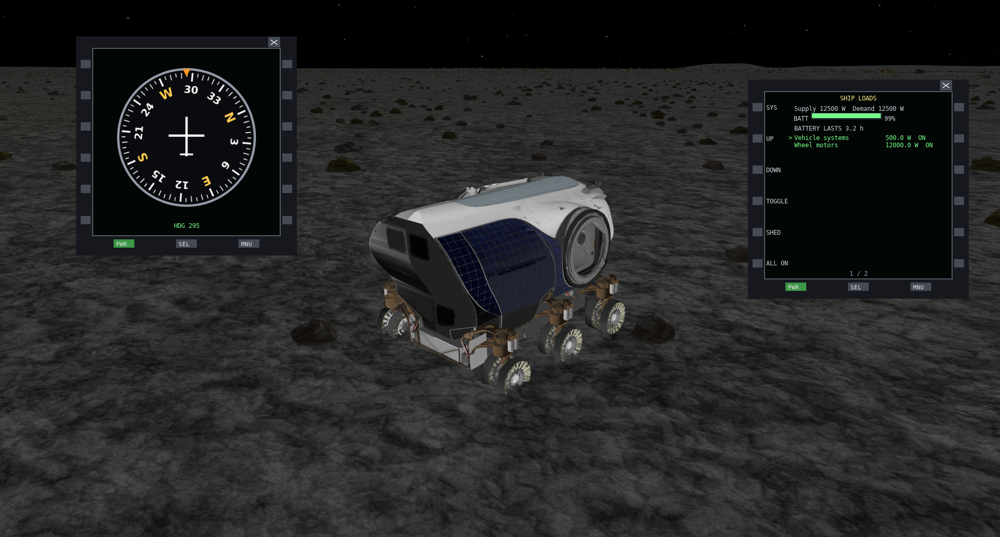
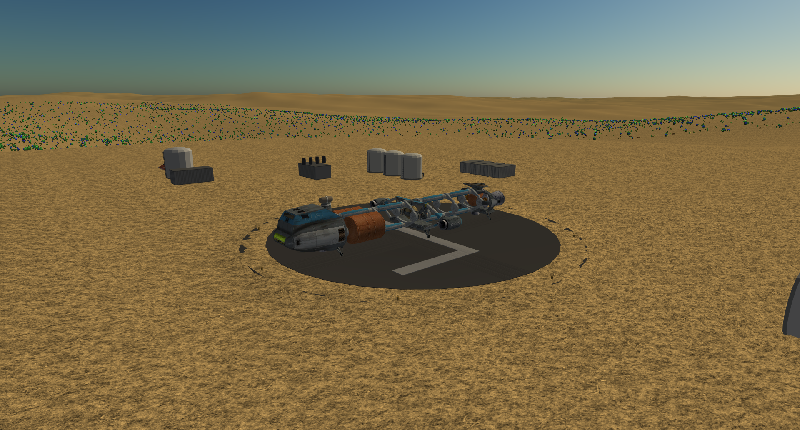

# Kosmos

**A spaceflight and atmospheric flight simulator — now looking for beta testers.**

Kosmos is a free spaceflight simulator built in C++ on [simlib](https://github.com/daver64/rsimlib). Launch from Earth, navigate in orbit, travel to the Moon and other planets, or explore procedural star systems. Inspired in part by Orbiter and Kerbal Space Program, it combines flight simulation with tools for building spacecraft, missions and add-ons.

Kosmos began around twenty years ago as a personal project. It is now ready for wider testing.

**[Download Kosmos](https://github.com/daver64/Kosmos/releases/latest) · [Website](https://salyut.ddns.net/kosmos/index.html) · [User manual](https://salyut.ddns.net/kosmos/manual.html) · [Modding guide](https://salyut.ddns.net/kosmos/modding.html) · [SDK](https://salyut.ddns.net/kosmos/sdk.html)**

| Dragonfly and Deltaglider | Apollo 11 launch |
| :---: | :---: |
|  |  |
| **Space Exploration Vehicle at Tranquility** | **Shuttle-AQ at Thalassa depot** |
|  |  |

> **Project status — beta.** The main feature set is in place. Current work concentrates on bug fixes, stability, performance and visual improvements rather than major new features. Expect rough edges and experimental systems; some navigation and autopilot features have significant limitations documented below.

## Help test Kosmos

Until now, Kosmos has been tested mainly by its developers. We would welcome a wider range of people willing to fly it, explore its systems and tell us what goes wrong.

You **do not need to be a programmer**. Useful feedback includes installation problems, crashes, unexpected flight behaviour, confusing controls, poor performance and unclear documentation. If you enjoy creating spacecraft, scenarios, instruments or external tools, the modding and SDK facilities are also available to try.

To get started, download a packaged build from the [latest GitHub release](https://github.com/daver64/Kosmos/releases/latest), unpack it and run the launcher. Choose a scenario and fly; you do not need to build from source. The [manual](https://salyut.ddns.net/kosmos/manual.html) explains the controls and systems.

On Windows, right-click the downloaded ZIP and choose **Extract All**, then open the extracted folder and run `kosmos-launcher.exe` there. Do not run it from inside the ZIP: Windows may extract only the executable and warn that other files are needed.

If you encounter a problem, please [open a GitHub issue](https://github.com/daver64/Kosmos/issues), ideally including your operating system, Kosmos version, scenario or spacecraft, steps to reproduce and any relevant log. The launcher also has a **Report this log** option that lets you preview a sanitised log before submitting it.

## What you can do

- **Fly spacecraft and aircraft:** launch, stage, manoeuvre, rendezvous, dock, land and explore using orbital and atmospheric flight systems.
- **Navigate the Solar System:** use MFDs, flight computers, manoeuvre planning, autopilots and mission-planning tools; experimental aids require supervision.
- **Explore beyond Sol:** visit a deterministic catalogue of **24,409 stars**, including procedurally generated planetary systems, landable terrain and quantum-portal travel.
- **Leave the spacecraft:** walk or manoeuvre in EVA and interact with supported environments.
- **Create and modify content:** use the scenario and base editors, ShipEdit, KosmosCAD and KosmosMission, as well as JSON-based add-ons.
- **Extend the simulator:** write Lua scripts and MFDs, or connect external programs using the KosmosLink SDK.
- **Try multiplayer:** up to four players can see one another as ghost ships; this is not a shared collision or docking simulation.

## Documentation and development

This README also serves as the technical reference for developers. The detailed build instructions, source layout, tests, command-line options and subsystem notes are retained below.

Kosmos is directed by a small core team. Suggestions, bug reports and community-created content are welcome; architectural and project-direction decisions remain with the maintainers. Public source availability does not imply that every proposed feature or pull request will be accepted.

The sections below describe the current implementation, including experimental behaviour and known limitations.

Kosmos's own code is available under the [MIT License](LICENSE). Third-party code and assets
retain their own licences and credits; see their accompanying notices and the credits for [sounds](data/CREDITS-sounds.md),
[models](data/CREDITS-models.md), [textures](data/CREDITS-textures.md), and
[gravity data](data/gravity/README.md).

### Recent flight improvements

Recent releases improve saved-flight resume and OrbitComp encounter and burn estimates. Sync Orbit's APPR page and target-relative retrograde hold help with manual rendezvous, while RADALT adds a sampled terrain-ahead warning. Experimental autoland can approach a target or plan an orbital base landing, and flights can be recorded and replayed as snapshots. Optional nonspherical gravity uses spherical-harmonic fields for several Solar System bodies during integrated flight. These aids have important limits: see the sections below before relying on them.

---

## Build and run

Kosmos builds against an installed [simlib](https://github.com/daver64/rsimlib) (`cmake --install` of rsimlib; pinned to the commit in `SIMLIB_COMMIT`; the build scripts check your simlib checkout against it, and the pin is only moved after simlib itself changes). Needs a C++17 compiler, CMake 3.28+ and simlib's dependencies; the command below uses Ninja.

    cmake -S . -B build -G Ninja -DCMAKE_PREFIX_PATH=$HOME/opt
    cmake --build build --target kosmos
    ./build/kosmos [options]

Use `-DKOSMOS_SIMLIB_DIR=/path/to/rsimlib` to build against a simlib source checkout instead.

### Native Windows build (MSVC)

With the MSVC C++ tools, a neighboring simlib checkout at the commit in `SIMLIB_COMMIT`, and simlib's dependencies (including wxWidgets for the launcher) installed in vcpkg's `x64-windows` triplet, configure and build the default targets:

```powershell
$env:VCPKG_ROOT = "C:\path\to\vcpkg"
cmake -S . -B build-msvc -G "Visual Studio 18 2026" -A x64 `
  "-DCMAKE_TOOLCHAIN_FILE=$env:VCPKG_ROOT\scripts\buildsystems\vcpkg.cmake" `
  -DVCPKG_TARGET_TRIPLET=x64-windows `
  -DKOSMOS_SIMLIB_DIR=..\rsimlib `
  -DSIMLIB_RENDERERS=gl -DSIMLIB_BUILD_SHADER_COMPILER=OFF -DSIMLIB_VALIDATE_SHADERS=OFF
cmake --build build-msvc --config Release --parallel 4
```

Use the Visual Studio generator name matching the installed version. The default build includes `kosmos`, `kosmos-launcher` and `planetbake`; optional GTK-based tools are not part of this native Windows CMake build. The Windows package script below remains the MinGW cross-build.

### Source layout

`src/kosmos.cpp` is only `main`. The application is the `App` struct in `src/app_state.h` (its members are the state that used to be `main`'s locals); `App::run` calls the start-up steps in `app_start.cpp`, `app_world_setup.cpp` and `app_ui_setup.cpp`, then one frame at a time from `app_frame.cpp`, whose phases live in `app_input.cpp` (events, keys), `app_camera.cpp` (time, camera), `app_draw_world.cpp` (the 3D scene; its lighting, sky, bodies, ships, weather and effects passes are in `app_scene.cpp`), `app_draw_hud.cpp` (overlays, sound, HUD) and `app_gui.cpp` and `app_windows.cpp` (menus and the tool windows). The pieces that need no shared state are modules of their own: `scenario_start`, `body_terrain`, `surface_textures`, `cockpit_panels`, `ship_visuals`, `exhaust_fx`, `map_views`, `settings`, `procedural`, `engine_sound`, `selftest` and `command_line`.

### Tests

`sh scripts/run-tests.sh` builds and runs the quick regression suite, including unit tests and headless selftests. Add `--extended` for the slower OrbitComp trajectory, ascent, cargo, autoland and Atlas flight tests; these can take several minutes. The suites are separate from website deployment and release packaging. The arsenal and ordnance tests use an isolated test craft with bomb racks. The simlib commit Kosmos is built against is pinned in `SIMLIB_COMMIT`; the build scripts check your simlib checkout against it (`SIMLIB_ALLOW_MISMATCH=1` overrides). Move the pin only after changing simlib. The check verifies the checkout, not the installed libraries: rebuild and install the pinned revision for each release platform before building Kosmos.

GitHub Actions runs the quick suite on Linux with the exact simlib revision in `SIMLIB_COMMIT`. CI builds the OpenGL backend and runs off-screen with software rendering; it does not cover Windows or the extended suite.

## Launcher

`kosmos-launcher` (wxWidgets) lists scenarios with previews, toggles addons (`<user dir>/addons.json`), manages texture packs, sets launch options, updates the install in place (refused while Kosmos runs; user addons, scenery and settings are kept, and a running launcher is swapped aside and replaced) and shows logs, with a "Report this log" button that posts a log (home paths removed, after a preview) to the server's `report/submit.php`. The server side is `report/` (PHP: submit, password-protected `admin.php`, public form), installed once with `scripts/setup-reports.sh [HOST]`; reports are kept in `/var/lib/kosmos-reports`, outside the web root. With the default server, game updates, their metadata and the standard Orbiter scenery catalogue come from GitHub releases; an existing custom server setting still supplies its own game updates and catalogue, although the server field is hidden in the launcher. Previews are `thumbs/<scenario id>.png` beside each scenario JSON; `scripts/make-thumbs.sh` makes them.

Website traffic can be summarized with `python3 scripts/page-report.py`: it reads the public host's Apache logs over SSH and writes `~/kosmos-page-report.txt`, with completed daily page-hit totals and likely bots separated. The running history is stored in `~/.local/share/kosmos/page-days.json` without visitor IP addresses. The server account needs access to its Apache logs. This reports website page requests, not GitHub downloads.

## Distributions

    scripts/build-linux.sh                          # build/package/kosmos-beta-<version>-Linux.tar.gz
    scripts/build-windows.sh                        # build-win/package/kosmos-beta-<version>-Windows.zip (mingw-w64 + vcpkg cross-build) (both do a clean rebuild; INCREMENTAL=1 skips the clean)
    scripts/release.sh                              # build both packages for GitHub (--linux-only, --windows-only, -j N)
    # builds run at most 4 compile or link jobs at once, even a bare `ninja` (a Ninja job pool); use -j N or JOBS=N with the scripts, or -DKOSMOS_BUILD_JOBS=N with cmake, to change that

Both scripts use the installed simlib under `SIMLIB_PREFIX` (default `~/opt` for Linux, `~/opt-win` for the mingw build); set `KOSMOS_SIMLIB_DIR` to build from a source checkout instead.

`import/orbiter/` (launcher-installed Orbiter high-resolution tiles and optional source material) and `data/textures-hires/` (optional high-resolution surface maps) are git-ignored and never packaged; the repository carries a default texture set in `data/textures/` that works on its own. See the developers manual for installing hi-res data.

## Native addons

Native addons: programs that connect over KosmosLink (loopback only) and are allowed per addon in View > Native addons. The client library, examples and manual are the separate Kosmos SDK (`sdk/`, packaged by `scripts/build-sdk.sh`; the protocol and server are in `src/link/`). `addons/kosmosmap` is the launcher for KosmosMap, a GTK 3 moving map of the body the ship is at (Linux); its source is the SDK's model program, `sdk/kosmosmap`.

**KosmosMap.** Tick it in View > Native addons to open a map window: relief or imagery of the body you are at, your ship (yellow), other ships (blue), your track, airports with runways and navaids, and a read-out of position, altitude, heading, speed and the height under the pointer. Drag pans, the wheel and +/- zoom, F follows the ship, C clears the track. It also runs on its own: `kosmosmap --body Moon --lat 10 --lon 20 --ppd 12` (`--imagery`, `--root DIR`, `--no-link`, `--shot FILE.png [--size WxH]`). Usage and internals: `sdk/kosmosmap/README.md`.

**ShipEdit (`sdk/shipedit`, launcher `addons/shipedit`).** A GTK 3 editor for ships and rocket stacks, started from the Native addons list or as `addons/shipedit/bin/shipedit`. Pick an addon and ship and load it; the tree shows Ship > Stage > parts, engines and gear. Add, delete, duplicate and reorder stages; choose the mesh (OBJ or GLB) or generated prop of each part; edit stage mass, propellant (with a slider), starting fuel (`fuel_start`, 0 to 1 of the tank), Z, length and radius, engine thrust, Isp and placement (Offset, Rotate and Position fields have nudge sliders; one drag is one undo step), and the ship's class, drag and gear; every node also has a raw JSON box, and any key the editor does not know (cockpit, systems, animations, scripts) is written back untouched. A live preview (software drawn with cairo, no OpenGL) shows the stack: drag to orbit, middle or right drag (or Shift+drag) to pan, wheel to zoom at the pointer, with Front, Back, Left, Right, Top, Bottom and Iso view buttons and Fit, and a table gives each stage's mass, thrust, Isp, delta-v and thrust-to-weight, with a problems list (missing models, engines outside their stage, duplicate ship name). **Save** writes the ship back into the addon it came from, after copying the whole addon to `shipedit-backups/<id>-<time>/` beside the addons folder. **Save as new addon** instead writes a new addon folder (a copy of the source with the edited ship, a new id and name, and any model files you pulled in) and leaves the source alone. `shipedit --addon ID --shot FILE.png` draws the preview without a window.

**KosmosMission (`sdk/kosmosmission`, launcher `addons/kosmosmission`).** A GTK 3 mission planner (Linux and Windows; the views are OpenGL). Pick a start (a base or a circular orbit), a ship and a payload; the ship's stages from its `ship.json` give a delta-v budget by the rocket equation. Add legs: an ascent (orbital speed minus the ground's speed plus a gravity/drag loss, replaced by any measured value in `data/mission/ascent.json`), a Hohmann transfer, a plane change, a custom burn, or a transfer to another body (a Lambert search over departure and flight time with a porkchop plot, from the sibling planets' ephemerides in `data/sol.json`; to a moon with the burn-delay search; and back to the parent). A ledger shows each leg, the running total and what is left of the budget after the reserve. Missions save as ordinary scenarios (the ship at the start point) with an extra `"mission"` block the game ignores; Export writes a text or CSV summary; **Start Kosmos with this mission** launches the game on the plan (and **To game** does so if no game is running); **To game** sends the selected leg's delta-v to OrbitComp's manoeuvre node over KosmosLink. Moon-to-planet transfers are not supported: route them through the parent. `kosmosmission --demo` plans a launch to Mars. The planning core is tested headless: `cmake --build build --target missioncore_test && build/missioncore_test`.

**KosmosCAD (`sdk/kosmoscad`, launcher `addons/kosmoscad`).** A GTK 3 3D modeller whose four views (Top, Front, Side and a perspective view) are all OpenGL; nothing is drawn with cairo. Open a `ship.json` (or a `.kmodel` scene) with `addons/kosmoscad/bin/kosmoscad FILE`, or press **Model in KosmosCAD** in ShipEdit. Object, Vertex, Edge and Face modes with click and box picking; Move, Rotate and Scale gizmos; add box, cylinder, cone, sphere, torus and plane, sketch extrude, loft and lathe; extrude, inset, split edge, weld, flip and delete faces; mirror; boolean union, subtract and intersect; per-face materials (the object name, written as an OBJ `o` line, is the animatable part name in Kosmos), UV projection, a textured view (Z cycles wire, solid and textured; PNG, JPG and Orbiter DDS) that also shows each material's normal map, metallic/roughness and emissive settings, a Blender-style UV editor (U: slide, rotate and scale the mapping of the selected faces over the material's image) View > Render... (a window with Save), mesh import (Orbiter .msh, glTF/GLB, OBJ) and an Edit-in-KosmosCAD choice next to Blender in the part and base editors (`--edit-mesh FILE`; Ctrl+S sends the mesh back to the sim); undo and redo. Engines, gear, tanks, ISRU, reactors and pressure vessels are draggable markers with property forms. Scenes save as `.kmodel` and export OBJ+MTL (texture paths are relative to the model's folder, and images from elsewhere are copied into a `textures` folder beside it); saving a `ship.json` keeps a `ship.json.bak`. `kosmoscad FILE --shot OUT.png --size 1280x800` renders without interaction. File > Close file (Ctrl+W) clears the editor; opening a JSON that is not a ship.json shows a warning. A manual and tutorial are on the website (`kosmoscad.html`). The modelling core is tested headless: `cmake --build build --target kosmoscad_test && build/kosmoscad_test`.

## Controls

The keys below are the defaults. View > Keyboard rebinds the configurable actions (saved in `keys.json` in the config folder); Ctrl+Esc is a fixed quit shortcut. Addons can add bindable actions with a `keys.json` of their own, see the modders manual.

| Key | Action |
|---|---|
| Keypad + / Keypad * | Full throttle / cut throttle |
| Ctrl+Keypad + / Ctrl+Keypad - | Ramp the throttle up / down while held |
| Ctrl+Page Up / Ctrl+Page Down | Elevator trim nose up / down while held (the Deltaglider cockpit trim buttons do the same) |
| Keypad 2 8 / 1 3 / 4 6 | Pitch / yaw / roll |
| Arrow keys | RCS translation |
| Joystick | View > Joystick: bind axes and buttons separately for aircraft and spacecraft (saved in `joystick.json`) |
| Space | Stage |
| Keypad / , Ctrl+Keypad / | RCS rotation / linear mode, RCS off (linear: Keypad 2 8 up/down, 1 3 left/right, 6 9 forward/back; Ctrl for fine; in the atmosphere a hybrid's control surfaces always answer the rotation keys) |
| Keypad 7 / Insert | Fire primary / secondary weapons |
| Keypad 5 / `[` / `]` / `;` / `'` | SAS: kill rotation / prograde / retrograde / normal / anti-normal |
| View > Camera | Standard Camera or Dynamic Camera (spring-mounted cockpit eye that lags under acceleration) |
| X / Z, Ctrl+X / Ctrl+Z | Widen / narrow the field of view while held / by a step (10 to 90 degrees)|
| Ctrl+P | Pause or resume |
| Ctrl+C | Start or stop video recording |
| Ctrl+Esc | Quit the simulator (fixed shortcut) |
| Ctrl+Q | Quit the simulator (default configurable shortcut) |
| P | Autopilot (aircraft: hold heading, altitude and thrust; rockets: ascent, for the Kestrel and the CVEL Soyuz-FG, Energia and Energia-M, Delta IV Heavy, Atlas III, Proton-K, the Titans and the Saturn V, V-23L and MLV3). The Autopilot menu has an Aircraft and a Spacecraft window; P also cancels an active autoland, timed burn or ship-specific ascent |
| R / T | Time warp down / up; up to 50x with engines firing in vacuum (Shift+R restarts the scenario) |
| `,` | Wheel brakes |
| Ctrl+M (or Tab) | Orrery map (F: focus, `-` `=` zoom, right-drag rotate) |
| **G** | Toggle landing gear |
| **N** | **Galaxy map** (Left/Right choose star, `-` `=` zoom, **Enter** jump) |
| Arrows, PgUp/PgDn | In the cockpit view: move your head forward/back, left/right, up/down |
| **Enter** | **Leave the ship / board a ship** within 30 m (also View > Leave ship). On foot: W A S D walk, either Shift boosts, Space jumps, Ctrl crouches, the mouse looks (press ` or hold Alt to free the pointer for the menus), arrows also look, F manoeuvring pack, Q/E roll when floating |
| C | Cycle cameras: chase, 2D cockpit, 3D cockpit, then your own cameras (an orbiting External camera is built in) |
| **F2** | **Camera window**: pick any ship, cockpit, interior or base camera |
| **F3** | **Settings window**: body/ship labels (off by default), building entrance labels (on by default), orbit line, key help, sound, volume, time warp and optional nonspherical gravity. Saved to `~/.config/kosmos/settings.json` on exit. **Edit > Performance settings** (no key) holds the graphics, weather (including the cloud style: simple deck, layers or volumetric), scenery and texture options |
| **F4** | **Property browser**: browse, filter, read and write the property tree (like FlightGear). Typing in its boxes does not fly the ship |
| **F11** | **Lua console** (like FlightGear's Nasal console): edit scripts with syntax highlighting, **Run** (Ctrl+Enter), **Save** (Ctrl+S, to `~/.config/kosmos/scripts/`). Choose the event that runs a script: manual, scenario load / ship change, every frame, timer, or when a property changes, and tick **Armed**. Scripts see `props` plus `event`, `dt`, `event_path`, `event_value`; `print` and errors go to the output pane. Examples live in `data/scripts/` |
| **F12** | **Multiplayer** window: host or join a game, browse the IRC lobby, chat |
| **Menu bar** | A **File / Edit / View / Tools / Help** bar is pinned along the top (untick View > *Keep menu bar visible* and it slides in only when the mouse touches the top edge). **File**: open or save a scenario, record or play back a flight, restart, quit. **Edit**: undo/redo for the open editor, Settings, Properties. **View**: every window plus both editors. **Tools**: *Scenario editor*, *Base editor*, screenshot, *Scenario thumbnail* (captures the view and updates the active saved scenario; it removes old generated thumbnails unless shared, and the launcher refreshes automatically), *Start/Stop recording video* (H.264 + AAC sound, `kosmos-<time>.mp4` in the working directory, needs `ffmpeg` on the path), reload user content. **Help**: controls, about. **Esc** closes menus and windows or returns from a habitat panel; it never quits the simulator. **Ctrl+Esc** quits |
| , / F | Wheel brakes / cycle flaps (aircraft) |
| G | Landing gear up / down (retractable gear) |
| Ctrl+D | Undock |
| Home | Reset the cockpit view direction to forwards |
| Ctrl+I | Show or hide all on-screen text |
| Left mouse drag | On a 2D cockpit panel or an MFD, hold the left button on anything that is not a control and move the mouse to reposition it |
| Delete / Shift+Delete | Deploy / cut parachutes (ships with a `parachutes` block) |
| Y / Shift+Y | Navigation lights and strobes / landing and nose lights on or off (also under View) |
| V | Switch ship |
| O | Orbit line |
| M | Sound on/off (rocket, RCS, ground wind and cabin ambience inside pressurised spaces) |
| Shift+R | Restart the scenario |

### Flight recording and playback

**File > Record flight** starts a local state recording in a new `.json` file under the user recordings folder; **File > Stop flight recording** saves it. It samples vessel snapshots, clock, selected control inputs and chase/cockpit camera roughly once per simulated second (at most once per rendered frame, so warp can leave wider gaps). Recording stops on a scenario or star-system change, EVA, multiplayer, at 3600 samples, or near the size limit. Existing files are not overwritten. If saving fails, use **File > Retry saving flight recording** to choose a new path; the unsaved frames are retained in memory until saved or the game exits.

**File > Open flight recording** opens a recording from the current star system, with the recorded addons installed. Playback starts paused and offers play, pause, rewind and stop. It displays discrete snapshots, not smooth interpolation or a deterministic physics re-simulation; date, positions, fuel, basic controls and camera are restored at each sample. It has the saved-scenario limitations: autopilot state, debris, transient effects and complex docking networks are not faithfully replayed; it does not record EVA or multiplayer. Stopping restores the previous flight paused, with thrust and recorded control axes zeroed; autopilots do not resume. This is separate from video recording.

## Command line

| Option | Meaning |
|---|---|
| `--system <index\|name>` | Start in a galaxy star system (0 / "Sol" is the hand-authored one) |
| `--render-style normal\|flat\|wireframe` | Shading style (flat and wireframe are much cheaper on slow or software graphics) |
| `--stars` | Print the 20 nearest stars and exit |
| `--galaxy-map` | Start in the galaxy map |
| `--orbit`, `--orbit-body B`, `--orbit-alt KM` | Start in orbit (`--orbit-alt` also lifts a scenario's circular orbits) |
| `--sunlit`, `--sun-angle DEG` | Start on the Sun side of the planet; with `--sun-angle`, DEG round from there (about 70 gives a planet two thirds lit) |
| `--max-texture N` | Largest body texture accepted (default 16384; halved until the GPU accepts it) |
| `--gl`, `--vulkan`, `--d3d12` | Choose the graphics backend (D3D12 is Windows only). Vulkan prefers a discrete GPU (`SIMLIB_VULKAN_DEVICE_TYPE=discrete\|integrated\|any` overrides); the chosen GPU is printed at startup |
| `--user-camera N`, `--camera-editor` | Start looking through the Nth user camera, or open the Camera editor (View menu) |
| `--selftest SECS`, `--autopilot` | Headless test run |
| `--shot FILE`, `--shot-at SECS` | Save a screenshot (`scripts/make-gallery.sh` uses it to make the web gallery's JPEGs; `scripts/make-promo.sh` records the showreel) |
| `--alone` | With `--orbit`, leave out the other addon ships that normally share the orbit |
| `--cam-tilt DEG` | Nod the chase camera up and down by up to DEG degrees (for video) |
| `--cam-dolly M` | Move the chase camera away from the ship at M metres per second (negative moves in), for video |
| `--cam-spin DEG` | Swing the chase camera round the ship at DEG degrees per second (for video) |
| `--record SECS` | Record a video from the start for SECS seconds, then quit |
| `--auto-stage` | Scripted ascent for video: pitch over at half the first stage's propellant, drop each empty stage and light the next 5 s later (and return to 1x warp) |
| `--drop SECS COUNT INTERVAL` | Release COUNT bombs from the first hardpoint, one every INTERVAL seconds from SECS (a scripted ripple drop for video) |
| `--launch-at SECS` | With `--auto-stage`, hold the throttle at zero until SECS, then light the engines with a thump and ramp thrust up over 3 s |
| `--scenario-file PATH` | Start from a scenario file outside the scenario folders |
| `--set-at SECS PATH=VALUE` | Set a property once SECS into the run (repeatable) |
| `--record-after-stage SECS` | With `--record`, end the video SECS after the first staging instead of at the `--record` time |
| `--host [PORT]` | Host a multiplayer game (default UDP port 7777) |
| `--join HOST[:PORT]` | Join a hosted game |
| `--name NAME` | Your name in multiplayer and the lobby |
| `--lobby` | Open the Multiplayer window at start |
| `--irc HOST`, `--channel #NAME`, `--advertise ADDR:PORT` | Lobby IRC server (default `salyut.ddns.net`, `#kosmos`) and the address you announce |
| `--no-clutter` | Leave out trees, buildings and rocks on the ground |
| `--perf` | Print frame rate and ground-scatter CPU time every few seconds; Terrain relief also reports tile and mesh budgets |
| `--orbital-relief-patches N`, `--orbital-relief-meshes N`, `--orbital-relief-textures N` | Set visible patch, mesh-entry and resident/loading texture limits; defaults are unlimited, and a positive value sets a hard limit |
| `--orbital-relief-ground`, `--no-orbital-relief-ground` | Use Orbiter relief tiles near the ground (default) or switch back to the existing terrain renderer |
| `--orbiter-microtexture-root PATH` | Use microdetail assets from an existing Orbiter installation instead of `import/orbiter/`; `--no-detail` disables it |
| `--no-clouds` | Skip the cloud layers (faster start, helps on weak GPUs) |
| `--cam-planet R`, `--cam-phase DEG` | Planet-only camera at R planet radii, with the given sun phase angle (for screenshots) |
| `--show-info` | Start with the on-screen text (title, telemetry, key reminders) showing; it is hidden by default (toggle with `Ctrl+I`). The bottom warp and time line is separate (View menu) |
| `--clean` | Like `--hide-info`, and also hides the on-foot HUD (suit panel, door markers, prompts, log lines, held item) for promotional shots |
| `--interior-at X Z YAW PITCH` | After walking into an interior building, stand at this spot (metres in the plan, degrees) |
| `--console` | Windows only: open a console window for the output when Kosmos was not started from a terminal (it is a GUI program and shows none by default) |
| `--hide-info` | Hide the on-screen text and the orbit line and let the menu bar slide away (for screenshots); overrides `--show-info` |

| `--life-support off\|warn\|fatal` | What failing life support does to a crew: nothing, alarms only (default), or the crew dies and the flight ends. A scenario's `life_support` key overrides it |
| `--hud MODE` | Start with the head-up display in `orbit`, `surface` or `docking` mode (`H` cycles, `Alt+H` changes colour; shown in cockpit views only). Aircraft offer only the `surface` HUD unless the cockpit lists others in `"hud_modes"` |
| `--version` | Print the Kosmos version and exit |

### Ship-specific ascent MFDs

The Ares Spider has an **Ares Ascent** MFD for Mars; the CVEL Deltaglider and CVEL Shuttle-A, including their nuclear variants and Shuttle-AQ, have **Deltaglider Ascent** and **Shuttle-A Ascent** MFDs for Earth. Select the ship's mode from the MFD menu, set the target orbit altitude (150–1000 km) and launch heading, then press **START** while stationary near the surface. The default is 200 km, heading 090. The Deltaglider uses hover thrust for liftoff and fades it out between 50 and 200 m above the local terrain while accelerating forward; the Shuttle-A uses hover thrust at liftoff; the Ares ascends on its nose-axis hover engines. The Earth profiles account for atmospheric pressure and use different climb programs. The controller coasts and circularises near apoapsis; it keeps running if the MFD is closed. Low orbits can still decay in the upper atmosphere.

These are experimental profiles, not fuel or terrain-avoidance planners. Monitor the flight and take over if necessary; different launch sites, headings, payloads, fuel loads or weather may not reach the target. Passive, unpowered docked payloads are allowed and their mass counts toward liftoff; docking to another vessel or an addon-controlled payload is not allowed. Starts on other bodies, invalid targets and unavailable attitude control or engines are rejected. The target and heading cannot be changed while active. Warp is held at 1x and time skips are blocked. The Deltaglider profile trims main-engine pitch gimbal to reduce thrust torque and restores its previous setting on exit. **STOP**, P, manual attitude, throttle, hover or SAS controls, a Deltaglider pitch-gimbal change, staging, or a competing autopilot cancel the ascent. Cancellation cuts both engines unless a manual throttle command sets a new level.

### Autoland

Start **CVEL > CVEL-Ares > CVEL: Ares Spider, Mars orbit**, or put the Ares Spider in another bound Mars orbit above 50 km. Open **Autopilot > Spacecraft** and engage **Autoland**. This experimental, untargeted controller lowers periapsis, coasts through the atmosphere with the hover engines off, then brakes and descends on hover thrust. It deploys the gear and Ares legs and stops the hover engines on touchdown. It does not choose a base, avoid steep terrain or predict whether fuel will last; monitor the descent and take over if needed. Other non-aircraft ships can use it only if their active-stage hover engines push along the nose and have enough thrust and fuel. It rejects docked vessels and other bodies. Time warp is limited to 4x and time skips are blocked while active. A change of body or stage aborts autoland. Press P or use manual attitude, throttle, hover or SAS controls to cancel; cancellation cuts hover thrust.

For an experimental **target landing**, select that option before engaging Autoland, enter latitude and longitude or choose a base on the current body. Ares supports Mars and the Moon; Shuttle-A supports suitable bodies with sufficient hover thrust and fuel. For a local start, be 300–3000 m above the surface, within 2 km of the target, with horizontal speed below 50 m/s and vertical speed below 30 m/s. The controller approaches the coordinates and descends more quickly above 1000 m; it reports if touchdown is more than 50 m away. A selected base aims at its designated pad.

For an **orbital base landing**, select a base rather than coordinates and start in a bound orbit with periapsis at least 50 km and above the atmosphere. Disable nonspherical gravity and, on bodies with weather, disable weather. The controller searches up to 14 orbits for a plane-change window, forecasts the burn and descent with at least 100 kg of fuel remaining, and checks the chosen plan again before ignition. The Spacecraft Autopilot window shows time to plane burn while waiting, checking and aligning. Use time warp while it says **Waiting for window**; it reduces warp automatically before the burn. Planning and checking are held at 1x; during alignment, burn, powered descent and target approach you can select up to 4x. It then aligns, performs the plane change, descends under power and uses local target guidance. An orbital touchdown within 3 km of the base centre is reported as landed; it is not guaranteed to reach the pad. Planning can take time or reject a flight even when another trajectory might work. Forecasts are approximate, do not predict future weather or avoid buildings and other obstacles, and are not a guarantee of safe touchdown or sufficient fuel. If conditions change or the reserve is depleted during descent, a warning is shown and guidance continues. Monitor the flight and take over when necessary.

The Ares legs start deployed and splayed. **View > Animations > Landing legs (stow)** folds them in; turn it off to deploy them again. The animation takes eight simulation seconds. The touchdown contacts remain at the deployed feet even while the legs are stowed.

The Orbit MFD's **Orb** is speed relative to the planet's centre, not speed over the rotating ground. Surface and RADALT show surface-relative speeds. **AGL** is estimated local terrain clearance: the ground height beneath the vessel is subtracted along with a nominal vessel-bottom offset. It is not a ray-cast radar; without terrain data it uses the spherical surface. Autoland uses this same estimate.

SAS prograde and retrograde point along and against orbital velocity relative to the central body, not the rotating surface. RCS rotation and linear modes select how manual inputs are interpreted; SAS can still rotate the ship in linear mode, while RCS off disables it.

**Autopilot > Spacecraft > Attitude hold > earth-communications** points the active ship's nose (-Z) at Earth's current position without changing the navigation target. The Pioneer 10 and Voyager Jupiter scenarios start with their main dishes pointing at Earth and this hold selected. It requires working attitude control during physics flight; it does not steer on high-warp rails or while another vessel is active. It does not model radio propagation, light-time, occultation or a communications link, and damps rotation if Earth is unavailable.

### Timed spacecraft burns

In **Autopilot > Spacecraft**, set an ignition countdown in seconds or an absolute UTC date (or MJD), duration, throttle, main or hover engines, and a burn SAS attitude, then arm. Set a fixed pitch and heading in Attitude hold before choosing `attitude`. The selected attitude points the **nose**, not necessarily the hover thrust direction; `stability` damps rotation without pointing to a particular direction. Leave enough time for alignment: a directional burn aborts if the nose is more than about 10 degrees from its target at ignition or during the burn. The planner requires a fuelled, throttleable active-stage engine and working attitude control; it does not calculate the required delta-v or guarantee fuel will last. It holds warp at 1x and prohibits time skips. Press P, use manual controls or cancel in the window to stop it; cancellation cuts both throttles. It is separate from the Transfer and OrbitComp burn autopilots, whose planned start is the burn midpoint.

## Versions

Versions are `major.build`. The major number is 0 while Kosmos is in beta, and the build number counts published binaries. The [VERSION](VERSION) file holds the next build number.

To publish, first commit and push the source and `docs/release-notes/<VERSION>.md` (with a `# Kosmos <VERSION>` heading), check out the pinned simlib revision and install it for both platforms, and authenticate the GitHub CLI. Review and update the website manuals separately for any behaviour changes; the release script cannot infer documentation changes. The local and public copies of the release-related website pages must match before publishing, so reconcile and deploy those edits first. Then run:

```sh
scripts/turnkey.sh
```

It requires Python 3 with the `markdown` module, `gh`, `rsync`, passwordless SSH to the web host, a clean working tree, the committed HEAD on GitHub and a clean simlib checkout at `SIMLIB_COMMIT` (`KOSMOS_SIMLIB_DIR` or `SIMLIB_SRC` selects it); it cannot verify that separately installed simlib libraries match that checkout. It builds fresh Linux and Windows game packages and both SDK archives, runs the quick regression suite, checks the Windows ZIP for filename collisions, creates a draft, uploads and downloads the new assets to verify their checksums, and publishes the release as latest. It updates website version labels, latest archive links, SDK sizes and the historical release-notes page from the release notes, deploys only the affected HTML pages, and verifies the public pages. It creates the tag on GitHub, but never commits or pushes. After publication it advances `VERSION` locally for the owner to commit and push. The defaults are `/var/www/html`, `dave@gemini`, and `https://salyut.ddns.net/`; `--web-root`, `--host`, and `--site-url` override them.

If publication succeeds but a later step fails, inspect GitHub and run `scripts/turnkey.sh --resume <published-version>`. Resume verifies the published tag, release notes, and archive checksums, then finishes the version bump and website deployment without rebuilding or replacing assets. A failed draft must be inspected and resolved separately before a fresh attempt. `python3 scripts/publish-github-release.py` remains available for publishing without the website workflow.

The script carries forward the previous release's `packs.json`, pinning unchanged scenery archives to the releases that already host them; it does not re-upload them. For changed scenery, first generate a catalogue and archives with `scripts/pack-orbiter-defaults.py`, then pass `--packs-dir OUTPUT_DIR`. Each local archive is checked against its catalogue and compared by SHA-256; byte-identical archives are reused, while changed archives are uploaded. Regenerating an archive can change its bytes even if its underlying scenery is unchanged, so omit `--packs-dir` when there are no scenery updates. The latest release's `SHA256SUMS.txt` covers assets uploaded to that release, while reused packs retain their original release checksums. The launcher's high-resolution Orbiter tree downloads use the Orbiter mirror directly, not GitHub release assets. Launchers through 0.51 do not accept version-pinned scenery URLs; update the launcher before installing standard packs from the new catalogue. Already installed scenery is unaffected.

The GitHub CLI must be on `PATH` or supplied with `--gh /path/to/gh`. Failures after draft creation leave the draft for inspection; do not overwrite or replace published assets blindly. The website deployment does not copy release downloads.

## Galaxy

`galaxy.cpp` generates a deterministic catalogue of 24,409 stars: Sol, thirteen real stars at approximate positions (Alpha Centauri, Proxima, Barnard's, Wolf 359, Sirius, Lalande 21185, Procyon, Epsilon Eridani, Tau Ceti, TRAPPIST-1, Vega, Betelgeuse and Rigel), 400 invented nearby stars and a two-armed spiral disc.
Each star gets a procedural planetary system (planets, moons, belts, comets) with one home planet that has Earth-like terrain and atmosphere.
Press **N**, pick a star and press **Enter** to jump; a short hyperspace effect plays while the new system loads (the window stays open), and you arrive in a 200 km orbit around its home planet.

Hand-authored systems live in `data/systems/<name>.json` (same format as `sol.json`; the file name is the star's name in lower case with dashes). Sirius (with its white dwarf companion), Proxima, TRAPPIST-1, Betelgeuse and Rigel ship this way; every other star uses the generator.

Scenarios belong to a star system: a `"system": "Sirius"` entry in the scenario file (empty means Sol) makes starting it jump there first, and the scenario editor records the current system when it saves.

### Quantum portals

Interstellar travel goes through portals, structures like the gates of Babylon 5 or Stargate. Every system has a **Quantum Portal** (`addons/cvel-portal`), a 400 m ring in orbit of its star at 0.43 times the distance of its outermost planet (about 13 AU in Sol, between Saturn and Uranus), so reaching it is a real flight. Fly the ship within 100 km of the ring, open the galaxy map (**N**), pick a star within 50 light years and press Enter, or use **View > Quantum portal** and press *Dial portal*. The ring charges for 3 s, the disc opens over 6 s, and it stays open for ten minutes. Fly through the disc to emerge from the destination system's portal, 400 m out and moving away at 60 m/s. There is no choice of world: you arrive at the gate, wherever it is. A ship file marks a portal with `"portal": {"radius": 180}`. A scenario ship with `"portal_m": 1000` in its `orbit` starts that far in front of the system's portal, facing it (see `CVEL-ShuttleA/shuttle_a_portal.json`). `--test-dial N` dials star N a second into the run and `--test-jump N` jumps straight there; `--quantum` opens the window at startup. A jump builds a fresh ship, so fuel and state are not carried over, and the first visit to a system can take a while to generate its planet textures.

### Invented worlds

Every generated planet and moon gets a procedural look from `planet_gen.cpp`: Mercury-like (craters), Venus-like (volcanic plains under haze), Earth-like (continents, oceans, ice, biomes), Mars-like (rust, canyons, volcanoes, caps) or gas giant (banded, with storms; ice giants are the same type with soft bands). `galaxy.cpp` picks the type and its parameters (ocean fraction, ice, relief, tint, bands) from the world's size, temperature and atmosphere; the seed makes it the same for everyone. Rocky worlds, including generated home planets such as Thalassa, also get streaming terrain from the same generator. Earth-like styles can set `local_relief` in metres for extra kilometre-scale hills (default zero); Thalassa's depot has hills and alien vegetation beyond its cleared landing area. Earth-, Venus- and Mars-like worlds also get a procedural cloud layer (thin and pinkish on Mars-like, thick and cream on Venus-like), and `--list-worlds mercury|venus|earth|mars|gas` lists the ones within quantum range.
Nothing is shipped for these worlds. The first time a system is entered, each far-view image is generated (2048x1024, 1024x512 for small bodies; a second or two each) and kept in `~/.cache/kosmos/planets` (`$XDG_CACHE_HOME/kosmos/planets`, or `%LOCALAPPDATA%\kosmos\cache\planets` on Windows). Delete the folder at any time; it is rebuilt on demand.

**Far-view detail.** The default far-view image is 2048x1024 (1024x512 for small bodies). Edit > Performance settings > "World texture", the `/sim/settings/world-texture` property or `--world-texture WIDTH` picks Automatic, 2048, 4096, 8192 or 16384 wide instead, and the change is applied at once. A new world shows a 512-wide image immediately; the 2048 and the chosen width are then made in the background (two helper processes, nearest world first) and swapped in as each finishes, so arriving in a new system no longer stalls. Each size is made once and kept. Measured on a Mars-like world, 4096 took about 2 s and a 34 MB PNG, 8192 about 6 s and 134 MB; 16384 is about four times that again (roughly 540 MB, and as much video memory). The cache keeps every width you have tried, so delete the folder to reclaim the space. Close to the ground the terrain colours come straight from the generator (or from baked tiles, below), so this only changes the view from afar.

`kosmos --system N --gen-world "Name" [--gen-width 16384] [--gen-threads 4] [--gen-memory MB]` makes one world's far-view image into the cache from the command line, so the game finds it ready. It works in horizontal strips on at most 4 threads (the default and the limit) and 4 GB (`--gen-memory`, 512 to 4096; a 16384 image needs under 1 GB and about a minute). Use it instead of setting World texture to 16384, which makes every world in the system when you arrive. The image is not made again if it is already cached.

`--gen-planet TYPE SEED out.png [WIDTH]` writes a preview image of a type (`mercury venus earth mars gas`) and exits.

#### High-resolution bake (optional)

**For big or many-layer maps use planetbake.** It is a separate program next to KosmosMap (`addons/planetbake/bin/planetbake`, built with the game and in the game packages; the window needs GTK 3). Its source is in the SDK (`sdk/planetbake`; the SDK download has source and ready-made programs). It bakes a generated world into colour, height, normal, specular, night-lights and cloud maps, as PNG or DDS, as single images (to 16384 wide) or tile pyramids (to 65536), from a GTK 3 preview window or the command line, on at most 4 threads. It uses the same generator, so the maps match the game. `--gen-world` and `--bake-planet` print the planetbake command line for the world they were given. planetbake can also open an existing pack, fill its gaps from pictures or NASA datasets, open a clicked tile in your graphics program (Krita by default) and lock tiles against overwriting. See `sdk/planetbake/README.md`.

For a closer-looking far view, or maps you can open in other tools, pre-generate a tile set for one world:

    kosmos --system 294 --bake-planet "Noranth 294 e" --bake-width 16384
    kosmos --system 294 --bake-planet "Noranth 294 e" --bake-width 65536 --bake-estimate   # only print the size
    kosmos --system 294 --bake-planet "Noranth 294 e" --bake-width 65536 --bake-lazy       # no upfront work, see below

`--system` takes the star number from `--stars`; naming a body that has no generated ground lists the ones that do. The tiles are in Celestia's virtual-texture layout (`levelN/tx_COLUMN_ROW.png`, 512 pixel tiles, a `tiles.ctx` descriptor) under `<cache>/tiles/`, and Kosmos uses them automatically on the terrain wherever they are as fine as the terrain cell. Closer than the finest tile the generator carries on, so the ground never goes blurry. An interrupted bake resumes where it stopped.

**This takes disk space.** Sizes grow four-fold with each doubling of width (the pyramid of lower levels is included; PNG sizes are an upper estimate, smooth oceans compress better than rock):

| `--bake-width` | Map size | Tiles | Disk (about) | Time on 16 threads (about) |
|---|---|---|---|---|
| 4096 | 4k x 2k | 42 | 16 MB | seconds |
| 8192 | 8k x 4k | 170 | 65 MB | seconds |
| 16384 | 16k x 8k | 682 | 260 MB | under a minute |
| 32768 | 32k x 16k | 2,730 | 1 GB | a few minutes |
| 65536 | 64k x 32k | 10,922 | 4 GB | 10 minutes or more |

**Lazy baking** (`--bake-lazy`) writes nothing up front. Instead the terrain makes each tile the first time you fly over it and keeps it, so only the parts of the world you visit use disk, and a second visit reads a tile instead of recomputing the noise. `--bake-width` sets the finest level it will make (tiles that fine are made only where the terrain needs that detail; finer than that the generator answers directly). A lazy world can be completed later with a normal `--bake-planet` run, which skips tiles that already exist.

Per world. A system has 5 to 20 bodies and the galaxy has 24,409 stars, so bake the handful of worlds you care about, not every planet you pass. `--bake-estimate` prints the figure for your width without writing anything.

## Textures

`data/textures/<body>.{dds,png,jpg}` (equirectangular) is the default surface image of a body, built from Celestia's maps so a fresh checkout works. A file of the same name in `data/textures-hires/` (git-ignored) overrides it, so high-resolution maps never touch the repository; `tools/gen_textures.py` generates test maps up to 16384x8192 as BC1 DDS there. `tools/orbiter_import.py` turns an Orbiter `.tree` into such a map (Earth, Mercury, Titan, Io, Europa, Enceladus, Phobos, Vesta, clouds); `tools/orbiter_tiles.py` unpacks a tree into a tile pyramid, which is how the high-resolution Earth clouds (`data/textures-hires/earth_clouds/`) are streamed.
Earth's cloud shell remains visible from high orbit and beyond when clouds are enabled.
DDS files are uploaded to the GPU still block-compressed (`sl::load_dds`), with the mip chain the generator bakes in: a 16k Earth is about 90 MB of VRAM and a few hundred MB of total process memory, instead of ~1.5 GB for PNGs.
Earth transitions between its terrain mesh and tiled planetary imagery according to altitude and available assets. With Orbiter terrain relief enabled, installed imagery and elevation supply the orbital relief view; the existing renderer remains the fallback when the required assets are unavailable.
Launcher-installed Orbiter `Surf.tree` archives can supply terrain colour even when no `Elev.tree` is available; terrain height then uses the existing fallback. Orbiter individual BC1/BC2/BC3 DDS tiles in `<body>/Surf/LL/RRRRRR/CCCCCC.dds` override the selected archive's matching tiles, as in Orbiter; they are indexed when the system loads. The experimental relief renderer limits each decoded tile to 1 MiB of RGBA pixels; oversized overrides fall back to the same-level archive tile and then to parents. Terrain prefers available Orbiter imagery, including coarser parent tiles, over Celestia imagery to avoid switching between sources with different colours; where no readable Orbiter tile or parent exists it falls back to the other available imagery. Archives can also be converted with `python3 tools/orbiter_import.py <Orbiter folder> --body Earth --level 8`; the tiles are block-copied into one DDS (no decode) and the tree levels become the mip chain.

The textured-relief renderer is enabled by default when building against a simlib that provides the required relief APIs. The normal settings default also enables Earth's relief imagery from orbit; existing saved user preferences are preserved. Relief is used for Earth and the current non-Earth sphere-of-influence body when both Orbiter imagery and elevation are available; otherwise Kosmos falls back to its existing renderer. Relief tiles are also used near the ground by default (`--no-orbital-relief-ground` restores the previous ground renderer); microdetail on those tiles requires the assets described below. Hard patch, mesh-entry and resident-texture limits default to unlimited; use the corresponding `--orbital-relief-*` options to set positive limits. Near a base, the renderer checks flattened base and runway samples within 250 m of the camera; it does not certify the entire base at once. For a ship whose origin is within 10 km of the camera and 250 m of the surface, it also checks five points within 10 m of the origin. Each actual landing-gear contact within 10 km of the camera is checked when within 250 m of the surface, even if the ship's origin is farther away or higher. The point below a camera within 250 m of the surface is checked when visible. If relief is unavailable or differs by more than 1 m at a checked point, it temporarily uses the existing ground renderer; relief resumes after the checks pass continuously for one second. This safeguard can cause visible transitions and does not guarantee alignment across an entire base. Coloured terrain meshes are blended into relief imagery at the loaded tile's resolution, so a mesh smaller than a texel may not appear in that view. The transition can show a visible change in sharpness. Budgets apply separately to each renderer, not to total process or GPU memory. Its fixed 24-segment relief meshes render without skirts; settled edge-matched coverage has passed multi-view tests across longitude wrap, polar views and camera movement. Lower segment counts can expose a skirt-free mixed-LOD raster gap (reproduced at six segments), so this result does not establish watertight topology for arbitrary mesh settings or backends.

Microdetail is built by default when relief is enabled and requires a simlib with `PlanetTiles::draw_relative_microdetail`. Existing CMake build trees that cached it as off need `-DKOSMOS_EXPERIMENTAL_ORBITAL_MICRODETAIL=ON`. It looks for `Config/MicroTex.cfg` and `Textures/` under `import/orbiter/`, or under an existing Orbiter installation selected with `--orbiter-microtexture-root PATH`; no Orbiter graphics-client settings are read. Assets are not included in Kosmos. Normal maps use the medium blend and constant 0.06 sunward normal bias in Kosmos's renderer shaders. Only the current body's textures are retained, and loading occurs near its surface. Bodies without a configuration entry, such as Earth in Orbiter's supplied configuration, retain the relief imagery without microdetail. `--no-detail` disables it. OpenGL and Vulkan are pixel-tested; Vulkan requires at least six descriptor sets, and Direct3D 12 is cross-built but not runtime-tested. Whole-base alignment and arbitrary mixed-LOD configurations are not guaranteed.

The Linux and Windows game archives include low-resolution fallback textures, not
the standard Orbiter planetary datasets. The standard Orbiter 2024 archives are
split into separate Earth and planets packs to fit GitHub's per-asset size limit.
After those packs are referenced by the latest GitHub release's catalogue, the launcher offers them on
its Scenery packs page. They can be prepared from the Orbiter release ZIP with
`python3 scripts/pack-orbiter-defaults.py Orbiter-2024.zip OUTPUT_DIR` (requires
Python, NumPy and Pillow). The Earth pack includes converted standard cloud, night-light and water-specular maps. Publish
the catalogue with the release script's `--packs-dir` option; unchanged archives stay on their original release. The two packs install into
`data/orbiter-defaults/` and are excluded from the platform archives to stay
within GitHub's per-asset size limit. Orbiter surface and elevation trees under
the launcher-managed `import/orbiter/<body>/Archive/` and `import/orbiter/MinorBodies/<body>/Archive/` take precedence, separately for each layer. When `Elev_mod.tree` is beside the chosen `Elev.tree`, its flat or masked 8-bit and signed 16-bit modifications are applied to matching elevation tiles before interpolation, for both terrain and collision. Individual `Elev/LL/RRRRRR/CCCCCC.elv` and `Elev_mod/LL/RRRRRR/CCCCCC.elv` files beside the selected archive override matching archive tiles; a matching base elevation tile is required for a modification. They are indexed when the system loads, up to 200,000 files per layer; invalid files fall back to the archive. If no archive is installed for a layer, individual files can supply it instead; uncovered elevation falls back to zero. Legacy source-pack folders and external Orbiter installations are not scanned. Mask, cloud and label trees are not yet read directly by Kosmos.
Supported surface and elevation trees are read when building planetary terrain.
With Mars elevation installed, its terrain mesh remains visible through low and
medium orbits (up to approximately 1,596 km altitude); farther away it uses
the smooth orbital sphere.
The launcher also offers individual Orbiter high-resolution Earth, Moon, Mars
(legacy), Mercury and Titan trees, plus the minor-bodies pack, from the Orbiter Forum's mirror, verified
against SHA-256 values derived from copies matching its published checksums.
Surface and elevation trees install under `import/orbiter/` without overwriting
the standard packs; remove an installed layer before downloading it again.
On the launcher's Scenery packs page, add multiple packs to the queue and pause
or resume downloads. The list identifies downloading, installing and queued
packs; active downloads show recent speed and an estimated time remaining when
the server provides the size. Drag the divider to resize the page selector.
Closing during a download pauses it; the queue reopens paused and
partial files resume when supported by the server (otherwise the download
restarts). Verification and installation must finish before the launcher closes.
Other Orbiter high-resolution datasets are not yet offered by the launcher.
See `data/textures/README.txt` and the developers manual.

## Property tree

Simulation state is published in simlib's property tree (`sl::PropertyTree`), shared by C++ and Lua, e.g. `/controls/throttle`, `/autopilot/enabled`, `/galaxy/current`, `/galaxy/nearest/star[i]/name`.

## Weather

Planets with an atmosphere get procedural weather from 64 METAR-issuing stations (`src/weather.cpp`, FastNoiseLite); Earth can use live NOAA METARs instead (View > Graphics, fetched at most hourly). Wind acts on every ship at its own position. Scenarios can fix the weather with a `"weather"` METAR line, and View > Graphics or the launcher can choose a preset (clear, scattered, overcast, rain, fog, thunderstorm) or a typed METAR. Thunderstorms have lightning with a flash, a bolt and delayed thunder (`src/lightning.cpp`). Wind, rain, cloud cover and visibility appear under `/environment/*`. `data/weather/earth_stations.json` is generated by `tools/pick_weather_stations.py`. Tests: `cmake --build build --target weather_test && build/weather_test`.

## Equipment and ordnance
On foot, keys 1 to 9 pick an item from your pack and the left mouse button uses it: tricorder (live atmosphere, gravity and ground readout), geo scanner and survey theodolite (click to mark points and measure between them), pistol, plasma rifle and thrown demolition charges. In a ship with hardpoints, K releases the next store and Shift+K the special store. Bombs fall under gravity; the Fat Man airbursts with a flash, a damaging shock wave and a mushroom cloud. Equipment is JSON in `<addon>/equipment/*.json` (see `addons/field-kit`): `id`, `name`, `kind` (instrument, weapon, explosive, ordnance), `standard` (in every pack) and stats such as `damage`, `ammo`, `fuse`, `blast_radius` and `yield`. A `ship.json` adds `hardpoints` (`name`, `equipment`, `position`, `count`) and a `locker` list of items a person takes when leaving the ship or building. The `icbm_faslane` scenario launches the `cvel-icbm` two-stage missile from Faslane. Its target, burst and yield settings are in the ICBM Targeting MFD and the View > ICBM targeting window. Hardpoints may add `eject` and `eject_speed`; equipment may add `ship` (a ship class released as a real vessel, as the ICBM warhead is). Ships may add `thermal` (nose radius, heat capacity, ablative shield), `hypersonic` (aero coefficients and trim) and `parachutes` blocks for re-entry; falling ordnance can carry `thermal` too.

Ships can carry energy weapons: beams (a pulse that flares and fades, then recharges), pulses, bolts, volleys and flak with neon glow, sparks, impact explosions and capped weapon lights, plus shields. Weapons are JSON in `<addon>/weapons/*.json` and a `ship.json` mounts them with `weapons` and `shield`; keypad 7 and Insert fire the primary and secondary groups, and any ship can fire through `/ships/ship[N]/weapons/<group>/fire`, and KosmosLink programs through the `fire` request (`kl_fire`). `field-kit` provides red, yellow, green and violet beams and sparkles (`beam-red` ... `spark-violet`) in increasing strength; the Deltaglider is fitted with them. `kosmos --ship "CVEL Deltaglider" --orbit --selftest 1 --selftest-weapons` checks beam, shield, flak and the light cap.

## Addons

Ships live in `addons/<name>/` (spec JSON, Lua scripts, optional cockpit). Lua covers scripting, and compiled or other-language addons connect to a running game through KosmosLink (see the SDK manual, `sdk/docs/MANUAL.md`; the old in-process design is kept in [docs/native_addon_roadmap.md](docs/native_addon_roadmap.md) as history).

Set `"ignite_with_previous": true` on a stage to fire its engines alongside the preceding stage, each using its own propellant; staging still separates them independently. The Saturn V-23L uses this for its core and liquid boosters.

The launcher's Addons page groups installed addons into expandable folders. Select an addon and use **Enabled** to change its setting; the change applies when Kosmos next starts. An optional `"category"` string in `addon.json` sets its launcher group; otherwise the launcher groups it by its contents.

## Roadmap

The main feature set is in place; current work concentrates on stability, performance and visual improvements rather than major new features. The items below are ideas only and are not scheduled.

- Idea: a module block that launches its KosmosLink program with the ship, and more ships carrying weapons.
- Not planned: in-process native modules ([old design](docs/native_addon_roadmap.md), superseded by KosmosLink).

## Engines and exhaust

Each engine in a stage has a `type` and, for rockets, a `fuel`; together they decide the plume.

| `type` | Plume |
| --- | --- |
| `rocket` | by `fuel`: `kerosene` yellow and billowy (default), `hydrogen` longer, tighter and blue-white, `methane`, `hypergolic` |
| `solid` | short, fat and orange |
| `nuclear` | violet glow |
| `scramjet` | blue with shock diamonds; air-breathing unless `"air_breathing": false` is set |
| `jet` | invisible, unless `"afterburner": true` and the throttle is above 80%; air-breathing |
| `hyperjump` | no thrust and no plume (the interstellar jump drive) |

A ship's `camera_target` (`[x, y, z]` in the ship frame, nose along -Z) is the point the external camera orbits and looks at instead of the centre of mass, with `camera_distance` as the range; use it on a tall ship. `"horizontal": true` makes a non-aircraft ship (a rocket-class vessel such as the Shuttle-A) rest level on its `gear` (roof +Y, nose along the base heading) instead of standing nose-up; put the gear at negative Y.

Ship-borne in-situ resource units: an `isru` component with `"site": true` mines water only while landed (yield from a per-body richness table in `ship.cpp`, `surface_richness`; `n2_kg_per_day` and `regen_kg_per_day` add nitrogen and scrubber sorbent), and a `refinery` turns tank water into main propellant. `/ships/ship[N]/systems/processing` switches all of them. `"life_pod": true` in a ship file marks a supply pod: docked, it tops up the host ship's oxygen, nitrogen and water tanks and CO2 sorbent from its own `systems` tanks and scrubber sorbent (the Shuttle-A Life Support Pod; the CVEL Shuttle-A (Nuclear), `addons/cvel-shuttle-a-nuclear`, adds a 12 kW reactor and flies the portal expedition). The CVEL Deltaglider (Nuclear) (`addons/cvel-deltaglider-nuclear`, a Deltaglider variant with an 8 kW `fission` reactor, referencing the parent addon's assets with `../cvel-deltaglider/` paths) powers mining anywhere; the `nuclear_deltaglider_gale`, `shuttle_a_life_pods_orbit` and `shuttle_a_tranquility_miner` scenarios demonstrate it, the Shuttle-A with life pods, and lunar mining. `"reverse_throttle": true` in a ship's `ship.json` lets the main throttle go negative (down to -1): linear thrusters then fire in reverse, and the Ctrl+Num - ramp and the panel/VC throttle sliders reverse too (the Deltaglider uses it). `"hud_modes"` in a cockpit lists the HUD modes H cycles through. An engine with `"group": "hover"` is driven by a separate hover throttle (`/controls/hover`) instead of the main throttle: Keypad 0 / Keypad . raise and lower it, Ctrl+Home is full hover and Ctrl+End cuts it; the HUD shows `Hover %` on ships that have such engines. An engine with `"group": "pod"` is a swivelling engine pod (the Shuttle-A's two aux pods, on the left and right of the hull, chosen by the sign of `position.x`): `/controls/pod-left` and `pod-right` set their thrust and `/controls/pod-tilt-left` and `pod-tilt-right` (0 aft/retro, 0.5 up/hover, 1 forward) where they point; the pods swing at `pod_turn_rate` rad/s (default 0.2, as in Orbiter) and the live angle is `{ship}/pod-angle-left` and `-right`. Keys on a ship with pods: Keypad 9/3 pod thrust, Keypad 8/2 swing the pods forward/back, Keypad 4/5/6 jump to retro/hover/forward. Model animations can read `pod-left` and `pod-right` (0 to 1). An engine with `"group": "rcs"` is a reaction-control thruster fired by the control groups in its `"rcs_groups"` list (`left`, `right`, `up`, `down`, `forward`, `back`, `pitch-up`, `pitch-down`, `yaw-left`, `yaw-right`, `bank-left`, `bank-right`): it burns its own propellant and makes its own force and torque, and a ship with any such engine does not use the generic `rcs_thrust` jets. The CVEL Dragonfly's 13 hydrogen thrusters work this way. The generic RCS puffs are drawn at the ends of the stage envelope; `"rcs_effects": false` turns them off for a hull that does not reach there (the Ares Spider). A ship file with `"reverse_throttle": true` (the Deltaglider) lets the main throttle go below zero (Ctrl+Keypad - past zero): the negative part fires the linear RCS backwards, to the strength of `rcs_thrust` and drawing RCS propellant, in vacuum or thin air. A ship file with `"rcs_modes": true` gets an RCS mode switch, `/controls/rcs-mode`: `rot` (normal), `lin` (W/S, A/D and Q/E translate instead of rotating) or `off`. An aircraft-class ship with `"hybrid": true` (the Deltaglider) flies as a spaceship, with RCS, SAS and the spacecraft autopilots, wherever the air is thinner than a tenth of Earth's sea-level density or the ship is above the atmosphere, and as an aircraft otherwise; crossing the boundary disengages the autopilot. An aircraft-class ship with hover thrust holds itself level with RCS (SAS not off), since its control surfaces have no airflow to work with. A ship file's `animation_controls` list (`name`, `property`, `duration` seconds, optional `initial`) adds player-triggered animations, such as the Deltaglider's nose hatch: each is listed under View > Animations, set by `/controls/anim/<property>` (0 or 1), eased at the given duration, and read by model animations through the same `property` (0 to 1). A panel `toggle` control on that property gives it a button.

`plume` is the plume length in metres; `plume_width` and `plume_glow` (default 1) scale its width and brightness, for a very big engine. `plume_density` (default 1) scales how many particles it spawns, so a big plume looks smooth rather than dotty. `plume_billow` (0 to 1, default 0) keeps a hydrogen plume full and soft in vacuum instead of going tight and clean; the shock diamonds stay.

A rocket's `isp` is its vacuum value. Add `"isp_sl"` (sea-level Isp) and the engine behaves as in Orbiter: `thrust` is the vacuum thrust, propellant flow stays constant, and thrust and Isp fall toward `isp_sl` as the air thickens. Without `isp_sl` the Isp is the same everywhere.

A ship can carry its own engine sound: `"engine_sound": "sounds/engine.wav"` names a looping file in the ship's folder; its volume follows the throttle. A `parachutes` list (see `addons/cvel-soyuz/descent.json` and `addons/cvel-saturn-v/command_module.json`) gives each chute `position`, `cd_area`, `reef_cd_area`, `auto_altitude` and `auto_speed` (the automatic deployment is armed only after the ship has been above `arm_altitude`, default three times `auto_altitude` and at least 20 km, so a capsule on the pad or a rocket never opens it; Delete still deploys by hand); adding `model` (an OBJ) and `model_radius` draws the canopy, scaled to `canopy_radius`. SAS is switched off while a chute is out.

Specs that only set `"air_breathing": true` still work and count as jets. `--shot-throttle X` holds a throttle during a `--shot`, for exhaust pictures.

## Importing Orbiter add-ons

`python3 tools/orbiter_addon_import.py <add-on root> --id <id>` starts a whole addon: it converts the meshes and drafts
`ship.json` from the add-on's C++ source, leaving `"TODO"` where it can't tell. See `docs/importing-orbiter-addons.md`.

`--props` writes the props-library frame (+Z forward, +X left) for base `model` objects instead; the stock Orbiter meshes in `data/parts/orbiter/` were made that way (`parts/orbiter/vab.obj` in a base). `python3 tools/msh_import.py addons/<name>` converts every `.msh` under `addons/<name>/orbiter/Meshes` to OBJ/MTL in
`addons/<name>/models/` (DDS textures become PNG; needs Pillow). The mesh is mirrored from Orbiter's left-handed, nose +Z frame
into Kosmos's nose -Z frame, so it can be used as is: a part of `{"model": "models/x.obj"}` in a stage's `parts` draws it,
with optional `offset`. `./kosmos --ship "Ares Spider"` starts with that ship. Orbiter keeps masses, thrust and fuel in C++
(often in headers that are not part of the add-on download), so `ship.json` files for imported add-ons are written by hand;
`addons/cvel-ares` is the worked example.

The CVEL Star 48B and Star 37FM are available as separate upper stages, with
fictional stacked-payload scenarios in Earth orbit and on the Delta IV Heavy.
Their masses, thrust and specific impulse follow the original CVEL addon.
Unlike real solid motors, Kosmos currently permits throttling and restarting
them; attitude control also substitutes for spin stabilisation.

## MFDs (multi-function displays)

Press **F5** to cycle the MFD display: off, two framed panels (bottom of the screen, clickable buttons), or heads-up (shapes and text only, no background). In the 2D cockpit the MFDs are the dashboard to start with, and F5 steps dashboard, heads-up, off. **F6/F7** cycle the left/right mode, **F8/F9** toggle power. Each display has an **MNU** button (the mode list, paged, with short codes on the see-through displays) and a cross button that closes it; F5 brings it back. `--mfd 0|1|2`, `--mfd-left ID`, `--mfd-right ID` set them at launch.

When staging hands control to a docked payload, the first two MFDs retain their modes and settings if those modes are available on the new vessel. An incompatible mode uses the new vessel's default instead.

Modes are Lua addons. An addon.json lists them:

```json
{"id": "mymfd", "mfds": [{"id": "fuel", "script": "fuel.lua", "short": "FUEL", "ships": ["myship"]}]}
```

An entry may also carry `short` (up to 7 letters, for the compact mode list) and `ships` (addon folder names; the mode is then offered only on those ships).

A script returns a table: `name`, `buttons` (12 labels, left column then right), `init(self)`, `update(self, dt)`, `draw(self, g, w, h)` and `button(self, i)` (1-based). Each MFD gets its own `self` table. `g` draws in a 400x400 box: `g:colour(r,g,b)`, `line`, `rect`, `fillrect`, `circle`, `disc`, `tri`, `arc(cx,cy,r,deg0,deg1)` `g:text(x,y,s,align)` with align 0 left, 1 centre, 2 right, and `g:image(file,cx,cy,w,h,angle,sx,sy,sw,sh)` for a PNG from the mode's folder (rotated, optionally a source region). `addons/instruments` has an Attitude Indicator and an Altimeter built from bitmaps (`tools/make_instrument_bitmaps.py` draws the placeholders; replace them with real artwork of the same size). Scripts read the property tree (`props.get`), for example `/ships/ship[0]/latitude`. See `addons/stockmfd` for Orbit, Surface and Map. 

**Cockpits.** Press **C** to cycle chase view, 2D cockpit, 3D cockpit and then your own cameras (`--cockpit`, `--cockpit3d`). A ship with a `cockpit` block in ship.json gets a dashboard with two MFDs under its instrument row; set `"mfds": false` to turn that off and `"mfd_left"`/`"mfd_right"` to name the default modes. In the 3D cockpit the MFDs are render-to-texture screens on a console in the ship frame, and the buttons are clicked by ray picking. For a full instrument panel give the cockpit a `layout` and a list of `instruments` (MFD modes placed on a flat board in panel units, framed MFDs or bare gauges); that board is both the 2D panel and the 3D cockpit panel, and the optional Skylark addon's six-pack plus engine MFD is an example. The panel can also carry live `controls` over its bitmap, in panel units: `button` (sets a property, lit while it matches), `toggle`, `slider` (dragged, for throttle and hover), `mfd` (a bitmap MFD button: `unit` and `button` 0-14) and `hud` (HUD mode). The Deltaglider and Shuttle-A panels use them. Mode scripts get a fifth `bare` argument in `draw`. The `instruments` addon has the six-pack modes (`adi`, `altimeter`, `asi`, `vsi`, `dg`, `turn`) and `engine`. Panel controls also include `needle`, `bar` and `number` gauges bound to properties (`min`/`max`, `offset`, `lo`/`hi`, `gate_property`), and buttons can be drawn as a `knob` or `lever`. A cockpit can set `"vc_model"` to an OBJ virtual cockpit (made with `tools/msh_import.py` from an Orbiter VC mesh); parts whose material name contains `LMFD_DISPLAY` or `RMFD_DISPLAY` show the left and right MFDs. The Deltaglider and Shuttle-A have one; a part named `HUDDISP` shows the HUD, and `"vc_hotspots"` (a quad plus a panel control, clicked by ray picking; a `button` whose `value` is a comma list cycles through it), `"vc_hide"` (material names never drawn) and `"vc_animations"` entries (`parts`, `source` property or `gear` or `anim:<name>`, `pivot`, `axis`, `angle`, `initial`; or `move`, a ship-frame offset at value 1, to slide a part) move named parts such as levers and throttles (give each animated group its own material in the OBJ). `"vc_hotspots"` (a `quad` of four ship-frame corners, top-left, top-right, bottom-left, bottom-right, plus a panel `control`) make bezel buttons clickable, and `"vc_hide"` lists part names never drawn. Hovering a control in the 2D or 3D cockpit shows a tooltip with its name (a hotspot or panel control can set `label`; Settings > Cockpit tooltips turns it off). Settings has an Anti-aliasing (MSAA) option. A hotspot can `follow` an animated part (a lever is grabbed wherever it has swung to) or be a held `drag` slider (`drag`, `drag_gain`: the Deltaglider throttles). Panel controls `nudge` (adds `value` to a -1..1 property: trim, gimbal) and `step` (moves `button` = -1/+1 detents along the `value` list) suit dials and spring switches. `vc_gauges` (`part`, `image`, `controls`) redraws a VC part's texture each frame with needle/bar/number controls in image pixels (the Shuttle-A's engine and pod-angle dials), and a hotspot with `outline_active` is outlined in red while its control is selected. `vc_instruments` (`part`, `unit`) draws a panel instrument (an entry of the cockpit's `instruments` list) onto a VC part, which the model gives its own material (the Deltaglider's artificial horizon and HSI; an instrument marked `vc_only` is not drawn on the 2D panel). `--set /sim/settings/vc-hotspots=1` outlines every hotspot and logs each click's ray. Ships can use `/controls/af-mode` (`on`, `pitch`, `off`: which control surfaces respond), `/controls/trim`, `/controls/gimbal-pitch` and `/controls/gimbal-yaw` (swing set by the ship field `gimbal_range`, degrees) and the airlock model (`/controls/airlock/outer-door`, `inner-door`, `pressurize`; `/airlock/pressure`). Not done yet: Orbiter's other nine stock modes, and the Deltaglider's hover-mode, hatch, radiator and flood-light switches. Buildings can have walkable grid interiors with sliding doors, per-room pressure and an airlock, with metal-panel walls and plated floors from `data/textures/interior/` (see the modding guide).

Virtual cockpit authors can list exact OBJ material names in `cockpit.vc_repeat_materials` to repeat their textures beyond the 0-1 UV range instead of clamping. Other materials sharing a listed bitmap also repeat.

Set `cockpit.vc_cabin_lighting` to `true` to shade ordinary virtual-cockpit materials with the cabin light using Lambert shading; displays and glass retain their special rendering. It defaults to `false` for existing cockpits.

### OrbitComp

The website has an MFD Operations Manual (`mfd-manual.html`) covering every display with a screenshot of each, and step-by-step Transfer and OrbitComp guides (`scripts/make-mfd-shots.sh` retakes the screenshots).

**OrbitComp** is an orbital computer MFD in the spirit of Orbiter's TransX: an orbit plot with the target and closest approach, manoeuvre nodes (T+, Pe, Ap, AN, DN) with the post-burn orbit and burn time, and Hohmann, ejection, and Lambert intercept plans that can be loaded into a node. Same-frame transfers with eccentric or inclined orbits use a Lambert solution from the live states; this two-body intercept does not include arrival capture. MAN also predicts encounters with a parent or sibling body by patching an escaping post-burn orbit across the current sphere of influence and, for a sibling encounter, into the destination's sphere of influence. Its parent-centred plot shows the departure conic and the ship and target positions at the predicted closest approach; inside the destination sphere the path follows a different conic. For a sibling-planet ejection, the default PLN searches propagated planetary orbits for a low-cost Lambert departure, falling back to a circular Hohmann estimate if the search fails. Return PLN's target periapsis is a design goal, not the predicted arrival. These results are approximate, not a guarantee of an intercept: load the plan into MAN, check the predicted arrival and correct the flight. FAST cycles the default plan / FLIGHT / DEPART / BEST: in FLIGHT or DEPART, + and - change the flight time (10 days) or the departure date (1 day); in BEST, FIND searches the next synodic period for the cheapest departure within the set flight time. `/orbitcomp/fast`, `/orbitcomp/flight-days` and `/orbitcomp/depart-days` (and `/orbitcomp/find`) set it from a script. It reads `/universe/bodies/body[i]/*` and publishes `/orbitcomp/*`; `--set PATH=VALUE` sets any property at start.

Closest approach is labelled `Alt` for a body (distance from its centre minus its reference radius) and `Dist` for a ship (separation). A negative `Alt` means the predicted conic intersects the reference sphere, not a safe flyby; `Ctr` means the body radius is unavailable and the value is centre distance. ORB and HEL use same-frame two-body trajectories and do not patch in the target body's gravity, so their body approach can be inaccurate even when `Alt` is positive. MAN's SOI-patched result includes target gravity for a sibling encounter, but is still approximate. None of these estimates accounts for terrain or atmosphere; altitude is not terrain clearance. In 0.51, the unlabelled body approach is centre distance, not altitude.

**MFD filtering.** A cockpit's `mfd_filter` (`auto`, `atmosphere`, `space`, `none`) chooses which MFDs are offered: with `auto`, aircraft that cannot leave the atmosphere do not get the orbital ones and spacecraft lose most of the atmospheric instruments. Addon MFD modes can set `"domain"` (`space` or `atmosphere`); `none` offers everything, for spaceplanes. `mfd_hide` is a list of mode ids a ship never offers (the Deltaglider hides the airliner-style `asi`, `vsi`, `dg`, `turn`, `altimeter` and `engine`).

### Target-based MFDs

The Transfer MFD's AUTO button arms a burn autopilot (`/autopilot/burn/*`: `armed`, `start` as `/sim/time` of the window, `target-radius`, and read-only `state`, `remaining`, `ignition-in`): it holds prograde, burns until the apoapsis reaches the target radius, and ABORT cancels. Transfer and OrbitComp's PLN page draw the central body, both orbits, the transfer ellipse and a dot for each of you and the target (the Sun at the centre for a planet-to-planet plan). Align Planes, Sync Orbit and Transfer work against a target ship or body. Set it with the TGT+/TGT- buttons, `--target NAME`, or `/sim/target`. Telemetry appears under `/target/...`.

For the final rendezvous, Sync Orbit's **APPR** page shows range, closing and sideways relative speed, and a straight-line closest-approach estimate. The estimate is shown only for a ship in the same sphere of influence within 100 km and five minutes; gravity and thrust can change it, so it is not an orbital prediction or collision guarantee. **RVEL** selects target-relative retrograde SAS to point opposite your velocity relative to the target; it does not operate the engines. Burn gently, cut thrust before relative speed reaches zero, then use the Docking MFD for port alignment. The hold cannot acquire a target outside your sphere of influence or a relative speed below 0.1 m/s, and RCS must not be off. If the target becomes invalid or too slow, the hold falls back to damping; it does not cut thrust.

The RADALT MFD warns when the current vertical descent rate would reach the estimated local ground clearance within 30 or 10 seconds. When terrain data is available it also samples a constant-speed ground track every two seconds for 30 seconds and warns of sampled intersections. Both are approximations, not stopping-distance predictions: narrow terrain between samples, changes in motion, buildings and obstacles can be missed. The display says when terrain-ahead data is unavailable.

### Cameras

In the chase view, dragging with the mouse orbits the ship (the ship stays centred); the camera is kept above the terrain.

**C** cycles chase, 2D cockpit, 3D cockpit and then your own cameras, which include a built-in orbiting **External** camera that always looks at the ship. **View > Camera editor** (or the button in F2) makes more: *orbit* cameras circle a ship, planet or moon (right-drag swings, `[` `]` zoom, optional spin), and *mounted* cameras sit at an offset on a ship or body and face a direction or look at another ship or body. They are saved in `~/.config/kosmos/cameras.json`. `--user-camera N` starts through the Nth one and `--camera-editor` opens the editor.

### Window and full screen

The window can be resized and the view follows. `--fullscreen` (or **Alt+Enter**, a scenario's `"fullscreen"` setting, or the View menu) uses the full screen at the desktop resolution. The loading screen reports what is being prepared and responds to resizing, maximizing and Alt+Enter; individual asset loads may briefly delay a response.

## Scenarios

JSON files in `scenarios/` (and `scenarios/` inside any addon) describe a start state:

```json
{"name": "...", "description": "...", "active": 0,
 "ships": [{"ship": "CVEL Dragonfly", "body": "Earth", "orbit": {"altitude_km": 400, "inclination": 51.6, "phase": 0}}]}
```

File ▸ Set time to T-5:00 before burn moves the clock to just before the burn the Transfer or OrbitComp MFD is showing; with neither showing a plan it uses a circular, coplanar Hohmann estimate to the target. File ▸ Transfer windows lists the next departures to the target and skips to any of them, and sets the lead time (default 5 minutes). It is refused while any ship is landed, in the atmosphere or burning, and in multiplayer; consumables do not drain over the skipped time. MFD modes publish `/plan/<mode>/at`, `label` and `stamp` (the `/sim/frame` they last drew, -1 for none) for this.

Scenarios can sit in sub-folders; each folder becomes a submenu under File ▸ Open scenario (a leading `NN_` sets the order and is hidden, `_` shows as a space, e.g. `01_Earth/`). The menu re-reads the folders, so edits made outside Kosmos appear without a restart.

Save scenario and the launcher's Resume last scenario retain the current date, ship trajectories and attitudes, stages, propellant, gear, animations and system reserves. Earth-communications attitude hold is resumed; other active autopilots and burns, debris and some transient state such as the local cabin gas distribution are not. Docking is saved as one link per later-listed ship; more complex docking networks can lose links.

An undocked orbiting scenario ship can set `"point_at": "Earth"` beside its `orbit` to initially aim its nose at a named body. This cannot be combined with a saved exact `state` or portal placement. To keep tracking, also set `"/controls/sas": "earth-communications"` in the scenario's `set` object for the active ship.

A scenario can set up the instruments: `mfd_left` / `mfd_right` (mode ids such as `surface`, `orbit`), `mfd_power` (`{"left": true, "right": false}` powers each unit on or off), `mfd_display` (`panels`, `hud` for the see-through MFDs, or `off`) `hud` (`off`, `orbit`, `surface` or `docking`) and `view` (`chase`, `cockpit` or `cockpit3d`, the starting camera). Anything left out keeps the ship's defaults.

Mode ids and labels: `orbit` Orbit, `surface` Surface, `map` Map, `attitude` RCS Attitude, `ascent` Ascent Profile, `align` Align Planes, `sync` Sync Orbit, `transfer` Transfer, `orbitcomp` OrbitComp, `comnav` COM/NAV, `vor` VOR/ILS, `vtol` VTOL, `adf` ADF, `hsi` HSI, `docking` Docking, `fuel` Fuel, `instrument` Instruments, `systems` Systems, `radar-altimeter` Radar Altimeter; panel instruments `adi`, `altimeter`, `asi`, `vsi`, `dg`, `turn`, `engine`; ship-specific `ares_ascent`, `dg_ascent`, `shuttle_ascent`, `dg_aoa`, `dg_slip`, `dg_slope`, `icbm-target`, `shuttlea_levels`. The full table, and how an MFD publishes its burn for File ▸ Set time (`/plan/<mode>/at`, `label`, `stamp`), is in the website's modding page.

`scenarios/default.json` is loaded when Kosmos is run with no arguments (Kestrel on the Chippenham pad). Copy it to `~/.config/kosmos/scenarios/default.json` to change the default start; any start flag (`--scenario`, `--orbit-start`, `--orbit`, `--ship`) skips it.

A ship entry can name a texture set with `"skin": "Shuttle_BRI"`: the folder of that name inside the `Skins/` folder next to the ship's `models/` folder (the CVEL Deltaglider and Nuclear Deltaglider share the Deltaglider's). Its `.dds` files replace the model textures of the same name (`*_norm` files are ignored). The scenario editor has a Skin selector for ships that have skins.

A ship can use `"surface": {"pad" | "latitude", "longitude", "heading"}` instead of `orbit`. Run with `--scenario NAME`, list with `--list-scenarios`, and press F10 to load the next one.

## Planet ephemeris

Planets whose VSOP87A file is in `data/vsop87/` (VSOP87A.mer ... .nep) start at their true heliocentric position and velocity for the Julian date
`epoch_jd` in `data/sol.json` (default J2000, 2451545.0); the state is converted to osculating elements and the planet then follows that Kepler orbit.
Other bodies use the elements in the json.

### Nonspherical gravity

F3 > **Nonspherical gravity** enables optional spherical-harmonic fields for Mercury, Venus, Earth, Moon, Mars, Ceres and Vesta during integrated physics flight. It is off by default and the setting is saved. These include equatorial bulges and non-axisymmetric variations such as lunar mass concentrations. The coefficients use the same source models and degree/order cutoffs as Orbiter's configurations: 10 for six bodies and 70 for Ceres. See `data/gravity/README.md` for sources. Other bodies remain point masses unless their system data supplies a model or J2 term.

High-warp Keplerian rails suspend nonspherical gravity, as do time skips; the HUD and Settings indicate when the flown ship is on rails and the time-skip message reports the suspension. It resumes in physics flight, but the omitted drift is not recovered. Orbit lines, orbital elements and OrbitComp remain instantaneous two-body or patched-conic approximations. Switching this setting does not instantly reposition a ship. The fields use IAU-style body orientation, including lunar and Mercury libration, but Kosmos's ephemerides and some rendered surface orientations differ from Orbiter's; matching coefficients does not guarantee matching trajectories or perfect registration with terrain.

System authors can specify `gravity_model` as a path relative to the system JSON, and optionally `gravity_frame` with pole right ascension/declination (`ra`, `dec`), prime-meridian angle `w0` and rotation `rate` in degrees/day, with optional secular `ra_rate` and `dec_rate` in degrees/century. Otherwise the field follows the body's existing spin frame. A model takes precedence over dimensionless `gravity_j2` and `gravity_reference_radius` in metres; both J2 fields default to zero.

## Bases

**Active buildings.** A base object of type `building` places an addon building: a fixed ship (`"class": "building"` in a ship file listed under `"buildings"` in `addon.json`) with its own power, tanks, pressure vessels and 2D panel. Walk to its `door` on foot and press Enter to go inside, Enter again to leave. Gale Crater on Mars has a habitat, a power plant, a comms mast and an ISRU plant. Panel controls without artwork can be `label`, `readout`, `gauge` or `lamp`; components can be `isru` or `comms` and can have `wear_hours`. Press C inside to cycle chase, 2D panel and a clickable 3D interface board; `layout.image` gives the panel a background bitmap. `--enter-building TEXT` starts inside one; add `--hold ID` (for example `--hold tricorder`) to start with a pack item selected.

**Science instruments.** A ship can carry cameras (`visual`, `ir`, `uv`), a `radar` and a `spectrometer`, listed in `ship.json` under `"instruments"` (`id`, `type`, `name`, `load` = the name of a switchable systems load that powers it, `position`, `direction`, `fov` degrees, `slew` and `max_slew` degrees, `sun_limit` degrees, `resolution`, `frames`). The Instruments MFD (INST) shows a live second render from the instrument, points it (AZ/EL, slew-limited), and SHOOT saves a PNG (CSV for the spectrometer) to `instrument-shots/<ship>/` in the user directory. The shutter closes when the sun is within `sun_limit` of the boresight. Properties are under `/ships/ship[N]/instruments/` and `/sim/instrument/`. Voyager and Luna E3 are fitted.

**Ship systems.** Ships can carry power sources (solar, RTG, fission, fusion, fuel cell), batteries, gas and water tanks and pressure vessels (cabins). A cabin is a box simulated on a 12x12x12 gas grid; vacuum is a sink, so a breach vents it. Press **F1** for the Ship systems window or select the Systems MFD; failure effects follow `--life-support` or a scenario's `life_support`. With no electricity left, MFDs and ship lights go dark. Declare equipment in a ship's `"systems"` list and `"vessels"` list, or tag mesh parts `vessel_NAME`, `crew_*` and `vent_*` (OBJ `usemtl` groups or GLB node names; they are not drawn). From Lua, writing an area in cm2 to `/ships/ship[N]/systems/vessel[i]/breach-cm2` opens a leak. The CVEL Apollo stack carries its fuel cells and cryogenic tanks on the service module and batteries, oxygen and LiOH in the command module, so life support carries on after the service module is jettisoned; a vessel's `pressure_kpa` and `o2_fraction` set its atmosphere (Apollo is pure oxygen at 34.5 kPa). Inspect the ship systems with the Systems window or MFD; `tests/systems_test.cpp` is the unit test (`cmake --build build --target systems_test`).

Solar power depends on star luminosity, distance, panel facing and planetary or lunar eclipse. Soyuz arrays must first be deployed with **View > Animations > Panels and antennae**; until deployed, and in shadow, the batteries supply its electrical loads. Salyut's arrays start deployed and can be folded with **View > Animations > Solar arrays**; they generate power only when nearly fully deployed.

A base is a built-up site on a body's surface, defined in JSON so modders can add their own: put files in `data/bases/` or in a `bases/` folder inside an addon. The terrain is levelled to one height around the centre (`flat_radius`, easing back over `blend`), and the objects stand on it.

```json
{"bases": [{
  "id": "mysite", "name": "My Site", "body": "Earth",
  "latitude": 51.4, "longitude": -2.1, "heading": 90,
  "flat_radius": 300, "blend": 200,
  "navaids": [
    {"type": "vtol", "name": "Pad", "frequency": 92.3},
    {"type": "vor", "x": 20, "z": -170, "frequency": 113.4},
    {"type": "ndb", "x": 200, "z": -200, "frequency": 0.341}
  ],
  "runways": [{"name": "Runway 1", "x": 560, "z": 0, "length": 1500, "width": 45,
    "ils": [{"frequency": 109.5}, {"frequency": 109.9, "reverse": true}]}],
  "cameras": [{"name": "Control tower", "x": 60, "y": 28, "z": -120, "fov": 40}],
  "pad": {"x": 70, "z": 0, "heading": 0, "deck": 8.7},
  "objects": [
    {"type": "hangar", "x": 140, "z": -60, "heading": 270, "width": 36, "depth": 40, "height": 14},
    {"type": "street_lamp", "count": 6, "x": 20, "z": -35, "step_x": 25}
  ]}]}
```

`pad.deck` is how high (m) a ship stands above the levelled ground; it is also the Pad height field in the base editor. Rockets on a pad always stand with their roof to the west so pitching up turns them east.

Object coordinates are metres in the base frame (x right of the heading, z along it; `y` lifts a prop). `heading` turns the prop, `scale` scales it, `count` with `step_x`/`step_z` makes rows. Optional `size`, `width`, `depth`, `height`, `length`, `radius`, `number`, `seed`, and `colour`/`colour2` as `[r,g,b]` override the builder defaults. Types: house, office, skyscraper, hangar, wall, fence, water_tower, radar, domed_radar, pressure_dome, habitat_tube, lunar_rover, landing_pad, control_tower, street_lamp, road, barrel, crate, container, tank, conifer, rock, tree, bush, rock_cluster, car, spaceship, aeroplane, launch_tower, launch_pad, saturn_v, rocket_stage, station_module, solar_array, solar_windmill, antenna_dish, satellite, skylab, rtg_house (RTG canisters on a hall), reactor (vessel, hall and radiator wing).

**Terrain meshes.** `terrain_meshes` in a base file sets an `.stl`, `.obj`, `.glb` or `.gltf` into the ground so its surface becomes the terrain (a height map: no overhangs or caves). Coarse terrain samples average the mesh grid, so small features may differ from the full-resolution collision surface. Keys: `file`, `x`, `z`, `heading`, `scale` (metres per unit), `vscale`, `y`, `blend`, `up`, `texture` (`auto` uses the mesh's own textures or vertex colours when it has them, `terrain` keeps the terrain's colouring) and `image` (a picture draped over the footprint, for STL). The Gale Crater base sits in a scan of the crater (`import/nasa/Gale Crater.stl`).

Navaids: `vtol`, `vor`, `ndb` (frequency below 1 MHz, tuned with the ADF MFD) and per-runway `ils`. A runway is drawn with markings and is levelled with the rest of the site; each `ils` entry puts a localizer and glideslope at the touchdown zone (`glide` degrees, default 3) for that landing direction. Base `cameras` appear in the F2 camera window, grouped under "Bases on <body>" for the body the flown ship is at (nearest first; tick "Bases on all bodies" for the rest); they follow the flown ship while it is nearby or above the local horizon (otherwise they look at the pad), unless `"track": false`, which uses `yaw` and `pitch` (degrees from the base heading).

A scenario stands a ship on a base with `"surface": {"base": "mysite"}`, optionally with `"runway": 0`, `"reverse": true`, `"along": metres past the threshold`, and `"altitude"` / `"speed"` to start in the air. Bundled: Chippenham, Twickenham, Helsinki and Wagga Wagga.

## Aircraft

Every ship feels atmospheric drag (`drag_area`) and wind; weapons hit a ship's bounding box, or a ball of the stage radius with `"hit_sphere": true`; a ship with `"class": "aircraft"` also flies on simlib's aerodynamic model of lifting surfaces. Besides `stages` and `engines` (give a jet `"type": "jet"` so thrust fades with air density), it describes:

- `payload_bays` and `payload_size`: where a launcher carries cargo (cylinders or boxes with `length`, `radius` or `size`, optional `max_mass`) and how big a ship is as cargo. KosmosMission uses them to check that the ships it is asked to carry fit. A bay's optional `"port"` names the launcher port a payload docks to when KosmosMission spawns it (default "Payload"). KosmosMission can also build 2-3 stage payload stacks.

- `surfaces`: lifting surfaces in the ship frame (nose is -Z, roof +Y). Each has `position`, `area`, `cl0`, `cl_alpha`, `cd0`, `induced_drag`, `stall_deg`, optional `forward`/`up` (a fin has `up: [1,0,0]`), and a `control` of `elevator` (pitch), `aileron` (roll), `rudder` (yaw) or `flaps`, with `gain_deg` the angle change at full deflection. Keypad 2/8, 4/6 and 1/3 control pitch, roll and yaw respectively; with SAS on, a rate damper (`damping`) steadies them.
- `wheels`: contact points (`position`, optional `steer_deg` for the nose wheel, `rolling_resistance`, and `drive` for a driven wheel of a ground vehicle). `,` brakes; a parked aircraft holds its brakes.
- **Ground vehicles.** `"class": "ground"` makes a wheeled vehicle (it rests level on its wheels, like an aircraft, and shows surface instruments only). Its `wheels` carry the drive: `"ground": { "drive_force": N, "max_speed": m/s }` is the total force shared by the `drive` wheels, fading to nothing at `max_speed`, limited by the wheels' grip. The throttle (Ctrl+Keypad + / -; down continues below zero) goes from -1 (reverse) to 1, Keypad 1/3 steer wheels that have `steer_deg` (negative for rear wheels that turn the other way), and the vehicle parks on its brakes when the throttle is zero. A `"prop": "lunar_rover"` part draws the six-wheeled rover. See `addons/cvel-lunar-rover`.
- An optional `{"type": "drive_motor", "watts": 24000, "priority": 2}` systems component draws its rated power in proportion to absolute throttle, including reverse and while stalled. It is idle at zero throttle; the bus sheds it on insufficient power, disabling its share of the drive. The CVEL Lunar Rover uses solar power; the Curiosity Rover uses an RTG and battery, with approximate loads and faster-than-real driving for play. Its camera mast turns via the Animations menu. The Space Exploration Vehicle uses a battery and approximate drive and system loads. Vehicles without a drive motor component retain their original unpowered drive.
- A ground vehicle's stage `gear` points can provide additional body contacts for rollover; put them on the hull above the wheel contact points. They do not drive or steer, and suspension stiffness is sized from the wheels.
- `inertia` (optional): moments about X, Y, Z in kg m^2.
- `cameras` (optional, any ship): extra interior viewpoints with `name`, `position`, `yaw`, `pitch`, `fov`, listed in the F2 window.

The prop part `{"prop": "aeroplane", "span": 12}` gives the airliner mesh. Property tree: `/ships/ship/alpha`, `sideslip`, `dynamic-pressure`, `flight-path`, `rate-pitch`, `rate-yaw`, `rate-roll` (angular rates in deg/s; nose up, nose right and right bank are positive), and `/controls/brake`, `/controls/flaps`, `/controls/gear`. Ships with `"retractable_gear": true` (and `gear_time`) fold their gear away: it carries load only when fully down, and `/ships/ship/gear-position` reports the travel. A model part may name an `animations` JSON (simlib format, driven by `gear-position`), or a glTF model may carry a `gear` clip.

`--aircraft-autopilot-window`, `--spacecraft-autopilot-window`, `--settings-window`, `--performance-window`, `--property-window`, `--systems-window` (F1) and `--lua-window` open the F3/F4/F1/F11 windows at start; `--menu` pins the menu bar and `--scenario-editor` / `--base-editor` open the editors. `--check-data` loads every scenario and base, saves and reloads them, and reports any that do not round-trip. **Start date.** `--date "1969-07-16 13:32:00"` (GMT; also `T` separators, a trailing `Z`/`UTC` or an offset like `+01:00`) or `--mjd 40408.5648` starts the simulation on that date. With no date from the command line or the scenario, the simulation starts at the real current GMT date and time (the real sky and local daylight); give a scenario a `"date"` to fix it. The planets and Moon start where they really were (VSOP87 planets, Moon from its mean elements with node and perigee precession), and the home planet is turned so the Sun is at the right place for the time of day. A scenario can carry `"date"` or `"mjd"`; try `apollo11_saturn_v_t_minus_5`. Dates apply to any selected star system and when a dated scenario is loaded during a session; the Info line shows the current GMT date. The planets rotate: Earth, Mars and the Moon (locked to Earth) turn under you, so the Sun crosses the sky, landed ships and bases are carried round with the ground, and launches gain the real eastward speed. Earth and Mars have their real axial tilt (so seasons, and the Sun's height at the pole) and are turned for the date and time: Earth by Greenwich sidereal time, Mars by the IAU prime-meridian rate. A body's `pole` (J2000 RA/Dec) and `meridian` (w0, rate, node_ra) in `sol.json` set this. Limits: no precession of the poles, and the other worlds with terrain are not oriented by date.

`--no-relief` disables normal-map relief on bodies; `--no-detail` disables the fine ground-detail texture (`data/textures/detail_dirt.jpg` on Earth; a body can name its own with `detail`, `detail_tile` and `detail_strength` in `sol.json`, as the Moon and Mars do) blended into terrain colour; `--no-tiles` disables streamed Earth textures. Launcher-installed Orbiter trees go under `import/orbiter/`; optional Celestia source packs go under `import/celestia/`, and image overrides under `data/textures-hires/`. Only low-resolution fallback maps are included; large Celestia and Orbiter source packs are not shipped. Sol now includes 17 more moons with Celestia textures (`tools/celestia_import.py`). The `ares_spider_mars_orbit` scenario starts the Ares in Mars orbit. Settings live under `/sim/settings/` (`labels`, `ship-labels`, `help-text`, `clock`, `orbit-line`, `sound`, `volume`).

### Multiplayer (F12)

Up to 4 players share a sky as "ghost ships": each runs their own simulation and sees the others (drawn, labelled with name and distance, and listed in the HUD). There is no collision or docking between players, but weapon fire is shared: other players' shots look and sound right and do no damage. One player hosts (`--host`, or **Host a game** in the F12 window); others join by `host:port` or pick the game from the IRC lobby, which the host announces automatically. The host must make UDP port 7777 reachable (port forward or a VPN). Press **J** (or **Go to** beside a name in the F12 window) to move your ship next to another player, so everyone can gather at a scene: in space you appear about 150 m away matching their velocity, and beside a landed player you are set down on the ground 60 m away. Time warp is held at 1x while two or more players are connected. Clocks are not synchronised, so ghosts are positioned relative to the body they orbit; views that span two bodies can be a little off. The lobby uses plain-text IRC: don't type anything private.

### In-game editors (Tools menu)

Both editors are windows with Undo/Redo (one drag or one typed edit is one step) and a file browser for Load/Save.

- **Scenario editor**: name, description, flown ship, target and NAV1/NAV2 frequencies, and a list of ships (add, duplicate, delete, reorder). Each ship has a type, label, body and either an orbit (altitude, inclination, phase) or a surface start (latitude/longitude/heading, the launch pad, or a base with a runway, direction and distance past the threshold, optionally airborne). **From flight** fills it from the live ships, **Launch** runs it at once, **Save...** writes `~/.config/kosmos/scenarios/<id>.json`.
- **Base editor**: edits the bases already loaded, and every change to objects and cameras shows at once. Tabs: *Site* (id, body, latitude/longitude, heading, levelled radius, blend, elevation, landing pad), *Objects* (any prop type, position, heading, scale, rows, sizes, colours), *Runways* (with ILS), *Navaids* and *Cameras*. **Place at flown ship** copies the flown ship's position into the selected item, so you can fly to a spot and drop an object there. **Save** writes `~/.config/kosmos/bases/<id>.json`; **Export/Import** use the file browser. Moving a site or changing its levelled ground, and new beacons, take effect after a restart.

Files in `~/.config/kosmos/scenarios/` and `bases/` are loaded at start and replace shipped ones with the same id.
