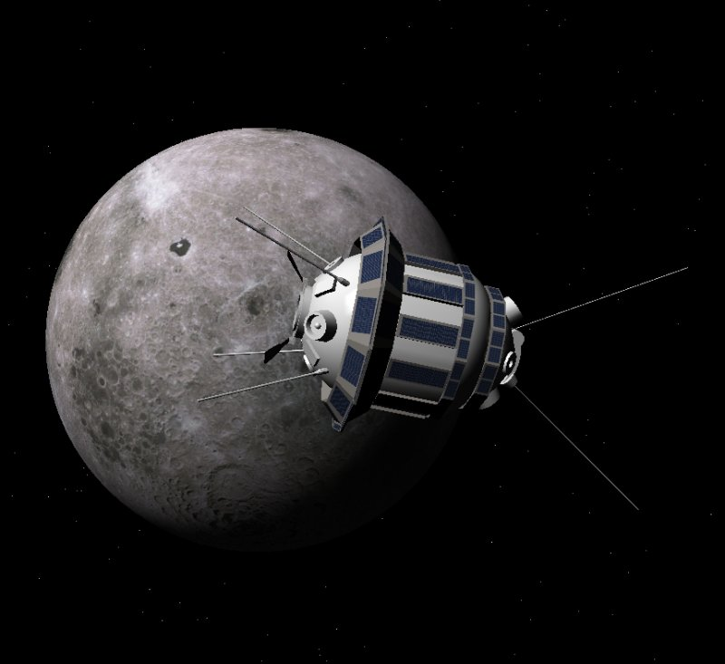

# Kosmos Space Flight Simulator



A cross-platform space flight simulator supporting realistic physics across hundreds of solar systems.

## Features

- **Realistic Physics**: N-body gravity simulation with VSOP87 for Sol system
- **Multi-System Support**: Explore hundreds of nearby star systems
- **Advanced Propulsion**: Detailed fuel tank and thruster system modeling
- **Plugin Architecture**: Extensible vessel system via DLL/.so plugins
- **Cross-Platform**: Windows, Linux, and macOS support

## Building

### Prerequisites

- CMake 3.20 or higher
- C++20 compatible compiler (GCC 10+, Clang 11+, MSVC 2019+)
- SDL3
- OpenGL 4.x
- GLM (OpenGL Mathematics)

### Linux

```bash
mkdir build
cd build
cmake ..
make -j$(nproc)
```

### Windows

```bash
mkdir build
cd build
cmake -G "Visual Studio 17 2022" ..
cmake --build . --config Release
```

### macOS

```bash
mkdir build
cd build
cmake -G "Xcode" ..
cmake --build . --config Release
```

## Dependencies Installation

### Ubuntu/Debian

```bash
sudo apt-get install libsdl2-dev libglm-dev libglew-dev libgl1-mesa-dev
```

### Fedora

```bash
sudo dnf install SDL2-devel glm-devel glew-devel mesa-libGL-devel
```

### macOS (Homebrew)

```bash
brew install sdl2 glm glew
```

### Windows

Download and install:
- SDL2: https://www.libsdl.org/
- GLM: https://github.com/g-truc/glm
- GLEW: http://glew.sourceforge.net/

## Downloading Data Files

After building, download essential data files:

### VSOP87 Planetary Data (Required)
```bash
cd data/vsop87
wget -q ftp://ftp.imcce.fr/pub/ephem/planets/vsop87/VSOP87D.{mer,ven,ear,mar,jup,sat,ura,nep}
```

### Star Catalogs (Recommended)
```bash
cd data/catalogs
# Quick start: Create minimal test catalog
cat > nearest_stars.txt << 'EOF'
# Name,Distance(ly),RA(deg),Dec(deg),Magnitude,SpectralType
Sol,0.0,0.0,0.0,-26.74,G2V
Proxima Centauri,4.24,217.42894,-62.67953,11.13,M5.5Ve
Alpha Centauri A,4.37,219.90205,-60.83399,-0.01,G2V
Sirius A,8.66,101.28715,-16.71611,-1.46,A1V
EOF

# Full Hipparcos catalog (~50 MB, ~118K stars)
# wget https://cdsarc.cds.unistra.fr/ftp/cats/I/311/hip2.dat.gz
# gunzip hip2.dat.gz
```

See `data/catalogs/README.md` for complete catalog options.

### Milky Way Skybox (Recommended)
```bash
cd data/textures
mkdir -p skybox
cd skybox

# ESA Gaia DR2 all-sky map (8K resolution)
wget https://www.cosmos.esa.int/documents/29201/1769576/GaiaDR2_FluxRGB_Cartesian_8192x4096.png \
     -O milky_way_gaia_8k.png
```

### Planet Textures (Optional)
```bash
cd data/textures/celestial/Sol/planets

# Earth - NASA Blue Marble
wget https://eoimages.gsfc.nasa.gov/images/imagerecords/73000/73909/world.topo.bathy.200412.3x5400x2700.jpg \
     -O Earth_color.jpg

# Mars
wget https://www.solarsystemscope.com/textures/download/2k_mars.jpg -O Mars_color.jpg

# See data/textures/TEXTURE_SOURCES.md for Celestia and Orbiter texture packs
```

For complete download instructions:
- **Star Catalogs**: `data/catalogs/README.md`
- **Textures**: `data/textures/TEXTURE_SOURCES.md` (Celestia, Orbiter, NASA sources)

## Project Structure

```
Kosmos/
├── src/                    # Source files
│   ├── Core/              # Core engine systems
│   ├── Math/              # Mathematical utilities
│   ├── Physics/           # Physics simulation
│   ├── Rendering/         # Graphics subsystem
│   ├── Plugin/            # Plugin system
│   ├── Input/             # Input handling
│   ├── Audio/             # Audio system
│   ├── Data/              # Data loading
│   └── Platform/          # Platform abstraction
├── include/               # Public headers
├── plugins/               # Plugin modules
│   └── vessels/          # Vessel plugins
├── data/                  # Game data
│   ├── catalogs/         # Star catalogs
│   ├── textures/         # Texture files
│   ├── models/           # 3D models
│   ├── shaders/          # GLSL shaders
│   ├── scenarios/        # Mission scenarios
│   └── vsop87/           # VSOP87 data files
├── docs/                  # Documentation
├── tests/                 # Unit tests
└── external/              # Third-party libraries
```

## Creating Vessel Plugins

See `docs/PluginDevelopment.md` for details on creating custom vessels.

Example minimal vessel plugin:

```cpp
#include "Kosmos/PluginAPI.h"

extern "C" {
    PLUGIN_EXPORT const char* GetPluginName() {
        return "My Vessel";
    }
    
    PLUGIN_EXPORT int GetAPIVersion() {
        return KOSMOS_API_VERSION;
    }
    
    PLUGIN_EXPORT void* CreateVessel(void* engineInterface) {
        // Create and configure vessel
        return vessel;
    }
}
```

## License

MIT License - See LICENSE file for details

## Contributing

Contributions welcome! Please read CONTRIBUTING.md for guidelines.

## Documentation

- [Architecture Overview](docs/Architecture.md)
- [Plugin Development Guide](docs/PluginDevelopment.md)
- [Physics System](docs/Physics.md)
- [Rendering System](docs/Rendering.md)

## Credits

Inspired by Orbiter Space Flight Simulator and Kerbal Space Program.
