# Flight & Operators Manual

For pilots and operators of Kosmos. To build your own ships, bases or scenarios, see the [Modders manual](modding.md).

KosmosCAD, ShipEdit and KosmosMission are very early editions with known bugs
and interface issues. Unless you are specifically testing those tools, edit
JSON data by hand and use Blender for modelling for now.

New: the [**MFD Operations Manual**](mfd-manual.md) covers every display, with step-by-step guides to [Transfer](mfd-manual.md#transfer-howto) and [OrbitComp](mfd-manual.md#orbitcomp-howto).

Something wrong? See Report a problem below to review and submit a GitHub issue.

<a id="intro"></a>

## Introduction

Kosmos is a space flight simulator. You fly rockets, tugs, landers, stations and even aeroplanes through a physically modelled solar system. Gravity follows whichever body you are in the sphere of influence of; atmospheres produce drag and lift; fuel is finite; time can be accelerated for long transfers.

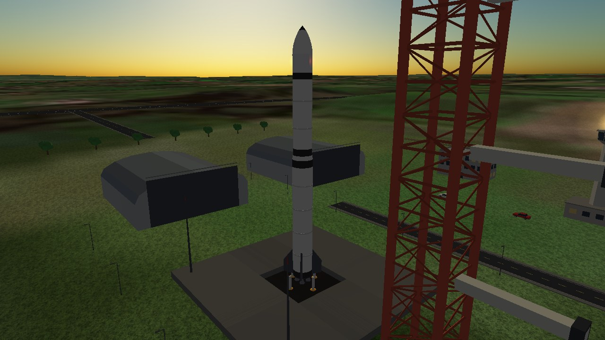The default start: Kestrel on its pad at Chippenham Spaceport.

Beyond the solar system there is a 24,409-star [galaxy](#maps) to visit, and you reach it through the [quantum portals](#quantum).

You can fly manually, use the ship's autopilot, or write your own scripts. Everything the simulator knows is published in a _property tree_ , which instruments, autopilots and the tools in this manual all read from and write to.

<a id="launcher"></a>

## The launcher

The easiest way to start Kosmos is the **Kosmos Launcher** (`kosmos-launcher`, next to the `kosmos` program). It is a separate program, so it still works if the simulator crashes.

The launcher's Play page: pick a scenario, see its preview, press Launch.

**To fly:** start the launcher, choose a scenario from the list on the **Play** page (its preview and description appear beside it), and press **Launch**. **Resume last scenario** reloads the session saved when you last quit Kosmos.

The other pages:

  * **Addons** : tick an addon to enable it, install one from a zip, or open the addons folder.
  * **Scenery packs** : download or remove optional texture packs. The
    procedural pack uses fictional, geographically inaccurate planet maps;
    it does not contain detailed surface tiles.
  * **Graphics** : render style, clouds, weather (on or off, live Earth weather, rain), frame-rate limit, light radius, terrain detail and Earth relief from orbit (the same settings as _Edit → Performance settings_ in flight).
  * **Options** : graphics backend (OpenGL, Vulkan, Direct3D 12), full screen, and extra command-line arguments.
  * **Updates** : check for a new version and download it; it unpacks beside the current install.
  * **Logs** : the output of each run, with a button to copy it and one to retry on another backend if Kosmos failed to start.


If Kosmos crashes or misbehaves, the launcher's Logs page can help you [prepare a report](#report).

On Linux the launcher needs `libwxgtk3.2`. You can also skip it and run `./kosmos` yourself, as described [below](#running).

<a id="running"></a>

## Running Kosmos
    
    
    ./kosmos [options]

With no options Kosmos loads the `default` scenario (`scenarios/default.json`): Kestrel on the pad at Chippenham Spaceport. Copy that file to `~/.config/kosmos/scenarios/default.json` and edit it to change what you start with. To pick a different start, give a scenario id (the file name without `.json`):
    
    
    ./kosmos --list-scenarios
    ./kosmos --scenario dragonfly_orbit

Press `F10` in flight to load the next scenario, or `Shift`+`R` to reset the current one. `Esc` quits. See the [command-line reference](#cli) for all options.

<a id="screen"></a>

## The screen

The top-left heads-up display shows, from top to bottom:

  * **Ship and clock** : the vessel you are flying and mission elapsed time.
  * **Position** : the body you orbit or stand on, altitude, speed and vertical speed.
  * **Orbit** : apoapsis, periapsis, period and eccentricity.
  * **Propulsion** : throttle, thrust, thrust-to-weight ratio (TWR), current stage, fuel and mass.
  * **Attitude** : pitch, heading, the SAS hold mode and the time-warp factor.
  * **Nearest base** : the closest spaceport on any body, with its distance.


Aircraft get their own line with airspeed, climb rate, angle of attack, sideslip and flap setting. Key reminders sit under the telemetry; you can hide them in the [settings window](#f3). The on-screen text is off when Kosmos starts, for a clean view: press `I` to show or hide it all at once (title, telemetry and key reminders), or start with `--show-info`. The bottom of the screen shows the warp factor, date and elapsed time; this is independent of `I` and can be turned off in **View** → **Warp and time display** or the settings window (`--hide-info` hides it too).

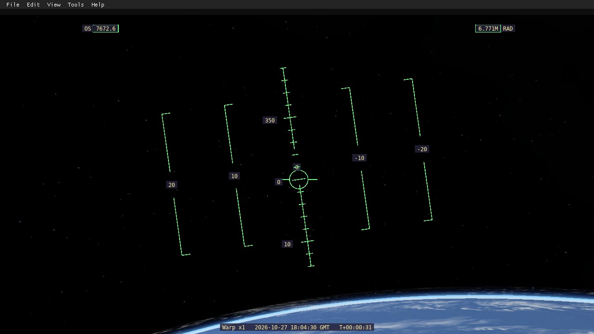The HUD and cockpit instruments in a 100 km lunar orbit: apoapsis 100 km, periapsis 100 km.

<a id="controls"></a>

## Controls

The keys below are the defaults. _View > Keyboard_ lets you rebind any of them (see [Keyboard](#keyboard)).

### Flight

Key| Action  
---|---  
`Num +` / `Num *`| Full throttle / cut throttle  
`Ctrl`+`Num +` / `Ctrl`+`Num -`| Ramp the throttle up / down while held (ships with reverse thrust, such as the Deltaglider, carry on below zero into reverse)
`Num 2` `Num 8`| Pitch up / down  
`Num 1` `Num 3`| Yaw (rudder in an aircraft)  
`Num 4` `Num 6`| Roll  
`Num /` / `Ctrl`+`Num /`| RCS rotation / linear mode, and RCS off. In linear mode `Num 2` `Num 8` push up / down, `Num 1` `Num 3` left / right and `Num 6` `Num 9` forward / back. Hold `Ctrl` with an RCS key for a tenth of the power. In the atmosphere the rotation keys always drive the control surfaces of a hybrid such as the Deltaglider, whatever the RCS setting; with RCS off the thrusters (and the SAS hold buttons) are silent  
Arrow keys| RCS translation  
`Home`| Reset the cockpit view direction to forwards (as in Orbiter)  
`Ctrl`+`Home` / `Ctrl`+`End`| Hover engines full / off (ships with hover engines, such as the Deltaglider)  
`Num 0` / `Num .`| Hover thrust up / down  
`9` / `3`| Pod thrust up / down (ships with swivelling engine pods, such as the Shuttle-A and the Deltaglider)  
`8` / `2`| Tilt the pods forward / back  
`4`, `5`, `6`| Pods to retro, hover and forward  
`Space`| Fire the next stage  
`Num 5` `[` `]` `;` `'`| SAS: kill rotation / hold prograde / retrograde / normal / anti-normal (Orbiter's navigation-mode keys)  
`X` / `Z`, `Ctrl`+`X` / `Ctrl`+`Z`| Widen / narrow the field of view while held / by a step of 10° (10° to 90°), as in Orbiter  
`Ctrl`+`P` / `Ctrl`+`C` / `Ctrl`+`Q`| Pause / start or stop video recording / quit  
`P`| Toggle the ship's autopilot  
`,` / `F`| Wheel brakes / cycle flaps (aircraft)  
`G`| Landing gear up / down (ships with retractable gear, such as the Deltaglider)  
Left mouse drag| On a 2D cockpit panel or an MFD, hold the left button on anything that is not a switch, button or slider and move the mouse to reposition it  
`Delete` / `Shift`+`Delete`| Deploy / cut parachutes (ships with a `parachutes` block)  
`Y` / `Shift`+`Y`| Navigation lights and strobes / landing and nose lights on or off (also in the View menu)  
`R` / `T`| Time warp down / up  
Keypad `7` / `Insert`| Fire primary / secondary weapons (ships with weapons, [see Ship weapons](#weapons))  
`Ctrl`+`D`| Undock  
`V`| Switch to the next ship  
`Shift`+`R`| Reset the scenario  
  
### Views and interface

Key| Action  
---|---  
Right-drag| Look around from the chase camera (the camera stays put and turns; the view is straightened again by switching camera with `C`)  
`-` `=`| Zoom the camera  
`C`| Cycle chase view, 2D cockpit, 3D cockpit, then your own cameras (the orbiting _External_ camera first)  
`Ctrl`+`M` (or `Tab`)| Orrery map  
`G`| Toggle landing gear (also `L`)  
`N`| Galaxy map  
Arrows, `PgUp`/`PgDn`| In the cockpit view: move your head forward/back, left/right, up/down (the arrows no longer fire RCS there)  
`O`| Orbit line on/off  
`H` / `Alt+H`; the mode is shown briefly as an on-screen message, as is the field of view when you change it, and both appear in the info line| Cycle the head-up display (orbit, surface, docking, off; aircraft have the surface HUD only, with airspeed, altitude, heading tape and pitch ladder) / change its colour. The HUD shows only in cockpit views (`C`)  
`Ctrl`+`I`| Show or hide all on-screen text  
`M`| Sound on/off  
`F2`| Camera window  
`F3`| Settings window  
`F4`| Property browser  
`F1`| Ship systems window  
`F5`| Cycle MFD display: off, framed panels, heads-up  
`F6` `F7`| Cycle left / right MFD mode  
`F8` `F9`| Left / right MFD power  
`F10`| Load the next scenario  
`F11`| Lua console  
`Alt`+`Enter`| Toggle full screen  
`F12`| Multiplayer  
`J`| Jump next to the nearest other player (multiplayer)  
`Esc`| Close menus and windows; quits when none are open  
Mouse to top edge| Slide in the [menu bar](#menu) (when unpinned)  
  
While you are typing in a text box in one of the F-key windows, flight keys are ignored, so editing a script will not fly your ship.

<a id="eva"></a>

### On foot (EVA)

Press `Enter` (or **View > Leave ship**) to step out of a landed ship or one in space, in first person. Press `Enter` again within 30 m of a ship to board it. Time warp works while you stand still on the ground and drops to 1x when you move or float.

Key| Action  
---|---  
`W` `A` `S` `D`| Walk and strafe (in the air with the pack on, thrust forward, sideways)  
`Shift`| Boost (either Shift)  
`Space` / `Ctrl`| Jump / crouch (pack up and down)  
Mouse, arrow keys| Look (press ``` to switch between mouselook and a free pointer for menus; holding `Alt` also frees it)  
`F`| Manoeuvring pack on / off (only where the suit is life support)  
`Q` `E`| Roll, when floating free  
  
You walk in the body's real gravity, so a jump on the Moon is six times as high as on Earth. You ride the rotating ground, so the Sun and stars move across the sky as the planet turns, but a jump carries the ground's motion with you and you land where you left. In air like Earth's the suit is only a heads-up display (heading, altitude, speed, gravity, distance and speed relative to your ship). Where the air is thin, dense or unbreathable it also tracks oxygen (six hours), power and pressure and carries a manoeuvring pack with its own propellant. When oxygen runs out the pressure falls, and when it reaches zero the crew pulls you back aboard. Standing next to your ship or within 150 m of a base refills the suit. Stepping out in orbit leaves you in the same orbit as the ship. Ships, buildings and clutter such as rocks, trees and houses are solid while you walk. `--eva` starts a scenario on foot.

<a id="animations"></a>

### Animations

**View > Animations** lists the moving parts of the ship you are flying, such as the Deltaglider's nose hatch, with their state (open, closed, opening, closing). Click an entry to open or close it. Ships can also expose these as buttons on their panels. Addon authors define them with `animation_controls` in `ship.json`.

<a id="equipment"></a>

### Equipment and ordnance

On foot you carry a pack. `1` to `9` pick an item and the left mouse button uses it (the mouse must be captured; press ``` to toggle). The standard kit is a **tricorder** (live atmosphere, gravity and ground readout), a **geo scanner** (click to sample), a **survey theodolite** (click to mark a point and measure from the last), and a **pistol**. Ships and buildings add a locker of extras, such as a **plasma rifle** and thrown **demolition charges**. Weapons are drawn as simple stand-in shapes. Your suit has health; if you are killed you revive aboard your ship.

Ships with hardpoints can release ordnance: `K` releases the next store and `Shift`+`K` the special store. The CVEL Sentinel ICBM carries a nuclear warhead. The Deltaglider also carries energy weapons; see [Ship weapons & shields](#weapons).

The CVEL Sentinel ICBM (scenario `icbm_faslane`) launches from Faslane. Its _ICBM Targeting_ MFD, or _View > ICBM targeting_, sets the target latitude and longitude, air or ground burst, burst height and a yield from 20 kt to 1 Mt (range 300 to 4900 km), and checks the range live. The warhead is released as a real vessel: the external camera follows it until it detonates, and it heats up and can burn up on the way down. Yield, mode and burst height can also be set per release through `/controls/ordnance/`.

<a id="weapons"></a>

### Ship weapons & shields

The **CVEL Deltaglider** carries sci-fi energy weapons and a shield. Hold keypad `7` to fire the _primary_ weapon and `Insert` for the _secondary_ (both can be rebound in [View > Keyboard](#keyboard)).

Ship| Primary (keypad 7)| Secondary (Insert)| Shield  
---|---|---|---  
Deltaglider| Yellow nose beam| Two green sparkle guns| Blue  
  
  * **Beams** fire one neon pulse per trigger pull: it flares up, fades to nothing, then the weapon recharges for about two seconds. Hold the key and it repeats. A beam hums with a deep whump as it fires.
  * **Sparklies** fire a rapid volley of six small, bright bolts per pull with a plasma-rifle zap, and the volley finishes even if you let go.
  * **Try it** with the Deltaglider (`deltaglider_chippenham`), or place target ships in your own scenario.
  * **Impacts** flash, throw sparks or plasma and light up their surroundings. Shots hit terrain, buildings and other ships. At most four weapon lights are active at once ([Settings](#f3), _Weapon lights_).
  * **Shields** soak hits first, recharge after a few quiet seconds and flash in their colour when struck; only what gets through damages the hull. Read the level in `/ships/ship[N]/shield` and the hull in `health` (0 to 1) in the [property browser](#f4).


The weapons come from the `field-kit` addon, which has four tiers of each, red, yellow, green and violet, in increasing effect. Modders add their own ([modders manual](modding.md#weapons)), and programs can fire them through KosmosLink ([SDK manual](https://github.com/daver64/Kosmos/blob/main/sdk/docs/MANUAL.md)).

<a id="buildings"></a>

### Buildings

**Mining your own supplies.** The Deltaglider and the Shuttle-A carry an ice miner, an electrolyser and a propellant refinery. Land, then press **Resource processing: start** in the Ship systems window (F1) (or set `/ships/ship[N]/systems/processing` to 1). The miner fills the water tank, scaled by how wet the ground is (rich on Europa, Ganymede, Enceladus and Titan, fair on Mars and the outer rocky worlds, poor on the Moon and Mercury, nothing on Venus or Io); on Earth and Titan it also collects nitrogen, and it slowly restores CO2 sorbent. The electrolyser turns water into oxygen, and the refinery turns water into main propellant (keeping a quarter of the water for the crew). It all needs solar or battery power, so expect it to run slowly and shed load in dim sunlight far from the Sun. Use time warp while landed. For mining far from the Sun, fly the **CVEL Deltaglider (Nuclear)** : the same ship with an 8 kW fission reactor (and 1.2 t more dry mass), so the miner runs at full rate in any light. Scenarios _CVEL: Nuclear Deltaglider, Gale Crater_ (Mars), _CVEL: Shuttle-A ice mining, Tranquility Base_ (the Moon, where water is scarce) and _CVEL: Shuttle-A with life support pods, orbit_ let you try it.

Some bases have interactive buildings you can enter and operate. Gale Crater on Mars has four: a **habitat** (life support), a **power plant** (batteries, pumps, compressor and workshop), a **comms mast** and an **ISRU plant** (water from regolith, electrolysis). They sit within about 70 m of the landing pad: the habitat dome to the west, the ISRU plant and comms mast to the north, the power plant to the east.

Inside a building, `C` cycles the view: chase, the 2D interface panel along the bottom of the screen, then a 3D interface board you click with the mouse.

Each door is marked on screen with a green ring and its distance. Walk up to it and press `Enter`; the menu item reads **Board ship / enter building**. Inside you see the building’s 2D control panel: gauges for pressure, oxygen, power and tanks, lamps for faults, and switches and buttons you click. `F1` opens the full Ship systems window. Pumps, compressors and dishes wear out after a few hours of running and drop off the power bus; the **REPAIR ALL** button overhauls them. Each building has its own batteries and solar panels. Press `Enter` again (or **View > Leave building**) to step back out at the door. Some buildings, such as the Mare Frigoris quarters, can be walked around in first person: Enter at the door takes you in, sliding doors open as you approach, each room has its own air (the HUD shows the room and its pressure), and the airlock is depressurised before it lets you out. Face a wall panel within 2.5 m and press `Enter` to use it. Modders can add their own buildings; see the [modders’ manual](modding.md#buildings).

<a id="attitude"></a>

## Attitude & SAS

The Stability Augmentation System (SAS) turns the ship to hold an orientation. Press `Num 5` (kill rotation), `[` (prograde), `]` (retrograde), `;` (normal) or `'` (anti-normal) to set a mode; the others are in the Autopilot menu:

Mode| Holds  
---|---  
stability| Damps rotation; holds whatever attitude you leave it in  
prograde / retrograde| Along / against your orbital velocity  
earth-communications| Points the nose at Earth's current position without changing the navigation target  
radial-out / radial-in| Away from / towards the body  
normal / antinormal| Perpendicular to the orbital plane, either way  
off| No assistance; you fly the rotation yourself  
  
Prograde and retrograde use velocity relative to the central body, not the rotating ground. Turning on the autopilot disables SAS holds. Rotation uses reaction wheels or thrusters, so it works in vacuum. Linear RCS mode changes manual input to translation but still allows SAS to rotate the ship; RCS off disables it. In an atmosphere, aircraft rotate using their control surfaces instead.

From 0.51 the Pioneer 10 and Voyager Jupiter scenarios start with their main dishes pointed at Earth and _earth-communications_ selected under _Autopilot > Spacecraft > Attitude hold_. The hold controls only the active ship during physics flight; it does not steer on high-warp rails. It needs working attitude control and damps rotation if Earth is unavailable. It points at Earth's instantaneous position; it does not model a radio link, light-time or occultation. A saved flight resumes this hold.

<a id="launch"></a>

## Launch to orbit

Start the `default` scenario: a Kestrel three-stage launcher on its pad. A typical ascent is:

  1. Set full throttle with `Num +`, then press `Space` to ignite the first stage.
  2. Climb straight up through the thickest part of the atmosphere. Once you clear about 10 km, gradually pitch over towards the horizon (heading 90° is due east, which gains the most from Earth's rotation).
  3. When the booster runs dry, press `Space` again to stage. The upper stage takes over.
  4. Keep your apoapsis climbing towards the target altitude, coast to apoapsis, and burn prograde to raise your periapsis and circularise.


Or press `P` and let Kestrel's built-in autopilot do it; it flies to a 200 km circular orbit. The CVEL Soyuz-FG, Delta IV Heavy and Atlas III have an ascent autopilot too.

Watch your TWR in the HUD. Above 1.0 you climb; much below it you are wasting fuel fighting gravity.

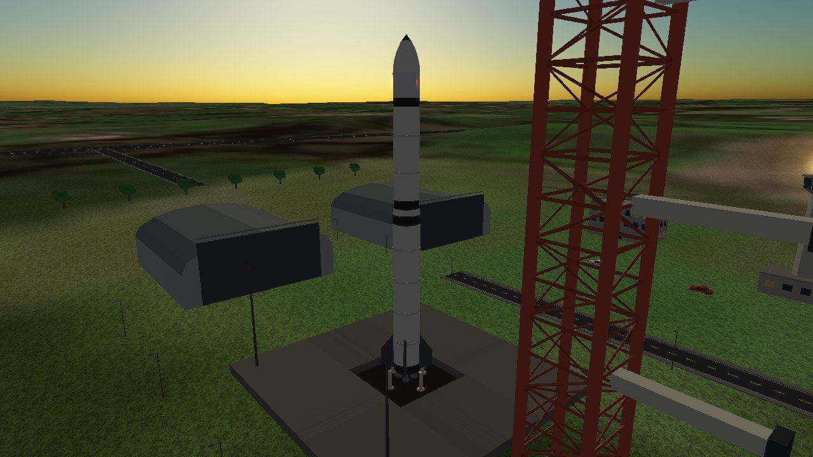Launching from a spaceport uses the same procedure.

<a id="orbits"></a>

## Orbits & time warp

An orbit is described by its apoapsis (highest point), periapsis (lowest point), eccentricity and inclination. The **Orbit** MFD draws it in its own plane and shows the main orbital elements; `O` toggles the orbit line in the 3D view.

Use `T` and `R` to change the time-warp factor. The levels are:
    
    
    1x  2x  3x  4x  5x  10x  50x  100x  1,000x  10,000x  100,000x

Warp up to 4x runs the full physics (up to 50x while an engine is firing in vacuum, so long burns can be sped up). Above that your ships go _on rails_ : they follow a pure orbit and cannot burn. Kosmos refuses to go on rails when it would be unsafe (for example, while you are thrusting, standing on a surface or in the atmosphere), and drops the warp back down. Above the atmosphere you can warp up to 1000x even if your orbit will dip back into the air; the warp steps down as the air gets close and is at 4x by the top of the atmosphere.

<a id="transfer"></a>

## Transfers

**Step-by-step guides:** [Transfer MFD](mfd-manual.md#transfer-howto) and [OrbitComp](mfd-manual.md#orbitcomp-howto) (including the HEL escape page) are in the [MFD Operations Manual](mfd-manual.md).

To travel between bodies, set a _target_ (**TGT+** /**TGT-** on the target-based MFDs, or `--target NAME` on the command line) and use:

  * **Align Planes** to see how far your orbital plane is from the target's and the ascending and descending node times.
  * **Sync Orbit** to match your orbit period and phase with a target orbiting the same body.
  * **Transfer** to plan a burn that takes you to the target.
  * **OrbitComp** , the orbital computer, for a full plan-and-burn workflow (below).


<a id="orbitcomp"></a>

### OrbitComp

OrbitComp is a space-only MFD in the style of Orbiter's TransX. Its left buttons switch page (**ORB** , **MAN** , **PLN** , **HEL** , the heliocentric orbit after an escape) and cycle the target (**TGT+** /**TGT-**); the right buttons change with the page.

  * **ORB** draws your orbit and the target's projected on your orbit plane, with periapsis and apoapsis, the closest approach to the target and your orbital elements. **ZOOM+** , **ZOOM-** and **FIT** change the scale.
  * **MAN** places a manoeuvre node (**NODE** cycles T+, Pe, Ap, AN, DN) with prograde, radial and normal delta-v and a time offset. **FIELD** selects the value, **+** /**-** change it by **STEP** , and **ZERO** clears it. It shows the orbit after the burn, the burn time and ignition countdown, and the closest approach to the target after the burn.
  * **PLN** plans a Hohmann transfer to a target in the same sphere of influence, or an ejection to another planet of the same star (delta-v, v∞, C3, transfer time, next window and ejection angle). **TO MAN** loads the plan into the MAN page.


Sibling-planet ejections use an approximate Lambert search over propagated planetary orbits, with a circular Hohmann fallback. MAN patches the encounter into the destination's sphere of influence when applicable. Return PLN's target periapsis is a design goal, not a predicted arrival. Load the plan into MAN, check the predicted encounter and correct en route; a planned window is not a guarantee of an intercept.

From version 0.50, for a nearby target ship, Sync Orbit's **APPR** page shows range, closing and sideways speed, and a straight-line closest-approach estimate. It is limited to the same sphere of influence, within 100 km and five minutes. Gravity and thrust change the result. **RVEL** selects target-relative retrograde attitude hold; burn gently and cut the engines before relative speed reaches zero. The hold requires RCS to be on and falls back to damping if the target becomes invalid or relative speed falls below 0.1 m/s; it does not cut thrust. Use the Docking MFD for final port alignment.

RADALT warns if the current descent rate would reach the estimated local ground clearance within 30 or 10 seconds. From version 0.50, with terrain data it also samples a constant-speed ground track every two seconds for 30 seconds. Neither warning predicts stopping distance; terrain between samples, buildings, obstacles and changes in speed can be missed. It reports when terrain-ahead data is unavailable.

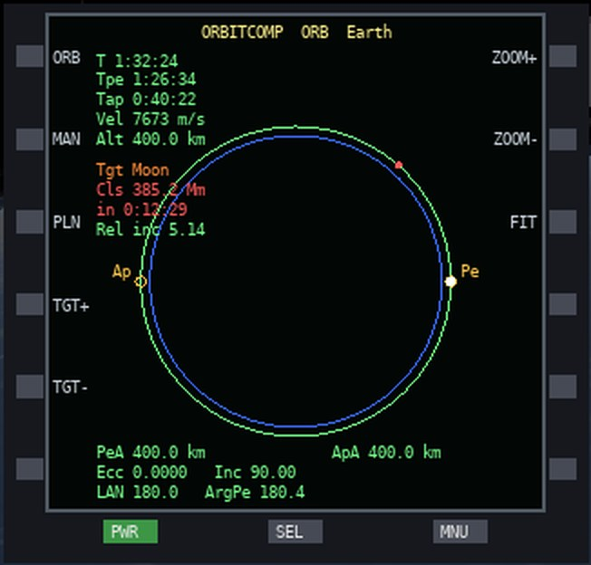OrbitComp: orbit page with the Moon targeted.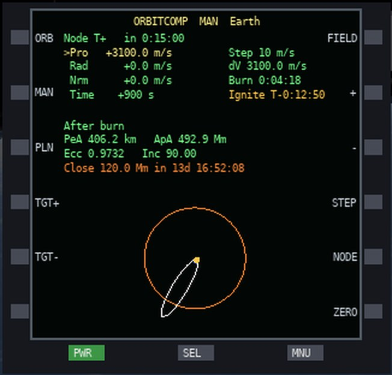The manoeuvre page.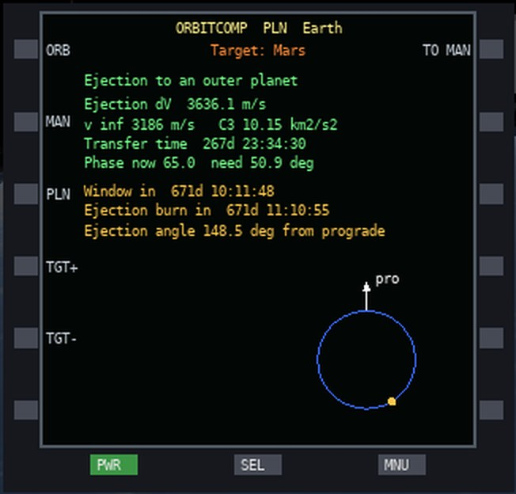An ejection plan to Mars (older display).

Leaving a body's sphere of influence for another (Earth to Moon, say) is automatic: the simulator switches the reference body, and the HUD tells you which body you are now in the sphere of influence of.

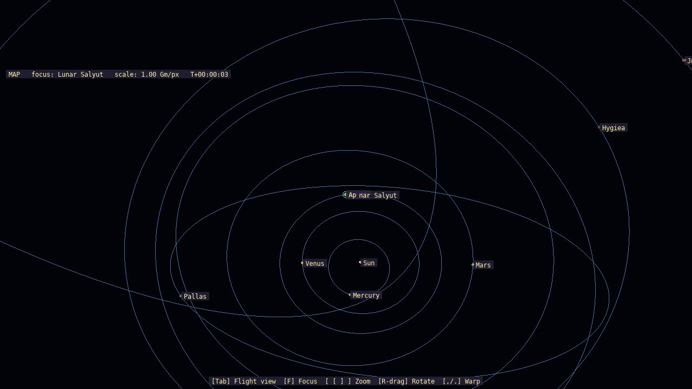The orrery map (`Ctrl`+`M`) is useful for planning interplanetary legs.

<a id="landing"></a>

## Landing

Landers like the **Ares Spider** are designed to touch down gently. Start one with `--ship "Ares Spider"` and a surface or orbit option to try a landing.

  1. Kill your orbital velocity with a retrograde burn (use SAS _retrograde_).
  2. Keep the ship upright, watching your vertical speed and altitude on the **Surface** MFD.
  3. Use the throttle to arrive at the ground below a few metres per second.


A crash ends the flight with a "vessel lost" message; press `Shift`+`R` to try again. The wreck stays where it fell. Ships built only for orbit (the Dragonfly, probes and stations) are wrecked by a hard landing and rest on the ground if they touch down gently. Earth, the Moon and Mars can use real elevation data when the optional Orbiter terrain packs are installed; otherwise their terrain is procedural.

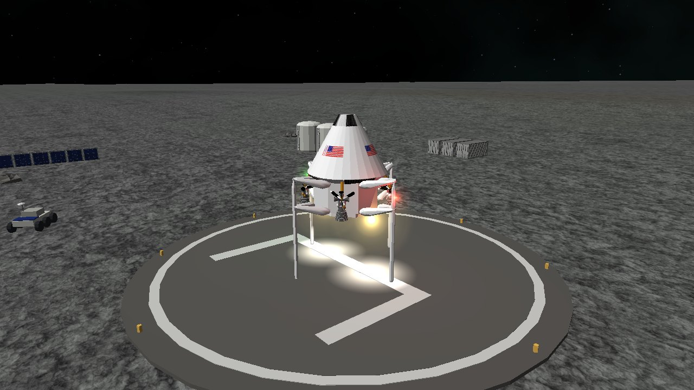Ares Spider at Tranquility Base.

### Dynamic Camera

In the cockpit view the eye is mounted on springs, so it lags behind the ship when you accelerate. Pick **View > Camera > Standard Camera** for a fixed eye or **Dynamic Camera** (the default), and set its strength from 0 to 200%. Sustained acceleration fades back to the seat.

Re-entry plasma: a ship falling faster than about 1.5 km/s through air glows with its heating. A small warhead leaves a thin faint streak, a capsule or the Deltaglider a medium glow, and a large blunt ship like the Shuttle-A a big glowing ball.

<a id="docking"></a>

## Docking

Ships and stations with docking ports can connect. Place a ship and a station in a scenario, or release a pod in `shuttle_a_cargo_orbit` and fly back alongside it. Use the **Docking** MFD, which shows the relative position and velocity of the target port:

  1. Select the target port (**PRT**) and tune its transponder (**TUNE**), or press **RCV** to receive.
  2. Close in slowly with RCS translation (arrow keys), steering the relative position to the centre of the display.
  3. Line up the ports' directions, and arrive at less than a metre per second.
  4. To separate, press `Ctrl`+`D` or the **UNDK** button.


The CVEL Shuttle-A carries up to six detachable pods on its spine: cargo pods, fuel pods holding 20 t of propellant, or **life support pods** (the “CVEL Shuttle-A Life Support Pod” ship, a year of oxygen, nitrogen, water and CO2 sorbent for two people). Docked, a life support pod tops up the shuttle’s own life support tanks and sorbent as they run down, so fit as many as you want as extra consumables; list them in a scenario like any other pod. Scenarios `shuttle_a_cargo_helsinki` and `shuttle_a_cargo_orbit` start with four cargo pods and two fuel pods attached. While docked, a fuel pod tops up the flown ship’s tank automatically. **View > Fuel transfer** switches between Automatic, Off, Pump to docked ships and Pump from docked ships, and shows how much propellant the docked ships hold.

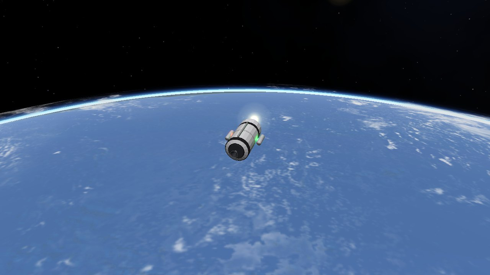A tug approaching a station over Earth.

<a id="weather"></a>

## Weather

Every planet with an atmosphere has 64 weather stations that issue METARs. Wind, rain, cloud cover and visibility follow the nearest stations. Wind acts on every ship (each feels the wind at its own position) and grows with height, rain wets the ground and reduces tyre and brake grip, fog thickens as visibility falls, and a line at the bottom of the screen shows wind, rain, cloud, visibility and the station. **View > Graphics** has a Weather switch and a choice of Procedural or Live (Earth, NOAA). Live downloads real METARs from aviationweather.gov at most once an hour and uses them only while the simulated date is within three hours of the real one; it needs an internet connection (Windows builds use the built-in WinHTTP, Linux uses libcurl). The launcher's Graphics page has the same weather switches. There is no weather in space: it stops about twelve scale heights up. Weather is also available as `/environment/*` properties.

**Weather presets.** The Weather preset choice (View > Graphics and the launcher) fixes the weather everywhere: Clear skies, Scattered cloud, Overcast, Rain, Fog or Thunderstorm, or Custom METAR, where you type a METAR line as in FSX, for example `KOSM 011200Z 27015G25KT 3SM TS BKN010CB 15/12 Q1005`. It needs a station, a day-hour-minute time group and then any of wind, visibility, weather (RA, TS, FG and so on), cloud layers, temperature and pressure; a line that cannot be read is reported and ignored. Automatic returns to simulated or live weather. A scenario's own weather line overrides the preset. In a thunderstorm lightning flashes the sky and strikes the ground with a bolt, and thunder follows after the delay sound takes to arrive (about three seconds per kilometre); sound must be on.

**Seeing the weather.** Rain falls as streaks around the camera and in the cockpit view, cloud layers sit at the METAR's base and top (cloud only appears below 100 km), and fog closes in as visibility drops. The line at the bottom of the screen reads _Wind 240/4 m/s rain 29% cloud 99% vis 8.6 km EGHQ_ : wind from 240° at 4 m/s, how hard it is raining, cloud cover, visibility and the nearest station.

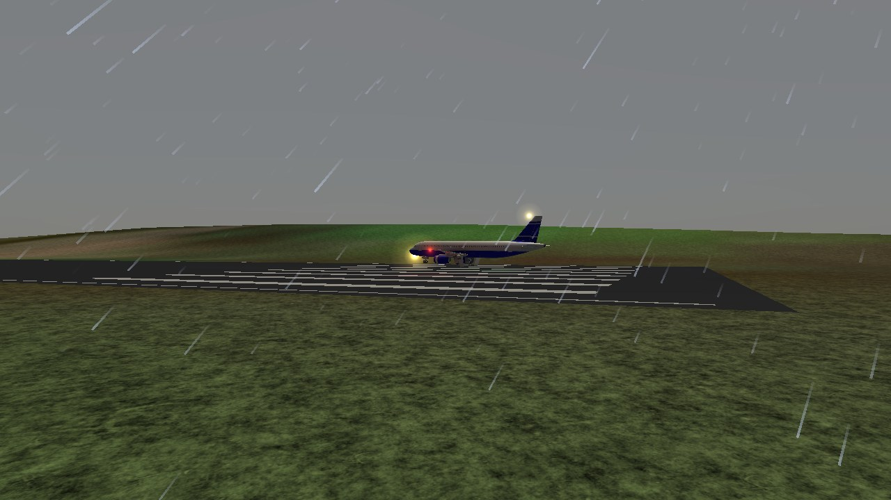The Rain preset at Chippenham: streaks of rain, a low grey sky and a wet runway. 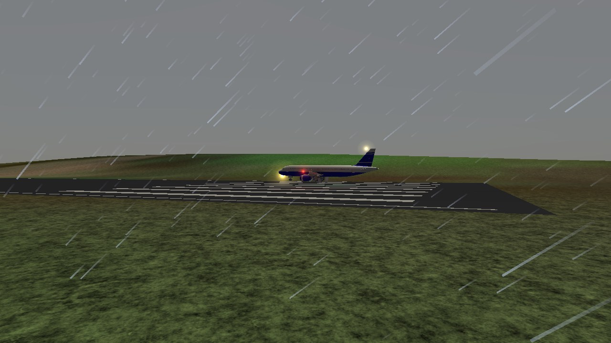The optional Skylark addon in a storm: a gusting crosswind, heavy rain and low cloud. 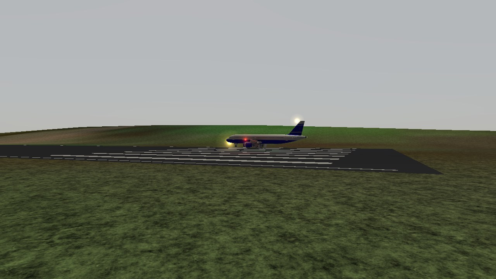The Overcast preset: full cloud cover, flat light and a muted horizon.

**Where it comes from.** Each body with an atmosphere at least half as dense as Earth's at sea level (Earth, Venus and Titan; not Mars) has 64 stations spread evenly over the globe (a golden-spiral layout), each named with a four-letter NOAA-style identifier. A station keeps one line of text, its METAR, and a new one is generated every ten minutes from simplex noise shaped by the body's climate (Titan gets methane rain). At any place the simulation blends the nearest stations, so conditions change smoothly as you fly. On Earth the 64 stations are real airports chosen to cover the world.

**What it does to flight.**

  * _Wind_ acts on every ship, rockets and landers included, at the ship's own position. It strengthens with height, and gusts add brief extra speed. A crosswind on the ground will turn an aircraft into the wind, so keep the nose straight with the rudder or nose-wheel steering.
  * _Rain_ wets the ground (quickly, drying over about half an hour) and cuts tyre and brake grip.
  * _Cloud and fog_ lower visibility and draw cloud layers; a thunderstorm adds lightning.
  * _Pressure and temperature_ come from the METAR and are published as properties.


**Settings.** _Edit → Performance settings_ and the launcher's Graphics page have the same controls:

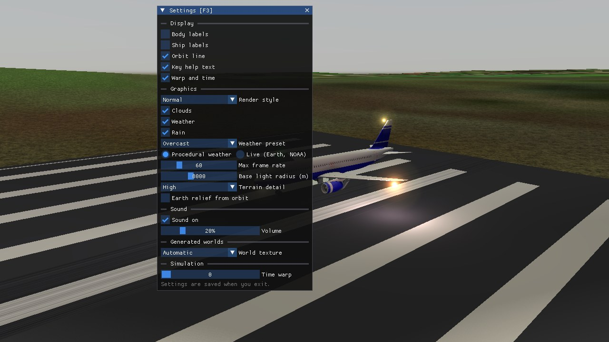The Graphics section of the Performance settings window: Weather, Rain, Weather preset and the procedural or live source. Control| What it does  
---|---  
Weather| Turns weather off entirely: no wind, rain, clouds from the METAR or fog.  
Rain| Hides the rain streaks without changing the rest of the weather (wet ground and reduced grip still apply).  
Weather source|  _Procedural_ (every body) or _Live (Earth, NOAA)_ , which downloads current METARs from aviationweather.gov no more than once an hour and uses them only while the simulated date is within three hours of the real one. It needs a network connection and is the same on all platforms: Linux uses libcurl and Windows the built-in WinHTTP, so nothing extra needs installing. If the download fails, procedural weather is used.  
Weather preset|  _Automatic_ follows the source above. The others fix the weather everywhere: _Clear skies_ , _Scattered cloud_ , _Overcast_ , _Rain_ , _Fog_ , _Thunderstorm_ , or _Custom METAR_.  
  
**Custom METAR.** Choose _Custom METAR_ and type a line, as in FSX. It needs a station, a day-hour-minute time group ending in Z, and then any of: wind (`27015G25KT`, or `MPS`), visibility (`9999` metres, `3SM` miles or `CAVOK`), present weather (`RA`, `-RA` light, `+RA` heavy, `TS`, `FG`, `SN` and so on), cloud layers (`FEW`, `SCT`, `BKN`, `OVC` with the base in hundreds of feet, `VV` for a sky hidden by fog), temperature and dew point (`15/12`) and pressure (`Q1005` hPa or `A2992` inHg). Remarks are ignored. A message under the box says whether the line was understood; one that cannot be read is ignored.

Try| Result  
---|---  
`KOSM 011200Z 00000KT CAVOK 20/10 Q1020`| Calm and clear  
`KOSM 011200Z 27015G25KT 3SM TS BKN010CB 15/12 Q1005`| A thunderstorm with gusts and low cloud  
`KOSM 011200Z 00000KT 0300 FG VV002 10/10 Q1018`| Fog with 300 m visibility  
  
**Lightning.** In a thunderstorm the sky flashes, a branching bolt strikes the ground and thunder follows after the time sound takes to arrive (about three seconds per kilometre). Strikes come every 12 to 42 seconds, more often in heavier storms, and the thunder is louder and higher for near strikes and quieter for distant ones. Sound must be on to hear the thunder.

**Scenarios and presets.** A scenario can carry its own `"weather"` METAR (see the modders’ manual), which overrides the preset and the source. For the file format see the [modders' manual](modding.md#weather).

<a id="aircraft"></a>

## Aircraft

Every ship, whatever its class, feels the atmosphere: drag from its `drag_area`, and the wind. Ships of class `aircraft` add an aerodynamic model on top: every lifting surface produces lift and drag according to its angle of attack, and stalls beyond its limit. Engines marked _air-breathing_ lose thrust as the air thins.

The following example uses the Skylark light twin, an optional aircraft addon that is not bundled. If installed, start it on the runway at Chippenham with `--ship Skylark`:

  1. Release the brakes (`B`), set takeoff flaps (`F`) and apply full throttle.
  2. Steer with the rudder (`A` `D`); the nose wheel steers on the ground.
  3. At roughly 70 m/s, pull back gently (`S`) to rotate. Keep the climb gentle, and retract the flaps once safely airborne.


The Skylark's cockpit has the traditional six-pack (airspeed, attitude, altimeter on the top row; turn coordinator, heading and vertical speed below), with an **Engine** MFD and a **Surface** MFD to the right. Press `C` for the 2D panel, and again for the 3D cockpit, where the MFD buttons can be clicked. The Deltaglider and Shuttle-A have Orbiter-derived 3D cockpits. Their plain 2D panels are live: click the MFD buttons, the autopilot hold and HUD buttons and (Shuttle-A) the gear switch, and drag the throttle and hover sliders. Some Deltaglider panel controls use hover tooltips. The Shuttle-A's two aux engine pods swing from retro through hover to forward, as in Orbiter: drag their tilt sliders, press the FWD, HOVER or RETRO presets, or use Keypad 8/2 (swing) and 4/5/6 (presets); Keypad 9/3 or the aux pod sliders set their thrust. The RCS mode switch picks rotation, linear (W/S, A/D and Q/E translate) or off.

With the Skylark airborne near Chippenham you can fly the ILS. Tune the localizer and glideslope on the **HSI** or **VOR** MFD, and fly them down to touchdown.

Earth runways also have **PAPI** lights on the left of each landing threshold, about 300 m in. Four lamps show white when you are above the 3 degree slope and red when below: all white is too high, two white and two red is on the slope, all red is too low.

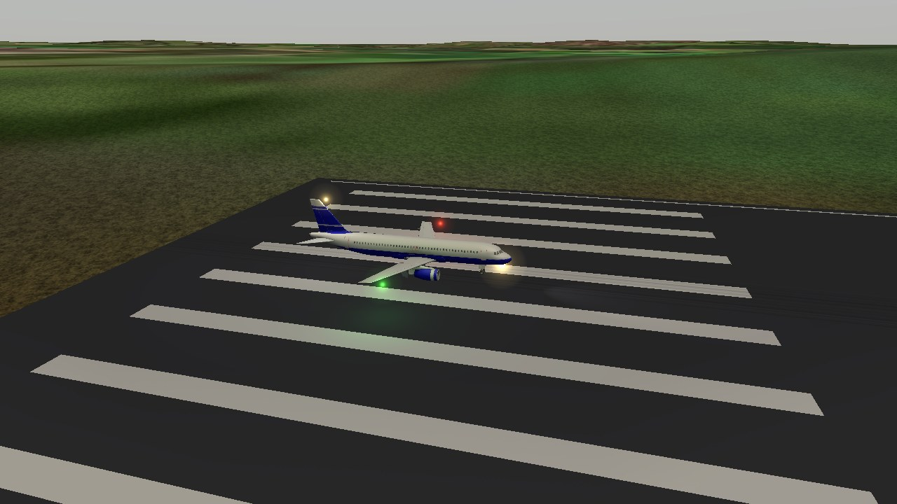Skylark lined up on the Chippenham runway.

Aircraft only fly in an atmosphere: Skylark will not climb into space.

<a id="bases"></a>

## Spaceports & navaids

Four spaceports sit on Earth, each with a pad, runway and buildings: **Chippenham** and **Twickenham** (UK), **Helsinki** (Finland) and **Wagga Wagga** (Australia). Bundled scenarios include starts at Chippenham, Twickenham and Helsinki.

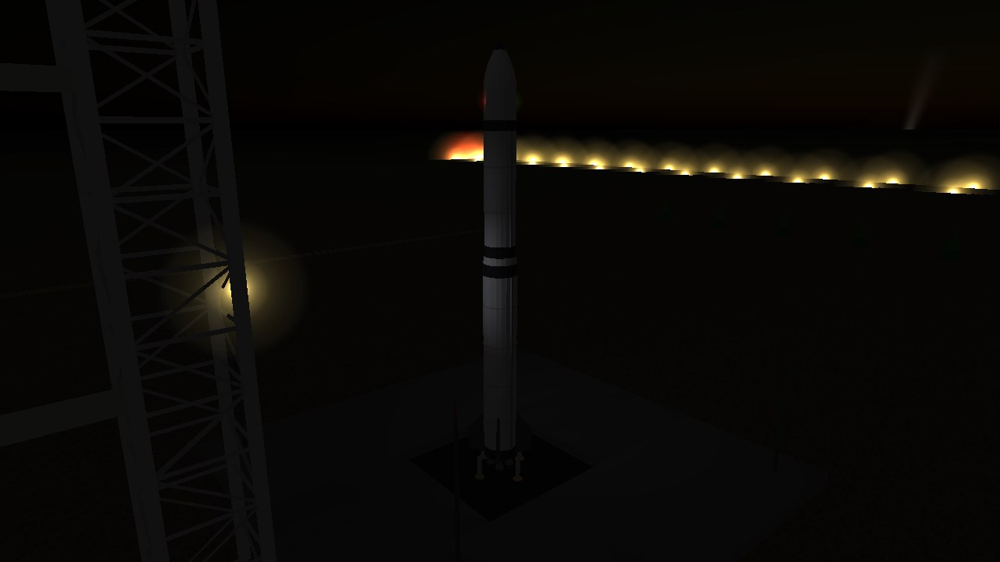Helsinki spaceport.

### Navaids

Type| Use| Instrument  
---|---|---  
VOR| Bearing to a station, with a tunable OBS| VOR, HSI  
NDB| Non-directional beacon (below 1 MHz); points the way| ADF  
ILS| Localizer and glideslope for a runway direction| HSI, VOR  
VTOL beacon| Pad guidance for landing vertically| VTOL  
  
Frequencies are shown in the base's definition, and each radio can be tuned with the ± buttons on the MFD.

<a id="views"></a>

## Views & cameras

Press `C` to cycle between the chase view, a 2D dashboard, a 3D cockpit and the cameras you have set up (see _Camera editor_ below). Drag the right mouse button to look around, and `[` `]` to zoom. Hover over a control in the 2D or 3D cockpit to see its name (Settings > Cockpit tooltips turns this off).

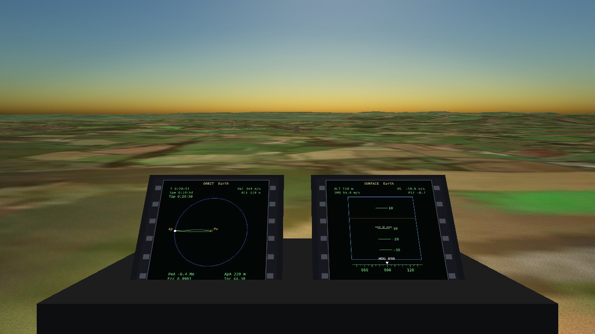3D cockpit with Orbit and Surface MFDs.

### Camera window (F2)

Press `F2` to open the camera list. It contains every ship in the universe (external view and any cockpit or interior cameras) and every camera at every base: control tower, pad, runway threshold and an overview. Click one to cut to it; _External_ returns you to the chase view.

### Camera editor

The **View** menu (and the _Camera editor_ button in the F2 window) opens the camera editor, where you build your own cameras. They are saved in `~/.config/kosmos/cameras.json`, listed under _My cameras_ in F2, and `C` steps through them after the ship's own views. There are two kinds:

  * **Orbit** cameras circle what they are attached to and always look at it. Right-drag swings round it, `-` `=` change the distance, and _Spin_ turns it slowly by itself. A distance of 0 frames the object. A default _External_ orbit camera is provided.
  * **Mounted** cameras sit at an offset (right, up, back, in metres) on the object, facing the way it faces or turned by an angle, or looking at another ship or body.


Either kind can be attached to the ship you fly, to any other ship, or to any planet or moon. Start in a camera with `--user-camera N` or open the editor with `--camera-editor`.

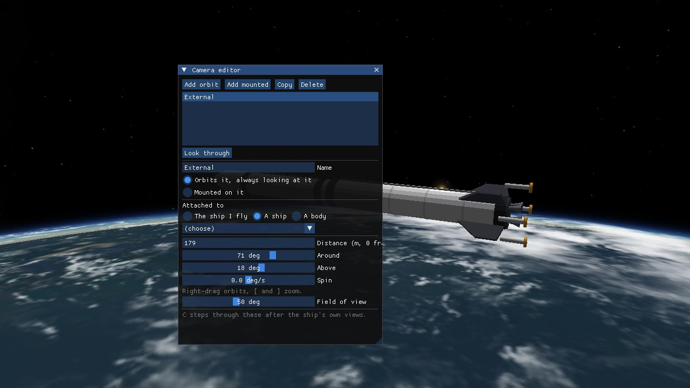The camera editor: add an orbiting or mounted camera, pick what it is attached to, and set its distance, angles and field of view. 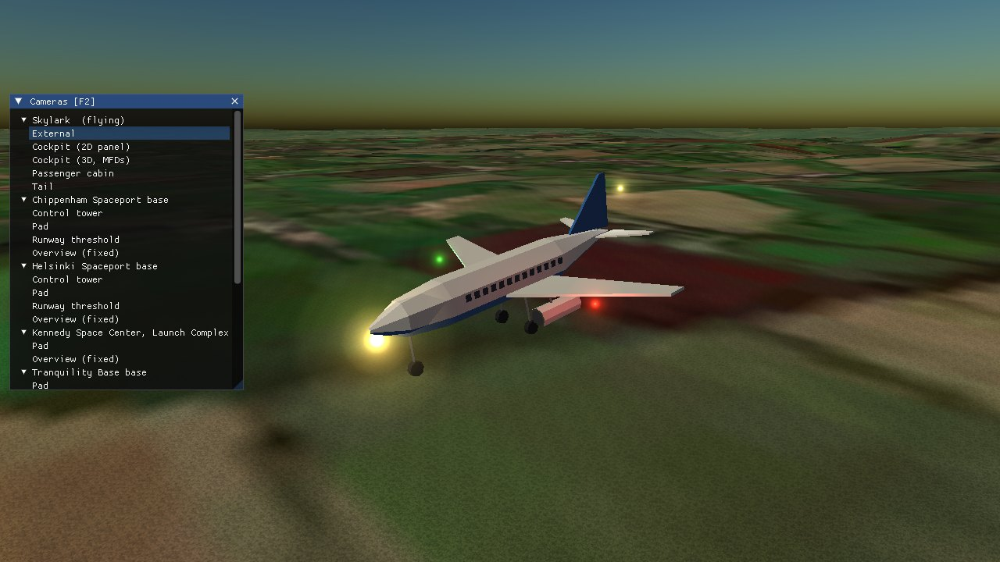The F2 camera window. 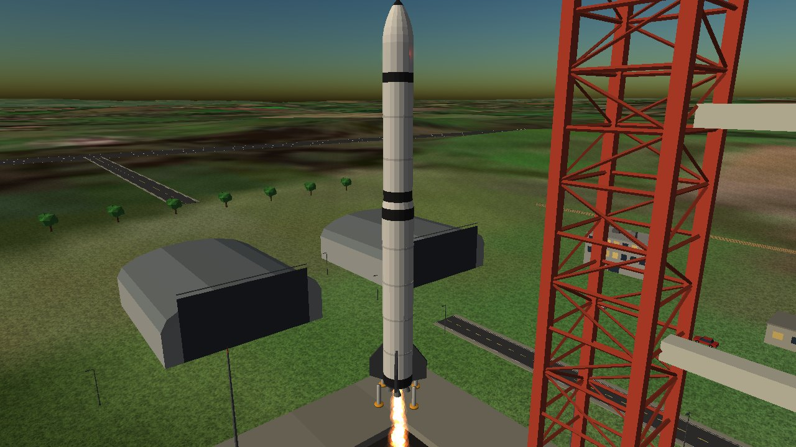The Chippenham control tower camera.

<a id="mfds"></a>

## MFDs (multi-function displays)

Full operating instructions for every mode are in the [**MFD Operations Manual**](mfd-manual.md).

MFDs are the ship's instrument screens. Press `F5` to cycle the display: off, two framed panels at the bottom of the screen with clickable buttons, or heads-up (shapes and text over the scene). In the 2D cockpit the MFDs are part of the dashboard to start with, and `F5` steps dashboard, heads-up, off. `F6` and `F7` cycle the left and right modes; `F8` and `F9` toggle their power. In the 3D cockpit the buttons are pressed by clicking on the screen.

Each ship only offers the displays that make sense for it. Aircraft (class `aircraft`) do not list the orbital modes (Orbit, Map, Ascent, Align, Sync, Transfer, Docking), and spacecraft do not list or show the airspeed, vertical speed, turn and heading gauges. Altitude and attitude stay for both. Addons can change this per ship.

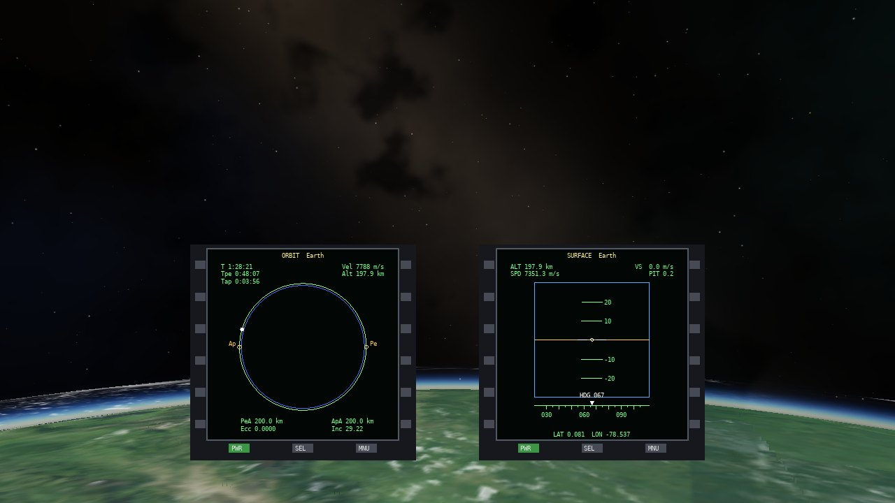Framed MFD panels showing Orbit (left) and Surface (right). Mode| Shows  
---|---  
Systems| Power bus, battery, tanks, and each cabin's pressure, gases and crew health, with a button to open a test leak. Goes dark if the ship loses all electrical power  
Attitude Indicator| The classic blue-and-brown ball: pitch ladder, roll scale and pointer, with pitch, heading and roll below  
Airspeed| Knots on a 0 to 500 dial, from the surface speed  
Vertical Speed| Climb and descent in feet per minute, zero at 9 o'clock  
Heading| A rotating compass card under a fixed aircraft symbol  
Turn Coordinator| A miniature aircraft banking with the turn rate (lined up with the marks at 3°/s), and the slip ball  
Engine| Throttle, thrust, propellant, fuel flow, endurance and the battery for the active stage  
Altimeter| A three-pointer clock face: the long needle turns once per kilometre, the short one per 10 km and the rim marker per 100 km, with a digital readout and vertical speed  
Orbit| Your orbit, in its own plane, with apsides and orbital elements  
Surface| Altitude, speed, vertical speed and attitude relative to the ground  
Radar Altimeter| Estimated terrain clearance, vertical speed and horizontal ground speed  
Ares / Deltaglider / Shuttle-A Ascent| Experimental ship-specific ascent controls and status  
Map| Ground track on the body  
Attitude| Attitude indicator, with buttons to set the SAS mode  
Ascent| Graph of altitude, speed and pitch against time since the display was opened or reset  
Align Planes| Orbit plane alignment with the target  
Sync Orbit| Orbit synchronisation with the target  
Transfer| Transfer planning to the target  
OrbitComp| Orbital computer: orbit plot, manoeuvre nodes, Hohmann and ejection planning  
Docking| Docking port approach  
Com/Nav| Radio frequencies and signal list  
VOR| Two VOR receivers with OBS adjustment  
HSI| Horizontal situation indicator with ILS needles  
VTOL| Pad beacon guidance with zoom  
ADF| Automatic direction finder for NDBs  
  
Launch with `--mfd 0|1|2`, `--mfd-left ID` and `--mfd-right ID` to choose the display style and the starting modes.

<a id="maps"></a>

## Orrery & galaxy maps

### Orrery (Tab)

A top-down map of the solar system with every body's orbit. Press `F` to focus a body, `-` `=` to zoom and drag with the right button to rotate.

### Galaxy (G)

Kosmos generates a catalogue of 24,409 stars: Sol, thirteen real stars (including Sirius, Proxima, TRAPPIST-1, Betelgeuse and Rigel), 400 invented nearby stars and a two-armed spiral disc. Use `Left`/`Right` to choose a star, `[` `]` to zoom, and `Enter` to jump (the _Galaxy_ map teleports; the ship's [quantum drive](#quantum) is the in-universe way to travel). You arrive in a 200 km orbit around that system's home world (see [Where you arrive](#quantum)). Each system is generated from its star, so it is the same every time.

Sirius, Proxima, TRAPPIST-1, Betelgeuse and Rigel are hand-authored in `data/systems/`; the rest are generated, and their planets and moons are [invented worlds](#worlds) with their own look.

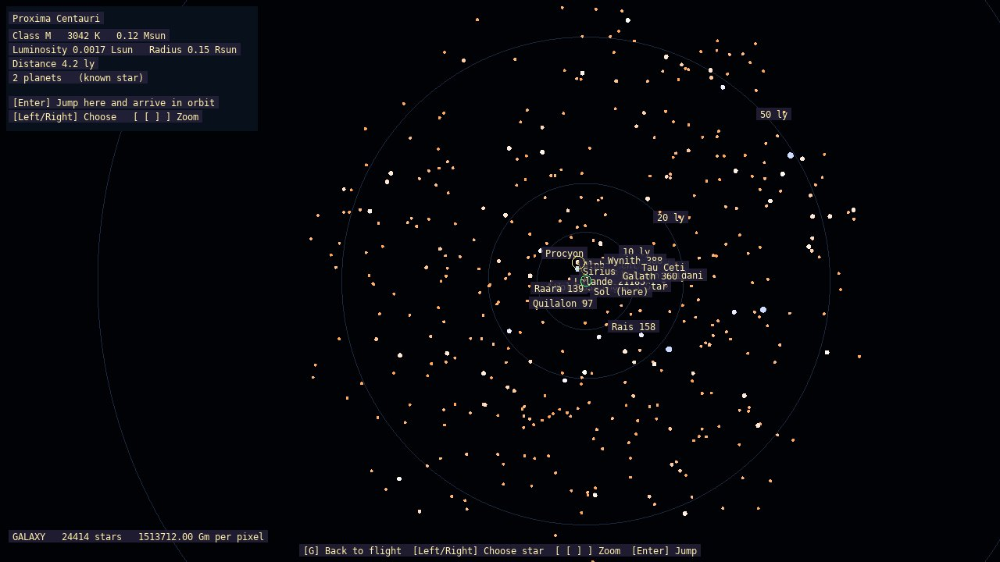The galaxy map.

Away from Sol, a few faint nebulae hang in the sky, different for each star.

<a id="quantum"></a>

## Quantum portals

Interstellar travel works like the gates of Babylon 5 or Stargate. Every star system has a **Quantum Portal** , a 400 m ring in orbit of its star at 0.43 times the distance of its outermost planet (about 13 AU in Sol, between Saturn and Uranus). Reaching it is a real flight, and any ship can use it.

### Making a jump

  1. Fly to within 100 km of the ring. (The scenario _CVEL: Shuttle-A at the Sol quantum portal_ starts you 1 km out, lined up on it.)
  2. Open the galaxy map with `N`, pick a star with the arrow keys and press `Enter`; or open _View → Quantum portal_ , choose a star within 50 light years and press _Dial portal_.
  3. The ring charges for 3 s, then the disc opens over 6 s. It stays open for ten minutes.
  4. Fly through the disc. You emerge from the destination system's portal, 400 m out and moving away at 60 m/s. There is no choice of arrival world.


The world pauses for a few seconds of hyperspace effect while the system loads; the first visit to a system can take longer while its planet textures are generated. A jump builds a fresh ship, so fuel and state are not carried over.

### Related options

`--system INDEX|NAME` starts in a given system without a jump, `--orbit-body auto` picks the best world to start in orbit of, and `--test-jump N` jumps to star number N a second into the run (a testing aid; `--test-dial N` dials the portal to star N instead). `--list-worlds mercury|venus|earth|mars|gas` prints the [invented worlds](#worlds) of that kind within quantum range, nearest first, so you know where to jump for a Venus-like or Mars-like sky. The galaxy map is documented under [Orrery & galaxy maps](#maps).

<a id="menu"></a>

## Menu bar

The menu bar is pinned open along the top of the screen. Untick _View → Keep menu bar visible_ and it slides away, returning when you move the mouse to the very top edge.

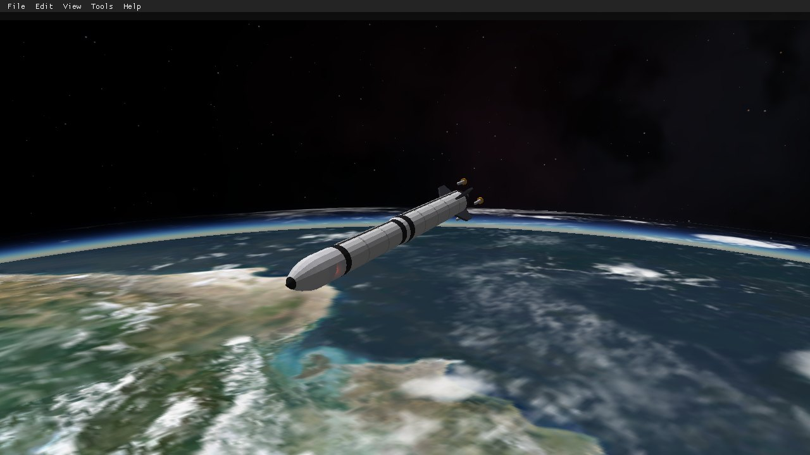The menu bar over a flight view. Menu| What it does  
---|---  
**File**|  Open or save a scenario, record or play back a flight, restart, and quit.  
**Edit**|  Undo and redo in the open editor; shortcuts to Settings and Properties.  
**View**|  Leave the ship on foot or board one, show or hide every window (Cameras, Settings, Properties, Lua console, Multiplayer, Ship systems, Quantum navigation, [Keyboard](#keyboard), [Joystick](#joystick)) and both editors, switch _Navigation lights_ and _Landing and nose lights_ , choose the MFD modes and fuel transfer, turn the warp and time display on or off, and toggle _Full screen_. _ICBM targeting_ sets the target, burst and yield for the CVEL Sentinel ICBM. _Animations_ lists the ship's hatches and doors. _2D Panels_ lists the instrument panels the current ship defines (the Skylark has _Flight instruments_ and _Navigation_) and shows the chosen one in the 2D cockpit.  
**Autopilot**|  _Aircraft_ and _Spacecraft_ windows for the autopilot modes, targets, attitude hold and throttle.  
**Tools**|  Scenario editor, Base editor, screenshot, and reload of your own scenarios and bases.  
**Help**|  The Controls reference (it shows your current keys) and the About box.  
  
From version 0.50, _Save scenario_ and the launcher's _Resume last scenario_ retain the date and ships' positions, velocities, attitudes, angular rates, stage propellant, RCS fuel, gear, animations and system reserves. Autopilots and active burns are not resumed, and some transient state such as debris and local cabin gas distribution is not saved. Docking is saved as one link per later-listed ship; more complex docking networks can lose links. Your saved files go in `~/.config/kosmos/scenarios/` and appear in _File → Open scenario_ after you save.

### Flight recording and playback

From version 0.50, _File → Record flight_ starts a local recording in a new `.json` file in the user recordings folder. _Stop flight recording_ saves it; if saving fails, use _Retry saving flight recording_ to choose a new path. Unsaved frames remain in memory until saved or the game exits, and existing files are not overwritten. The recording samples vessel states, clock, selected control inputs and chase/cockpit camera roughly once per simulated second, at most once per rendered frame, so warp can leave wider gaps. It stops on a scenario or star-system change, EVA, multiplayer, at 3600 samples, or near the size limit.

_File → Open flight recording_ opens a recording from the current star system with the recorded addons installed. Playback starts paused and offers play, pause, rewind and stop. It shows discrete snapshots, not smooth interpolation or physics re-simulation. It inherits the saved-scenario limitations above and does not record EVA or multiplayer. Stopping restores the previous flight paused, with thrust and recorded control axes zeroed; autopilots do not resume. This is separate from video recording.

_File → Set time to T-5:00 before burn_ moves the clock to just before the burn the Transfer or OrbitComp MFD is showing (with neither showing a plan, a circular, coplanar Hohmann estimate to your target). _File → Transfer windows_ lists the next departure windows to the target, each with a _Go to_ button, and sets the lead time (default 5 minutes). It is refused while a ship is landed, in the atmosphere or burning, and in multiplayer; consumables do not drain over the skipped time.

<a id="editors"></a>

## Scenario & base editors

Both live under _Tools_. Edits can be undone and redone, and one drag or one typed change counts as one step.

### Scenario editor

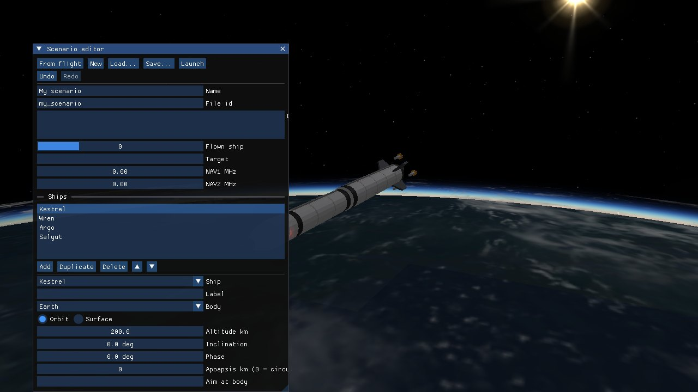The scenario editor.

  * Set the name, description, which ship you fly, the target and the NAV1/NAV2 frequencies.
  * Add, duplicate, delete and reorder ships. Each one has a type, an optional label and a body.
  * Start each ship in orbit (altitude, inclination, phase) or on a surface: latitude and longitude, the launch pad, or a base (pad or runway, direction, distance past the threshold). Give a height above zero to start in the air.
  * **From flight** fills the editor from the ships as they are now. **Launch** runs it at once. **Save** writes it for later.


### Base editor

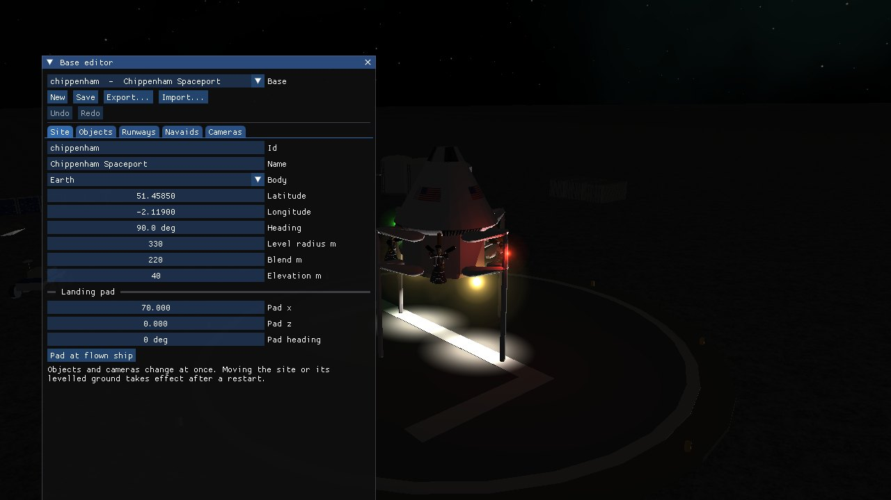The base editor's Site tab.

  * **Site** : id, name, body, position, heading, levelled radius and landing pad.
  * **Objects** : any prop type with its position, heading, scale, rows of copies, sizes and colours. Changes show in the world at once. The _Stock model_ list adds the NASA models (habitats, VAB, radome, astronaut and more).
  * **Runways** (with ILS), **Navaids** and **Cameras** have their own tabs.
  * **Place at flown ship** copies your ship's position into the selected item. Fly to a spot, then drop a lamp or a camera there.
  * **Save** writes the base to `~/.config/kosmos/bases/`. A saved base replaces a shipped one with the same id.


Moving a site, changing its levelled ground, and new beacons take effect after you restart Kosmos.

<a id="worlds"></a>

## Invented worlds

Every planet and moon in a generated system gets its own look; nothing is shipped for them. Each one is one of five kinds, chosen from its size, temperature and atmosphere: **Mercury-like** (cratered rock), **Venus-like** (volcanic plains under haze), **Earth-like** (continents, oceans, ice caps and biomes), **Mars-like** (rust, canyons, volcanoes, polar caps) or **gas giant** (banded, with storms). The same star always makes the same worlds, so everyone who visits sees the same planet.

  * Rocky worlds have real streaming terrain made by the same generator, so what you see from orbit is what you land on.
  * Earth-, Venus- and Mars-like worlds have a procedural cloud layer: patchy white on Earth-like, thick and cream on Venus-like, thin and pinkish on Mars-like.
  * The night side is dark: planets and moons have no fill light of their own, only your ship does.
  * Only a handful of Earth-like worlds exist within quantum range (`--list-worlds earth`); Mercury-like worlds are by far the commonest.


### Detail and disk space

The first time a system is entered, the far-view image of each of its worlds is made (a second or two each) and kept in a cache folder, so the next visit is instant: `~/.cache/kosmos/planets` on Linux (`$XDG_CACHE_HOME` is honoured), `%LOCALAPPDATA%\kosmos\cache\planets` on Windows. You can delete it at any time; it is rebuilt when needed.

The default image is small (2048×1024, or 1024×512 for small bodies). Open _Edit → Performance settings_ and set _World texture_ to 4096, 8192 or 16384 to make them sharper from orbit, or to _Automatic_ to go back. The change is applied straight away. A world you have not seen before shows a small image at once, and the 2048 and chosen widths are made in the background (nearest world first) and swapped in as they finish; once made they are cached and ready next time. The same choice is the `/sim/settings/world-texture` property, and `--world-texture WIDTH` sets it from the command line.

World texture| Time per world| Cache per world  
---|---|---  
Automatic (2048 or 1024)| about a second| 2 to 8 MB  
4096| about 2 s| about 35 MB  
8192| about 6 s| about 135 MB  
16384| 25 s or more| about 540 MB (and as much video memory)  
  
Every width you have used stays in the cache, and a system has 5 to 20 worlds, so a large setting adds up quickly across a few jumps. The [Modders manual](modding.md#virtual) explains the sizes, the optional high-resolution tile bake for close-up ground colour, and how to clean up.

<a id="keyboard"></a>

## Keyboard

Open _View > Keyboard_ to change the keys. Every action has two slots: click a key button, then press the new key (`Esc` cancels); right-click a button to clear it, and _Reset_ restores one action or _Reset all to defaults_ the lot. Shift combinations such as `Shift`+`K` can be bound; for the held controls (throttle, pitch, walking) a modifier such as `Shift` or `Ctrl` can itself be the key. A key already used by another action is taken from it, except across contexts: flying and walking can share keys, so `W` can both pitch and walk. Fixed keys are `Esc`, `Alt`+`Enter`, the `1` to `9` pack items and the arrow keys and `Enter` in the galaxy map. Your choices are saved in `keys.json` in the Kosmos config folder (only the ones you changed), and menu hints follow them. Addons can add their own bindable actions (see the [Modders manual](modding.md#keys)).

<a id="native"></a>

## Native addons

Some addons come with a separate program that reads and controls the simulation (an autopilot, a hardware bridge, an extra instrument page). Kosmos never runs one until you allow it: open _View > Native addons_ and tick the addon. The window shows what each addon is allowed to do (read properties, set controls, spawn things, draw an MFD page, define keys), whether its program is connected, and a Restart button. Programs connect only from this computer. Untick an addon to stop it. _Listen for programs started outside Kosmos_ lets a program you start yourself connect (needed for the mock tools in the SDK); start Kosmos with `--link` to turn it on from the command line, and `--link-port N` to change the port from 9420.

<a id="kosmosmission"></a>

## KosmosMission

KosmosMission is a mission planner in its own window (Linux and Windows). Choose a start (a base, or a circular orbit), a ship and a payload; the ship's stages give a delta-v budget. **Add leg** adds an ascent from the base, a Hohmann transfer, a plane change, a custom burn or a transfer to another body. Transfers to planets and moons are found by a Lambert search over departure and flight time; tick _Porkchop_ to see the grid (green is cheapest). The list shows each leg, the running total and what is left after the reserve; legs that overrun the budget turn red. **Save** writes the mission as a scenario with a `mission` block, **Export** a text or CSV summary, and **To game** sends the selected leg's delta-v to OrbitComp's manoeuvre node. Measured ascent costs can be added to `data/mission/ascent.json`. Moon-to-planet transfers are not planned directly: go through the parent body. See the [KosmosMission manual](kosmosmission.md) for a worked example.

<a id="kosmosmap"></a>

## KosmosMap

KosmosMap is a moving map in its own window (Linux and Windows), a little like FlightGear's Atlas. It shows the ground of the body your ship is at, with the ship, its track, other ships, airports and runways. Tick **KosmosMap** in _View > Native addons_ to start it (it only reads the simulation) and untick it to close it. It follows the flown ship and changes body by itself when you change sphere of influence.

### On the map

  * **Relief** shades the elevation data (Earth: blue sea, green to brown to white land; the Moon grey; Mars rust). **Imagery** , in the drop-down in the title bar, uses the planet's surface picture with the same shading. Without the Orbiter data (not in the download) it shows the pictures unshaded.
  * Your ship is the large yellow aircraft pointing along its heading, other ships on the same body are small and blue, and are named once you zoom in. Your track trails behind you.
  * Airports and bases are dots with their ICAO code and name; zoomed in you see the runways to scale and navaids with their identifiers. A graticule and a scale bar show position and distance.
  * The panel at top left gives the ship's position, altitude, heading and speed in knots, and below it the position and ground height under the mouse pointer.


### Controls

Control| Action  
---|---  
Drag| Pan (switches Follow off)  
Mouse wheel| Zoom about the pointer  
`+` / `-`| Zoom in and out (down to about two metres a pixel)  
`F` or Follow| Keep the map centred on your ship  
`C` or Clear track| Forget the track  
  
### Without the game

Run it on its own to browse any body: `kosmosmap --body Moon --lat 10 --lon 20 --ppd 12` (`--ppd` is pixels per degree). `--imagery` starts with the picture, `--root DIR` names the Kosmos folder, `--no-link` skips the connection, and `--shot FILE.png [--size WxH]` writes a picture and exits. If no window opens, check _View > Native addons_ shows it connected and that `addons/kosmosmap/bin/kosmosmap` exists. Developers: [how it is built](https://github.com/daver64/Kosmos/blob/main/sdk/docs/MANUAL.md).

<a id="shipedit"></a>

## ShipEdit

ShipEdit is a ship and rocket-stack editor (Linux, a GTK 3 window; start it from _View > Native addons_ or run `addons/shipedit/bin/shipedit`). Pick an addon and a ship and press _Load_. The tree shows Ship > Stage > parts, engines and gear; the form beside it edits whatever is selected, and every node has a _Raw JSON_ box. Anything the editor does not show (cockpit, systems, animations, scripts) is written back untouched.

  * **Stages and parts:** add, delete, duplicate and reorder stages, pick a model (OBJ or GLB) or a generated prop for each part, and edit masses, propellant, _Starting fuel_ (0 to 1 of the tank), length, radius, engines (thrust, Isp, placement, plume) and gear. _Up_ and _Down_ reorder the list; to move something, change its Offset, Position or Z, or drag the nudge sliders under each axis (one drag is one undo step). _Auto-pack_ stacks each stage against the one before it.
  * **Preview:** a live picture of the stack. Drag to orbit, middle or right drag (or Shift+drag) to pan, the wheel zooms at the pointer, and the Front, Back, Left, Right, Top, Bottom, Iso and Fit buttons snap the view. A table gives each stage's mass, thrust, Isp, delta-v and thrust-to-weight, and a problem list flags missing models and engines outside their stage.
  * **Saving:** _Save_ writes the ship back into the addon it came from, after copying the whole addon to `shipedit-backups/` beside the addons folder; it refuses if the ship file was changed by something else since you loaded it. _Save as new addon_ writes a separate copy with a new id and name and leaves the original alone. _Launch in Kosmos_ starts the game with the saved ship. Undo and Redo cover every edit.


For the 3D mesh itself, _Model in KosmosCAD_ opens the saved ship in KosmosCAD, the 3D modeller (see [the KosmosCAD manual](kosmoscad.md)).

See [the modding guide](modding.md#shipedit) for the ship-file keys.

<a id="joystick"></a>

## Joystick

Open _View > Joystick_. It lists each connected stick, throttle or pedals with live axis bars and the buttons held. There are two profiles: _Aircraft_ is used while you fly an aircraft and _Spacecraft_ for everything else. Nothing is bound at first (stick axis numbers differ), so bind each action: press _Bind_ and move the axis or press the button; set _Invert_ , dead zone and curve per axis, then _Save_ (written to `joystick.json` next to `settings.json`). Stick deflection adds to the keyboard, so keys still work. Throttle and hover follow their axis only once it moves. Aircraft buttons: brake (held), gear, flaps, autopilot, throttle zero and full. Spacecraft buttons: stage, SAS cycle, autopilot, throttle zero and full, hover on and off.

<a id="f3"></a>

## Settings (F3)

The settings window controls display, sound, time warp and optional gravity. Graphics, weather, scenery and texture options are in _Edit → Performance settings_ (the table below lists both). Values live in the property tree under `/sim/settings/` and are saved when you quit.

From version 0.50, **Nonspherical gravity** adds an optional J2 equatorial-bulge correction for Earth and Mars during integrated physics flight. From 0.51, it uses spherical-harmonic fields for Mercury, Venus, Earth, Moon, Mars, Ceres and Vesta, including non-axisymmetric variations such as lunar mass concentrations. It uses the same source models and degree limits as Orbiter's configurations, but body ephemerides and orientations differ, so trajectories need not match; the field and the rendered surface can be misaligned. High-warp Keplerian rails and time skips suspend the correction; the HUD and Settings indicate rails suspension, and time skips report it. The omitted drift is not recovered. Orbit lines, orbital elements and OrbitComp are still instantaneous two-body or patched-conic approximations.

Setting| Property| Default  
---|---|---  
Mouse look: flip left-right / up-down| `/sim/settings/mouse-invert-x`, `mouse-invert-y`| off  
Body labels| `/sim/settings/labels`| off  
Ship labels| `/sim/settings/ship-labels`| off  
Orbit line| `/sim/settings/orbit-line`| on  
Key help text| `/sim/settings/help-text`| on  
Warp and time| `/sim/settings/clock`| on  
Nonspherical gravity| `/sim/settings/nonspherical-gravity`| off  
Sound| `/sim/settings/sound`| on  
Volume| `/sim/settings/volume`| 20 %  
World texture| `/sim/settings/world-texture`| Automatic (0)  
Render style| `/sim/settings/gfx-style`| Normal (0); 1 flat shaded, 2 wireframe  
Clouds| `/sim/settings/gfx-clouds`| on  
Cloud style| `/sim/settings/gfx-cloud-style`| 0 (0 Simple, 1 Layers, 2 Volumetric)  
Weather| `/sim/settings/weather`| on  
Rain| `/sim/settings/weather-rain`| on  
Weather preset| `/sim/settings/weather-preset` (`auto`, `clear`, `scattered`, `overcast`, `rain`, `fog`, `storm` or `custom`)| auto  
Custom METAR| `/sim/settings/weather-metar`| empty  
Weather source| `/sim/settings/weather-source` (`procedural` or `live`)| procedural  
Largest texture| `/sim/settings/max-texture` (0, 2048, 4096, 8192 or 16384; applies at the next start, `--max-texture` overrides it)| Default (0 = 16384)  
Max frame rate| `/sim/settings/gfx-max-fps`| 60  
Base light radius| `/sim/settings/gfx-light-radius`| 8000 m  
Weapon lights| `/sim/settings/gfx-weapon-lights` (most beams and bolts that light the scene at once)| 4  
Earth relief from orbit| `/sim/settings/gfx-earth-relief`| Off; on gives terrain relief and sea glint from 300 km down instead of the tiled 64k sphere down to 20 km (slower)  
Terrain detail| `/sim/settings/gfx-terrain-detail`| High (1); 0 ultra, 2 medium, 3 low  
Trees, buildings and rocks| `/sim/settings/gfx-clutter`| on  
Scatter density| `/sim/settings/gfx-clutter-density`| 100 % (10 to 200)  
Scenery draw distance| `/sim/settings/gfx-clutter-radius`| 100 % (25 to 200); scales how far trees, houses and rocks are drawn  
  
_Trees, buildings and rocks_ scatters scenery over the ground near a base or your ship: trees, shrubs and houses on Earth (placed using procedural land cover unless local land-cover data is installed), alien plants on an inhabited invented world, and rocks, boulders and the odd pressure dome, habitat or rover on Mars, the Moon and other airless or thin-aired worlds. _Scatter density_ thickens or thins it.

The _Graphics_ settings are also on the launcher's Graphics page. _Render style_ Flat shaded and Wireframe skip textures, clouds and haze and are far lighter on slow or software graphics (for example Kosmos over VNC). _Terrain detail_ applies the next time a world's terrain is built (restart). `--render-style normal|flat|wireframe` overrides the style from the command line.

You can also change time warp from this window. _World texture_ (Automatic, 2048, 4096, 8192, 16384) sets the width of the far-view image of [invented worlds](#worlds); it applies at once and each size is cached, so watch your disk space.

Sound has three layers: the rocket engine rumble, RCS hiss, and a wind that blows when you are on the ground or flying low in an atmosphere. Wind gets stronger with airspeed and is drowned out by the engines. Inside a cockpit, interior or pressurised room a cabin ambience clip plays at random every two to six minutes. Audio starts after the first frame is drawn, so the start-up is silent.

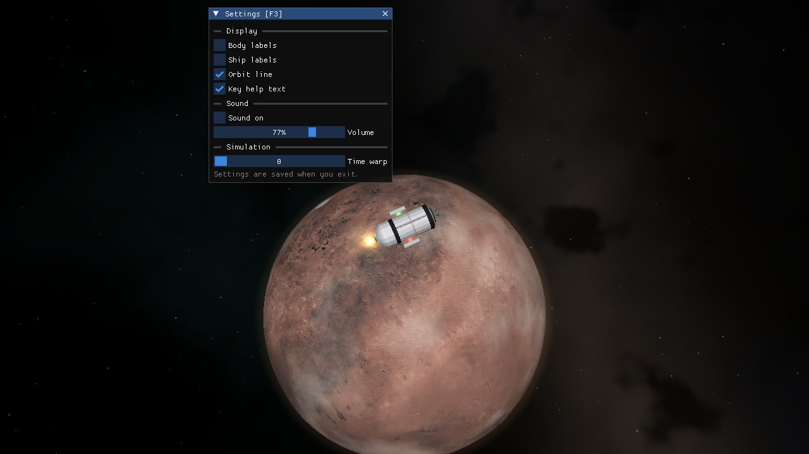The F3 settings window, over Mars.

<a id="f4"></a>

## Property browser (F4)

Everything the simulator knows is in a tree of _properties_ , such as `/controls/throttle` or `/ships/ship[0]/altitude`. The F4 browser lets you explore the tree, read any value and write to writable ones.

  * Expand the tree, or type in the filter box to search all paths (for example `altitude`).
  * Click a property to put its path and current value in the boxes at the bottom.
  * Edit the value and press **Set** , or press **Get** to refresh.


Some properties are _tied_ to live simulation values and ignore writes. Keyboard controls rewrite `/controls/pitch`, `yaw`, `roll`, `rcs-*` and `brake` every frame, so changes to those are overridden while a key is being polled; `/controls/throttle` is not.

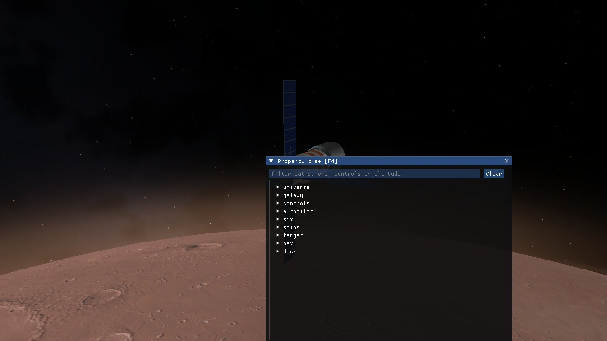The F4 property browser.

<a id="multiplayer"></a>

## Multiplayer (F12)

Up to four players share a sky as _ghost ships_ : each runs their own simulation and sees the others, drawn in 3D, labelled with name and distance and listed in the HUD. There is no collision or docking between players. Weapon fire is shared: you see other players' beams and sparklies, and they see yours, but shots from a ghost ship only look and sound the part and do no damage.

  * **Host** with `--host` or _Host a game_ in the F12 window. Make UDP port 7777 reachable (port forward or a VPN).
  * **Join** with `--join host:port`, by typing the address in the window, or by choosing a game in the lobby list.
  * **Lobby:** an IRC channel (default `salyut.ddns.net`, `#kosmos`). Hosts announce their game automatically; the window also has a chat box. IRC is plain text, so don't type anything private.
  * **Gather:** press `J`, or _Go to_ beside a name in the window, to move next to another player. In space you appear about 150 m away with their velocity; beside a landed player you are set down on the ground 60 m away.
  * **Time warp** is held at 1x while two or more players are connected. Clocks are not synchronised, so ghosts are placed relative to the body they orbit and views spanning two bodies can be slightly off.


<a id="f11"></a>

## Lua console (F11)

The Lua console is an in-game script editor. Scripts run in the simulator's Lua state, so they can read and write the property tree with the `props` table.

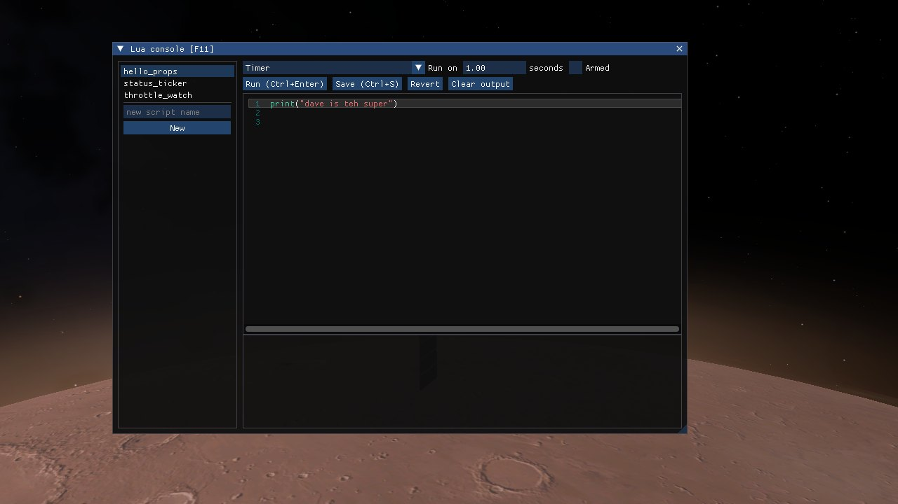The F11 Lua console with its bundled example scripts.

### Using it

  * The left list shows the available scripts. Type a name and press **New** to start another.
  * Edit in the main pane, which has Lua syntax highlighting. Errors are marked on the offending line.
  * **Run** (`Ctrl`+`Enter`) executes the script now. **Save** (`Ctrl`+`S`) stores it in your user folder. **Revert** reloads the saved version.
  * Output from `print`, and any errors, appear in the pane below the editor.


### Choosing when a script runs

The **Run on** list picks the event that triggers the script. Tick **Armed** to enable it:

Event| Runs  
---|---  
Manual| Only when you press Run  
On scenario load / ship change| Each time the flown ship changes  
Every frame| Once per rendered frame  
Timer| Every N seconds  
When a property changes| Whenever the named property's value changes  
  
Inside a script, these globals describe the event: `event` (the trigger name), `dt` (seconds since last run), and for property triggers `event_path` and `event_value`.
    
    
    -- throttle_watch.lua: runs when /controls/throttle changes
    print(event_path .. " = " .. event_value)
    
    -- Read and write properties
    local alt = props.get("/ships/ship[0]/altitude")
    props.set("/controls/throttle", 0.5)

A script that raises an error disarms itself, so a bug cannot flood the console every frame. Fix it and arm it again.

Bundled examples live in `data/scripts/`: `hello_props` (manual), `throttle_watch` (property) and `status_ticker` (timer). Saved scripts go in `~/.config/kosmos/scripts/` alongside a small `.json` file holding the trigger.

<a id="autopilot"></a>

## Autopilot

Press `P` to engage the ship's autopilot, and again to disengage it. Which one you get depends on the ship: an _aircraft_ uses the aircraft autopilot below, and a ship with its own script (Kestrel) uses that script's ascent autopilot. The _Autopilot_ menu opens a window for each kind where every mode can be set with the mouse. The status line (on the HUD and in the window) says what is engaged, and the same values are in `/autopilot/status`.

### Aircraft autopilot

When you press `P` in the air, the autopilot captures the **heading and altitude** the aircraft has at that moment, holds them, and leaves the throttle where you set it. It does nothing on the ground. Open _Autopilot → Aircraft_ to change what it does:

Control| What it does  
---|---  
Autopilot engaged| The same as `P`. The line beside it shows the active modes, for example _HDG 090 ALT 1524 m_.  
Heading hold| Turns by banking, at most 25°, onto the target heading and holds it. Type a heading or press _Current_ to take the present one.  
Altitude hold| Climbs or descends at up to 5 m/s (about 1000 ft/min) to the target altitude, shown in feet.  
Vertical speed hold| Holds a climb or descent rate in ft/min instead of an altitude. It replaces altitude hold; turning one on turns the other off.  
Speed hold| An autothrottle: it moves the throttle to hold the target speed in knots. Without it the throttle stays where you left it.  
Receiver, NAV, APPR| Choose NAV1 or NAV2, which shows the tuned frequency, the station and the localizer and glideslope deviations. _NAV_ flies the ILS localizer; _APPR_ flies the localizer and the glideslope.  
  
Moving the pitch, yaw or roll controls (keyboard, stick or the window) hands the aircraft back to you at once; press `P` or tick the box to engage again and it captures the new heading and altitude.

**Flying an approach.** With the optional Skylark addon installed, set it up five miles out, level at 5000 ft and 200 kt with the autopilot engaged, the left MFD showing the HSI on the ILS (109.5) and the right MFD showing VOR (113.4), both tuned to Chippenham. Open _Autopilot → Aircraft_ , switch off altitude hold, turn on _APPR_ and the autopilot captures the localizer and descends the glideslope. Lower the gear and flaps, set the speed hold to your approach speed, then take over with any stick input for the flare: the autopilot does not land the aircraft.

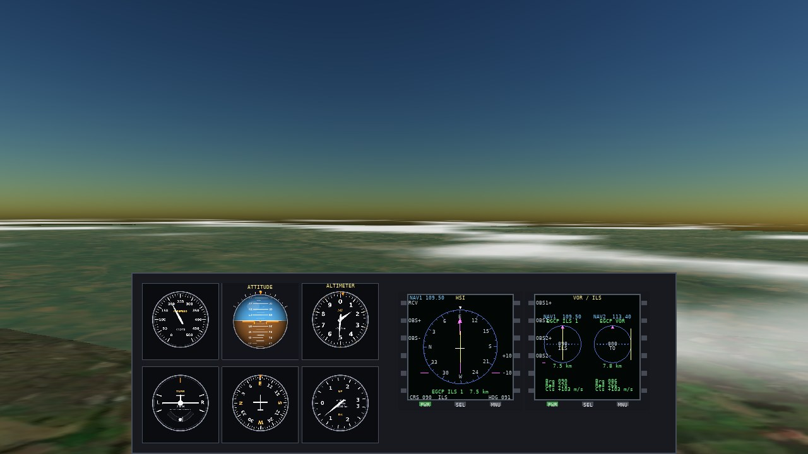The 2D panel during the approach: the HSI on the left MFD and VOR on the right.

### Spacecraft autopilot

**Ship-specific ascent MFDs (experimental).** Select _Ares Ascent_ on the Ares Spider for Mars, or _Deltaglider Ascent_ / _Shuttle-A Ascent_ on the corresponding CVEL ship (including nuclear variants and Shuttle-AQ) for Earth. Set target altitude (150–1000 km) and heading (defaults 200 km and 090), then press _START_ while stationary near the surface. The Deltaglider uses a runway takeoff, the Shuttle-A lifts on hover engines, and the Ares uses its nose-axis hover engines. The Earth profiles account for atmospheric pressure. They coast and circularise near apoapsis and continue when the MFD is closed. Target and heading cannot be changed while active; low orbits can still decay in the upper atmosphere.

These are not fuel or terrain-avoidance planners: monitor the flight and take over if necessary. Launch site, heading, payload, fuel load and weather can affect success. Passive, unpowered docked payloads are allowed and their mass counts toward liftoff; docking to another vessel or an addon-controlled payload is not allowed. Other bodies, invalid targets and unavailable engines or attitude control are rejected. Warp is held at 1× and time skips are blocked. The Deltaglider profile trims main-engine pitch gimbal to reduce thrust torque and restores the previous setting on exit. _STOP_ , `P`, manual attitude, throttle, hover or SAS controls, a Deltaglider pitch-gimbal change, staging or another autopilot cancel the ascent. Cancellation cuts both engines unless a manual throttle command sets a new level.

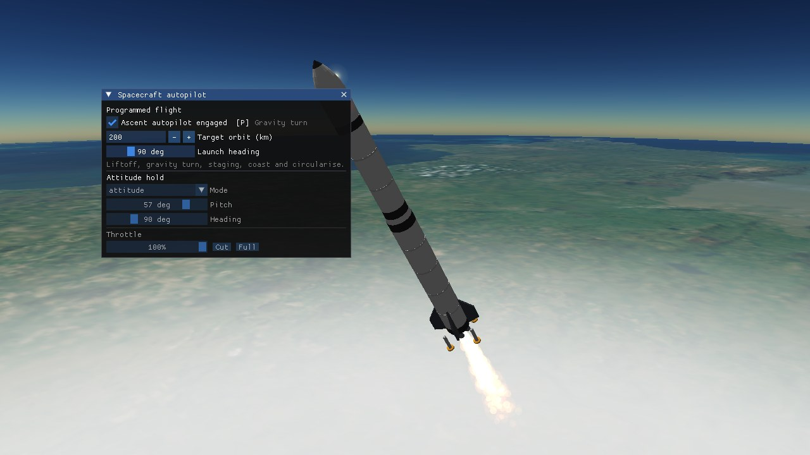Autopilot → Spacecraft while Kestrel climbs: the ascent autopilot has the throttle and attitude.

_Autopilot → Spacecraft_ has programmed ascent, Mars autoland, timed burns, attitude hold and main and hover throttle controls.

  * **Programmed flight.** For ships whose addon provides a script (Kestrel's ascent autopilot) it engages the script and sets its _Target orbit_ (80–2000 km, default 200) and _Launch heading_ (default 090, east). The script flies liftoff, a pitch kick, a gravity turn, staging, an upper-stage burn to the target apoapsis, a coast, and a circularising burn, then switches itself off. Cutting the throttle by hand disables it.
  * **Attitude hold.** The SAS mode: stability, prograde, retrograde, target-relative retrograde, radial out or in, normal or antinormal, a fixed _attitude_ (with pitch and heading sliders), or off. Keypad `5`, `[`, `]`, `;` and `'` select stability, prograde, retrograde, normal and antinormal respectively.
  * **Throttle.** Main and, where fitted, hover sliders with _Cut_ and _Full_.
  * **Timed burn.** Choose ignition as a countdown in seconds or a UTC date (or MJD), the duration, throttle, main or hover engines, and an SAS attitude. For fixed attitude set pitch and heading before arming. SAS points the nose, not necessarily the hover thrust direction; stability damps rotation without pointing at a direction. Allow time to align: directional burns abort if the nose is more than about 10 degrees from the target at ignition or during the burn. The active stage needs a throttleable engine, fuel and working attitude control. The planner does not calculate delta-v or guarantee sufficient fuel. Warp is held at 1× and time skips are blocked; press `P`, use manual controls or cancel in the window to stop it and cut both throttles. This is separate from Transfer and OrbitComp, whose planned start denotes the burn midpoint.


**Mars autoland (experimental).** Start _CVEL → CVEL-Ares → CVEL: Ares Spider, Mars orbit_ , or put an undocked Ares Spider in another bound Mars orbit above 50 km. Open _Autopilot → Spacecraft_ and tick _Autoland engaged_. It lowers periapsis, coasts through the atmosphere without hover thrust, then brakes and lands on the hover engines. Gear and Ares legs are deployed automatically; hover thrust cuts on landing. The landing is untargeted: it cannot select a base, avoid steep terrain or predict whether fuel will last, so monitor it and take over if necessary. Other non-aircraft vessels require active-stage hover engines pushing along the nose and sufficient thrust and fuel. Time warp is limited to 4×. From 0.51, time skips are blocked and a change of body or stage aborts autoland. Press `P`, or use manual attitude, throttle, hover or SAS controls, to cancel; cancellation cuts hover thrust.

From version 0.50, alternatively select _Target landing_ , enter latitude/longitude or choose a base on the current body, then engage. From 0.51 Ares supports Mars and the Moon, and Shuttle-A supports suitable bodies with enough hover thrust and fuel. For a local start, be 300–3000 m above the local surface, within 2 km, with horizontal speed below 50 m/s and vertical speed below 30 m/s. It approaches the coordinates, descends more quickly above 1000 m from 0.51, and reports touchdown more than 50 m away. A selected base aims at its designated pad.

From 0.51, for an experimental **orbital base landing** , choose a base rather than coordinates and start in a bound orbit with periapsis at least 50 km and above the atmosphere. Disable nonspherical gravity and, on bodies with weather, disable weather. The controller searches up to 14 orbits for a plane-change window, forecasts the burn and descent with at least 100 kg of fuel remaining, and checks the plan again before ignition. The Spacecraft Autopilot window shows time to plane burn while waiting, checking and aligning. Use time warp while it says _Waiting for window_ ; it reduces warp automatically before the burn. Planning and checking are held at 1×; during alignment, burn, powered descent and target approach you can select up to 4×. It aligns, performs the plane change, descends under power and switches to local guidance. An orbital touchdown within 3 km of the base centre is reported as landed; it is not guaranteed to reach the pad. Planning can take time or reject a flight even if another trajectory might work. The forecast is approximate, does not predict future weather or avoid buildings and other obstacles, and cannot guarantee safe touchdown or sufficient fuel. If conditions change or the reserve is depleted during descent, a warning is shown and guidance continues. Monitor and take over when necessary.

The Ares landing-leg control remains available, but its procedural placeholder does not show or animate the legs. Touchdown contacts remain at the deployed feet regardless of the control state.

The Orbit MFD's **Orb** is speed relative to the planet's centre, not the rotating ground. The Surface and RADALT MFDs show surface-relative speeds. **AGL** estimates clearance above local terrain by subtracting a nominal vessel-bottom offset from terrain height beneath the vessel. It is not a ray-cast radar; without terrain data it uses the spherical surface. Autoland uses the same estimate.

While a programmed autopilot, autoland or timed burn is running, the attitude and throttle controls are greyed out because the autopilot owns them. Rotation uses reaction wheels and thrusters, so it works in vacuum; in an atmosphere aircraft turn with their control surfaces instead. Ships with no autopilot script show a note saying so.

Scenarios can start with the autopilot already on, a throttle setting and chosen MFD modes (see the [modders' manual](modding.md#scenario-ap)). Programmed flight autopilots are ordinary Lua scripts, so you can write your own or replace the default one: see [Autopilots](modding.md#autopilots). Mars autoland is built into Kosmos.

<a id="scenarios"></a>

## Scenarios

Bundled scenarios include `default` and the situations in the `CVEL` folder. Start one with `--scenario ID`; `F10` steps through them. Scenarios live in sub-folders, shown as submenus under File → Open scenario; the menu re-reads the folder, so files you add or edit outside Kosmos appear without a restart. _File → Save scenario_ adds your own, and the game keeps `last_session` so you can resume where you left off.

Choosing a scenario in the system you are already in does not reload it: the terrain, textures and clouds stay, and if the scenario has its own date only the planets’ positions and the turn of the ground are moved to it. Any ship can be started anywhere with `--ship`, `--orbit` and `--orbit-body` (see the [command-line options](#cli)).

Examples include:

ID| Situation| Ships  
---|---|---  
default| Earth: Kestrel on the pad at Chippenham| Kestrel  
atlas_iii_kennedy| Atlas III, Kennedy| CVEL Atlas III  
centaur_g_orbit| Centaur G, 400 km orbit| CVEL Centaur G  
ares_spider_gale_crater| Ares Spider, Gale Crater| Ares Spider  
ares_spider_mars_orbit| Ares Spider, 200 km Mars orbit| Ares Spider  
delta_iv_heavy_kennedy| Delta IV Heavy, Kennedy| CVEL Delta IV Heavy  
deltaglider_chippenham| Deltaglider, Chippenham (30 July 2020)| CVEL Deltaglider (Nuclear)
dragonfly_orbit| Dragonfly, 1500 km orbit| CVEL Dragonfly  
soyuz_tma_orbit| Soyuz TMA, 400 km orbit| CVEL Soyuz TMA  
soyuz_fg_twickenham| Soyuz-FG, Twickenham| CVEL Soyuz-FG  
shuttle_a_cargo_helsinki| Shuttle-A with cargo, Helsinki| CVEL Shuttle-A and pods  
shuttle_a_cargo_orbit| Shuttle-A with cargo, 400 km orbit| CVEL Shuttle-A and pods  
dragonfly_deltaglider_mars| Dragonfly and Deltaglider, Mars departure| CVEL Dragonfly, Deltaglider  
mare_quarters_on_foot| Mare quarters, on foot| CVEL Deltaglider (you start inside the quarters)  
shuttle_aq_thalassa_depot| Shuttle-AQ, Thalassa freight depot (Tau Ceti)| CVEL Shuttle-AQ  
lunar_rover_tranquility| Lunar Rover, Tranquility| CVEL Lunar Rover  
rover_gale_crater| Rover, Gale Crater| CVEL Lunar Rover  
transtage_orbit| Transtage, 400 km orbit| CVEL Transtage  
  
<a id="systems"></a>

## Ship systems

Crewed ships carry electrical power, consumables and pressurised cabins, and they can fail. Open the **Ship systems** window with `F1` (or **View** → **Ship systems**), or put the **Systems** MFD on a screen (`F6`/`F7` or the SEL button). Ships without any systems simply show “no systems on this ship”. Kestrel, Salyut, Ares Spider and the Luna probe have systems.

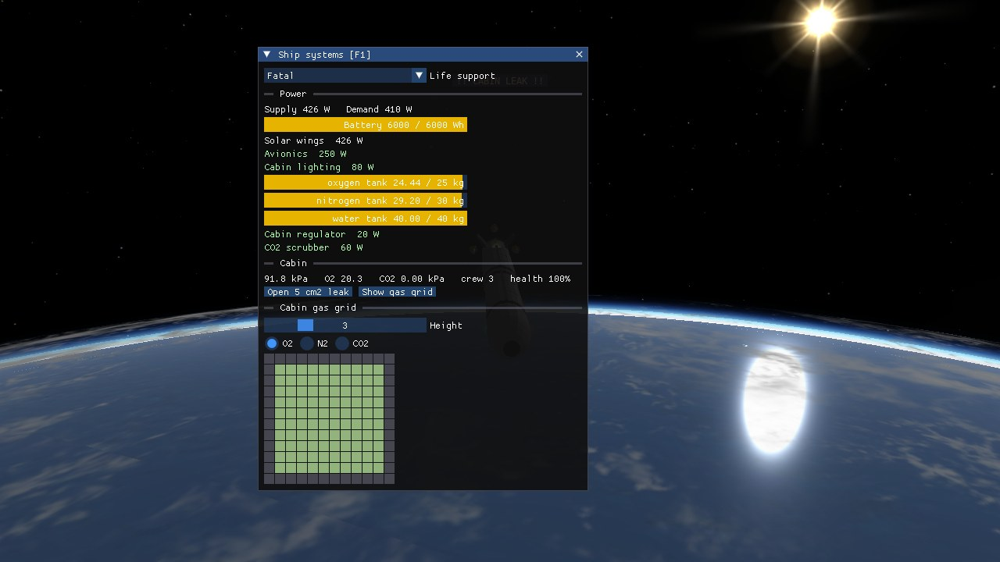The Ship systems window (F1): power, tanks, loads, a cabin and its gas grid.

### Power

Everything electrical hangs on one bus. Sources feed it, loads draw from it, and a battery smooths the difference.

Source| Behaviour  
---|---  
Solar cells| Output depends on panel area, efficiency, star luminosity, distance and the angle between a fixed panel and the star. Tracking arrays are assumed to face it. They produce nothing in a planet or moon’s shadow. Soyuz arrays must be deployed with View > Animations > Panels and antennae; batteries power the craft while they are stowed or in eclipse. Atmospheric absorption, clouds and local shadows are not modelled.  
RTG| Constant heat-to-electric power that decays slowly with the isotope’s half-life (87.7 years for plutonium-238). Works anywhere, in shadow or far from the Sun, which is why deep-space probes carry one.  
Fission and fusion reactors| Start up when the other sources cannot meet demand, up to their rated power, and burn fuel as they go. Fission fuel is a few kilograms; fusion burns deuterium. When the fuel is gone they stop.  
Fuel cell| Also dispatched on demand. Burns hydrogen and oxygen from the tanks and makes water.  
Battery| Charges from any surplus and discharges to cover a shortfall, at a limited rate.  
  
When there is not enough power, loads are _shed_ by priority. Priority 0 (cabin regulator, CO2 scrubber, avionics) is dropped last; lower-priority loads such as lighting go first. A shed load is shown as “(shed)” in the window. If the whole bus is dead the MFDs and the ship’s lights go dark. Time warp is safe: the power model runs in small substeps, so a battery or a solar eclipse is handled correctly at any warp.

### Tanks

Gas and water tanks hold oxygen, nitrogen, water, hydrogen and deuterium. Crew use oxygen and water; the cabin regulator draws oxygen and nitrogen to keep the cabin at its set pressure; fuel cells and electrolysers convert between water, hydrogen and oxygen. Propellant tanks for the engines are separate and work as before.

### The cabin

A cabin (a _pressure vessel_) is a sealed box of air. The simulation tracks oxygen, nitrogen and carbon dioxide in it, and spreads them through the box on a small 3D grid, so gas really does move: CO2 builds up near the crew and drifts through the cabin, and a leak drains the cabin through the hole. Vacuum outside acts as a sink.

  * **Crew** each breathe about 0.84 kg of oxygen and produce about 1 kg of CO2 per day, and drink about 3 kg of water.
  * The **regulator** tops up oxygen and nitrogen from the tanks to keep the cabin at its set pressure (101.3 kPa and 21% oxygen unless a ship says otherwise). It uses a little power.
  * The **scrubber** removes CO2 while it has power and sorbent. Sorbent runs out; a long flight needs enough of it.
  * A **leak** lets the air out exponentially. A 2 cm² hole in a 17 m³ cabin halves the air in about six minutes; the regulator can keep up with a small one until the tanks are empty.


#### Hazards and alarms

The window and HUD report a cabin as nominal or in _trouble_. Moderate hazards are oxygen below 16 kPa or above 50 kPa, total pressure below 50 kPa, and CO2 above 4 kPa. Acute hazards are oxygen below 12 kPa, total pressure below 30 kPa and CO2 above 8 kPa. Crew health drops over about half an hour in a moderate hazard and about three minutes in an acute one, and recovers over an hour once the air is good again. Alarms blink in red on the HUD: `POWER SHORTAGE`, `BATTERY LOW`, `O2 TANK LOW`, `<CABIN> LEAK` and the cabin’s hazard (for example `CABIN O2 LOW`, `CABIN CO2 HIGH` or `CABIN LOW PRESSURE`).

### What failure does

The consequences are a setting, so you can fly as you like.

Mode| Effect  
---|---  
`off`| Systems run but crew health never changes.  
`warn` (default)| Alarms and readouts only. Nothing happens to the crew.  
`fatal`| When crew health reaches zero the crew is lost and the flight ends (“CREW LOST”).  
  
Choose it with the combo box at the top of the Ship systems window, with `--life-support off|warn|fatal` on the command line, or per scenario in the scenario editor (_Life support_). The scenario wins over the command line.

### The Systems MFD

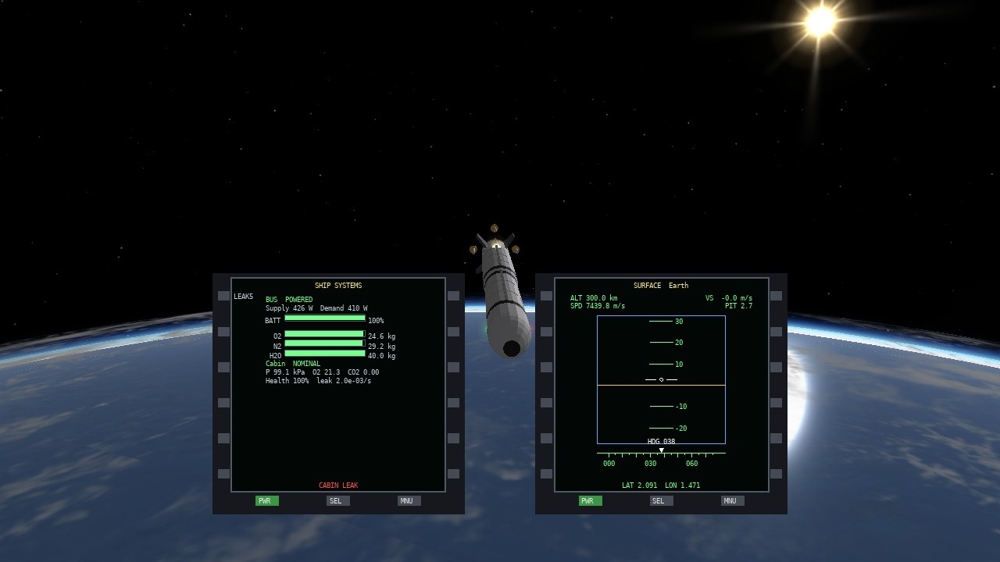The Systems MFD (left) with a cabin-leak alarm on the HUD.

The MFD shows the bus state (POWERED or BROWN-OUT), supply and demand in watts, the battery and the tanks as bars, and for each cabin its pressure, oxygen and CO2 partial pressures, crew health and leak rate. **LEAK5** (the top-left button) opens a 5 cm² hole so you can practise. **LOADS** (button 2) opens a page listing every switchable load (instruments, heaters, computers) with its power draw and state (ON, OFF, or SHED when the bus cannot feed it). **UP** and **DOWN** move the cursor, **TOGGLE** switches the selected load on or off, **SHED** switches off every load except the essential ones (priority 0), and **ALL ON** restores them all; **SYS** goes back. Both pages show how long the battery lasts at the present drain, so a battery-powered probe can shed instruments before a long coast. Loads can also be switched in the Ship systems window (F1).

### The Instruments MFD

Probes and satellites can carry cameras (visual, infrared, ultraviolet), a radar and a spectrometer. Each is powered by a switchable load: switch it on in the Systems MFD first. **INST** cycles through the ship's instruments, **AZ-/AZ+/EL-/EL+** slew it (by **STEP** degrees) at its own slew rate, and **SHOOT** uses a film frame to save a full-resolution PNG (a CSV for the spectrometer) to `instrument-shots/<ship>/` in the user folder; **GALLERY** browses the saved shots. The shutter closes automatically when the sun is within the instrument's sun limit. The infrared view is a false-colour thermal palette and the ultraviolet view a violet tint; the radar shows slope-lit terrain under the beam.

### Try it

  * In the window, press _Open 5 cm2 leak_ on any crewed ship, and use _Show gas grid_ for a slice through the cabin air (oxygen, nitrogen or CO2; slide the height).
  * Staging drops equipment with its stage. A capsule on top keeps its battery, tanks and cabin when the booster falls away.


This is a game-level model: gas is ideal, temperature is constant and there is no thermal or radiation model. It is meant to make you plan consumables and power, not to replace a mission simulator.

<a id="fleet"></a>

## The fleet

Ship| Class| Launch mass| Notes  
---|---|---|---  
Kestrel| Launcher| 219.5 t| Three stages (booster, upper stage, capsule); ascent autopilot  
CVEL Saturn V| Launcher| 3,000 t class| Apollo-era multistage launcher; Apollo 11 launch scenario
CVEL Deltaglider| Spaceplane| 12.0 t dry| Retractable gear, nose hatch; [beam, sparkle guns and shield](#weapons)  
Ares Spider| Lander| 30.0 t| Four 80 kN hover engines; top and aft docking ports  
Salyut| Station| 20.0 t| Two docking ports  
Lunar Salyut| Station| 37.0 t| Station with a large engine; procedural placeholder
Luna E3| Probe| 0.38 t| Small lander probe  
  
This is a selection of the bundled fleet, not a complete list. Use the launcher to browse available ships, `--ship "NAME"` to start one, and `V` to switch between ships in a scenario.

Several launchers and upper stages use simplified procedural visuals. Buran
uses a generic aircraft placeholder; its landing gear and bay doors do not
animate visually. Ares Spider's placeholder does not show its landing legs.
Salyut placeholders do not show solar arrays. Dragonfly and Deltaglider have
plain 2D panels; some controls rely on hover tooltips. The Deltaglider and
Shuttle-A have 3D cockpits converted from Orbiter's source meshes. Deltaglider's
exterior airbrake animation is unavailable.
Shuttle-A has no animated landing gear, and its detachable pods use simplified visuals.
Wheel has a simplified ring and hub without spokes.
Kennedy uses a procedural launch pad and tower and a NASA-derived VAB; the pad
deck is lower than in earlier builds.

<a id="cli"></a>

## Command line

Option| Meaning  
---|---  
`--scenario ID`| Start a scenario (none given: `default`); `--list-scenarios` lists them  
`--ship NAME`| Start with this ship  
`--system INDEX|NAME`| Start in a galaxy star system (0 or "Sol" is the hand-authored one)  
`--stars`| Print the 20 nearest stars and exit  
`--quantum`| Open the [Quantum navigation](#quantum) window at startup  
`--test-jump N`, `--test-jump-body NAME`| Quantum-jump to star N a second into the run (testing), arriving at the named world  
`--test-scenario ID`| Switch to scenario ID two seconds into the run (testing the same-system fast path)  
`--list-worlds TYPE`| List the [invented worlds](#worlds) of one kind (`mercury`, `venus`, `earth`, `mars`, `gas`) within quantum range, nearest first, and exit  
`--world-texture WIDTH`| Far-view image width for invented worlds: 0 (automatic), 2048, 4096, 8192 or 16384; overrides the saved setting  
`--gen-world NAME`, `--gen-width W`, `--gen-threads N`, `--gen-memory MB`| Make one invented world's far-view image into the cache from the command line (with `--system`), in strips on at most 4 threads and 4 GB; a 16384 image takes under 1 GB and about a minute  
`--gen-planet TYPE SEED OUT.png [WIDTH]`| Write a preview of an invented-world type and exit  
planetbake (SDK tool)| For big maps and more layers (colour, height, normal, specular, night; PNG or DDS; images or tile pyramids), use planetbake from the SDK instead of baking inside Kosmos. `--gen-world` and `--bake-planet` print its command line for a world  
`--bake-planet NAME`, `--bake-width W`, `--bake-estimate`, `--bake-lazy`| Pre-generate (or lazily generate) a high-resolution tile set for one invented world, with `--system`; see the [Modders manual](modding.md#virtual)  
`--version`| Print the version and exit  
`--systems-window`, `--part-editor`| Open the ship systems (F1) window or the part editor at start  
`--record SECS`| Record SECS seconds of screen and sound to an H.264/AAC `.mp4` through ffmpeg, then quit (_Tools → Start recording video_ does the same by hand)  
`--blender PATH`| The Blender executable used by the editors' _Edit in Blender_ round trip (also saved as `blender` in the settings)  
`--export-base ID FILE.glb`| Write every built-in prop of a base to a GLB scene, one object each, and exit  
`--selftest-gear-up`| With `--selftest`, raise the landing gear first  
`--galaxy-map`| Start in the galaxy map  
`--orbit`, `--orbit-body B`, `--orbit-alt KM`| Start in orbit around a body at an altitude; `--orbit-body auto` picks the best world as a quantum jump does  
`--target NAME`| Set the target ship or body  
`--set PATH=VALUE`| Set a property after startup (repeatable; value is a bool, number or string)  
`--cockpit`, `--cockpit3d`| Start in the 2D or 3D cockpit  
`--mfd 0|1|2`, `--mfd-left ID`, `--mfd-right ID`| MFD display style and modes  
`--base-cam id:idx`| Start looking through a base's camera  
`--menu`, `--scenario-editor`, `--base-editor`| Pin the menu bar (the default, except with `--hide-info`), or open an editor at start  
`--no-tiles`| Draw Earth from its single image instead of streaming the Celestia tiles  
`--no-detail`| Disable the fine ground-detail texture blended into terrain near the camera  
`--no-relief`| Disable body normal maps and Earth tile normal-map relief  
`--check-data`| Load, save and reload every scenario and base; report any that do not round-trip  
`--camera-window`, `--settings-window`, `--performance-window`, `--property-window`, `--lua-window`| Open the F2/F3/F4/F11 windows at start  
`--aircraft-autopilot-window`, `--spacecraft-autopilot-window`, `--keys-window`, `--link-window`| Open the aircraft autopilot, spacecraft autopilot, keyboard and link windows at start  
`--scenario-file PATH`| Start a scenario from any JSON file, not only the installed ones  
`--enter-building TEXT`, `--interior-at X Z YAW PITCH`| Start inside the first building whose name contains TEXT; then stand at that spot (metres, degrees)  
`--set-at SECS PATH=VALUE`| Set a property this many seconds into the run (repeatable)  
`--clean`| No HUD text, suit panel, prompts, messages or held item, for promo shots; implies `--hide-info`  
`--alone`| With `--orbit`, do not place the other addon ships alongside  
`--sun-angle DEG`| With `--sunlit`, sit DEG round the planet from the sub-solar point (about 70 shows two thirds lit)  
`--cam-tilt DEG`, `--cam-dolly M_PER_SEC`, `--cam-spin DEG_PER_SEC`| Move the chase camera as it films: nod up and down, pull away (in if negative), or swing round the ship  
`--auto-stage`, `--launch-at SECS`, `--record-after-stage SECS`| For video: drop each stage when its propellant runs out; with `--auto-stage`, hold the engines until SECS then light them over 3 s; with `--record`, end the video SECS after the first staging  
`--drop SECS COUNT INTERVAL`| Release COUNT bombs from the first loaded hardpoint, one every INTERVAL s from SECS (for video)  
`--selftest-weapons`, `--selftest-arsenal`, `--selftest-drop SECS`, `--selftest-drop-atom`| Headless weapon tests: fire the weapons, the whole arsenal, or release a bomb (the last hardpoint with `-atom`) after SECS  
`--max-texture N`| Largest body texture accepted (default 16384)  
`--selftest SECS`, `--autopilot`, `--selftest-throttle T`, `--selftest-warp N`| Headless test run; `--selftest-warp` sets the time-warp step used while the autopilot coasts to apoapsis  
`--fullscreen`| Start in full screen at the desktop resolution (also `Alt`+`Enter` or _View → Full screen_). The window can be resized or maximized; the view follows. Resize and `Alt`+`Enter` also work during loading, though an individual asset load may briefly delay the response.  
`--user-camera N`, `--camera-editor`| Start looking through the Nth camera from the camera editor / open the editor  
`--panel N`| Start in the 2D cockpit showing the ship's Nth panel (0 is the main one)  
`--shot-stages N`| Stage the ship N times before a screenshot  
`--shot FILE`, `--shot-at SECS`, `--shot-throttle T`| Save a screenshot after some seconds, optionally with the throttle set to T  
`--warp-to SECS`| Run the ship on rails until the simulation clock reaches this many seconds, then take the screenshot  
`--sunlit`| After the scenario loads, swing every ship round its planet to the sunlit side (for daylight screenshots in orbit)  
`--date "YYYY-MM-DD HH:MM:SS"`, `--mjd N`| Start on a real GMT date (or Modified Julian Date, as in Orbiter): planets and Moon take their true positions and the Earth is turned for the time of day. With no date (and none in the scenario) the game starts at the real current GMT time. Start only. Planets rotate during the run (the Sun moves, bases and landed ships turn with the ground); Earth and Mars have their real axial tilt and are turned for the start date
`--earth-turn DEG`| Turn the home planet by this many degrees, moving the Sun's position over a base: about 300 gives daylight at Chippenham and 20 gives night, when the base and ship lights switch on  
`--orbit-body BODY`, `--orbit-alt KM`, `--orbit-half`, `--orbit-phase DEG`, `--ambient F`| Start `--ship` in a circular orbit; `--orbit-half` picks the lit half, `--orbit-phase` the position round it; `--ambient` sets the fill light  
`--map`, `--map-focus BODY`, `--map-scale S`| Start in the orrery map, focused on a body at a zoom scale (for screenshots)  
`--root DIR`| Use this folder as the Kosmos root (its `data/` and `addons/`) instead of the one next to the executable  
`--host [PORT]`, `--join HOST[:PORT]`, `--name NAME`| Host or join a multiplayer game (UDP 7777 by default) and set your name  
`--lobby`, `--irc HOST`, `--channel #NAME`, `--advertise ADDR:PORT`| Open the Multiplayer window; choose the lobby IRC server and channel; the address announced for a hosted game  
`--hud MODE`| Start with the HUD in `orbit`, `surface` or `docking` mode  
`--no-clutter`| Leave out trees, buildings, rocks and outposts on the ground  
`--perf`| Print frame rate and the CPU time spent on ground scatter every few seconds  
`--no-clouds`| Skip the cloud layers (faster start, helps on weak GPUs)  
`--show-info`| Start with the on-screen text (title, telemetry, key reminders) showing; it is hidden by default (toggle with `Ctrl`+`I`)  
`--console`| Windows only: open a console window for the output when Kosmos was not started from a terminal (it shows none by default)  
`--hide-info`| Hide the on-screen text and the orbit line, and let the menu bar slide away (for screenshots); overrides `--show-info`  
`--cam-fov DEG`, `--cam-antisun`, `--cam-sunward`| Field of view (default 50); point the camera away from, or towards, the star  
`--cam-planet R`, `--cam-phase DEG`| Planet-only camera at R planet radii and a sun phase angle in degrees (for screenshots)  
`--cam-pitch R`, `--cam-yaw R`, `--cam-distance M`| Set the chase camera (radians, metres)  
  
<a id="hires"></a>

## High-resolution terrain

Kosmos ships with low-resolution runtime textures and procedural terrain for every body. For real elevation and close-up imagery, Kosmos can read **Orbiter high-resolution planet packs** directly: the same `Elev.tree` (heights) and `Surf.tree` (surface imagery) archives Orbiter uses. They are optional and are not included in the Kosmos download, so you add them yourself.

The bundled Moon, Mercury, Venus, Saturn, Uranus and Neptune maps are fictional
procedural approximations, not accurate geography; some smaller bodies use
generated textures. Earth night lights require an optional texture.

  1. Obtain the Orbiter 2016 high-resolution packs for the bodies you want (Earth, Moon, Mars). The launcher's **Scenery packs > Get Orbiter terrain** button opens the [Orbiter Forum mirror listing](https://www.orbiter-forum.com/resources/orbiter-2016-high-resolution-texture-packs.5676/), which lists individual `.tree` files and torrents; the third-party downloads are not verified or installed by the launcher. Check the source, applicable terms and available disk space: Earth elevation and surface imagery alone are approximately 32.7 GB combined.
  2. Under `~/.config/kosmos/scenery/` (Windows: `%APPDATA%\kosmos\scenery\`), place the files in `import/orbiter/Earth/Archive/`, `import/orbiter/Moon/Archive/` or `import/orbiter/Mars/Archive/`. Existing `import/orbiter/` folders beside the executable also work. A pack folder may instead end in the body's name.
  3. Check that each folder holds `Elev.tree` and, for imagery, `Surf.tree`. These may be in an `Archive` subfolder; the downloaded ZIPs may contain additional folders that must be unpacked or moved into this layout.
  4. Start Kosmos. The console prints `Earth terrain from Orbiter data` (and so on) for each body it found.


    
    
    ~/.config/kosmos/scenery/import/orbiter/
      Earth/Archive/   Elev.tree  Surf.tree
      Moon/Archive/    Elev.tree  Surf.tree
      Mars/Archive/    Elev.tree  Surf.tree

The launcher's **Get Celestia imagery** button opens the third-party
Celestia Earth catalog; it does not download, verify or install anything.
The catalog's HTTPS certificate failed validation when last checked; do not
bypass a browser certificate warning.
For Jestr Earth, put `JestrMarble JPG.ctx` and the `JestrMarble JPG/` tile
folder together under `~/.config/kosmos/scenery/import/celestia/hires/earth/`.
Put the optional levels 6–10 inside that tile folder, as described by its
readme. Check the source and terms before obtaining or redistributing it.
User scenery is not packaged or removed by application updates. For each
optional scenery source, a matching user file takes priority over an
installation-local one. Set `XDG_CONFIG_HOME` to use a different Linux
configuration directory.

You can install only some of them; without an Orbiter pack, terrain is procedural and the orbital image comes from the bundled texture or any optional override you have installed. Orbiter terrain tiles stream in as you approach, so the first low pass over new ground may show coarser detail for a moment. The optional Celestia source tree lives in `import/celestia/`: Earth colour tiles (and optional specular and normal tiles) can stream directly from `import/celestia/hires/`. Close-up terrain compares Orbiter and available Celestia colour maps per location and uses whichever has finer texels; Orbiter elevation still shapes the ground. For other Celestia maps, use the import tools to install an image into `data/textures/` or `data/textures-hires/`; moon sources under `import/celestia/moons/` are not scanned at runtime or included in release packages. See the [Developers manual](../../README.md) for map lookup and import details.

Other bodies can use the same format: give the body `"terrain": "orbiter"` in `sol.json` and place a matching folder in `import/orbiter/`. See the [Modders manual](modding.md).

<a id="files"></a>

## Files & settings

Path| Contents  
---|---  
`~/.config/kosmos/settings.json`| Saved F3 settings  
`~/.config/kosmos/scripts/`| Your Lua console scripts  
`scenarios/`| Bundled scenarios  
`data/bases/`| Spaceport definitions  
`data/scripts/`| Example console scripts  
`data/sol.json`| The solar system  
`addons/`| Ships, MFD modes and extra content  
`import/celestia/`| Optional Celestia sources; moon packs are grouped under `moons/<planet>/<Moon>/` and excluded from release packages  
`import/orbiter/`| Optional Orbiter high-resolution terrain packs  
`data/textures/`| Installed runtime fallback images  
`data/textures-hires/`| Optional installed texture overrides  
`~/.cache/kosmos/planets/`| Images and tile sets generated for invented worlds (safe to delete; see [Invented worlds](#worlds))  
  
On Linux, settings follow `$XDG_CONFIG_HOME` if set; on Windows they use `%APPDATA%`.

<a id="trouble"></a>

## Troubleshooting

Problem| What to try  
---|---  
Time warp will not go up| You are thrusting, landed or in an atmosphere. Cut the engines and climb or orbit first.  
"Vessel lost"| You hit the ground or burned up. Press `Shift`+`R` to reset.  
Keys do nothing| A text box in an F-key window has focus; click the scene or close the window.  
Ground looks soft or blurry close up| Install the Orbiter high-resolution packs ([see above](#hires)). Otherwise, textures are limited by `--max-texture` and your GPU; the terrain mesh gives way to a textured sphere above 300 km altitude.  
Startup is slow| If Orbiter terrain packs are installed, their elevation and image archives take time to load; the first start takes longest.  
Planet names are not shown| Body labels are off by default; switch them on in F3.  
  
<a id="report"></a>

## Report a problem

Open Logs in the launcher, select the run and choose Report this log. Review and edit the path-scrubbed report, then copy it and open GitHub Issues. Paste and submit it yourself; nothing is uploaded automatically. Check for private details before sharing: GitHub issues are public.
