# Modders Manual

Build ships, aircraft, spaceports, scenarios, planets and instruments for Kosmos using JSON and Lua. No compiler is needed. For flying, see the [Flight manual](manual.md).

KosmosCAD, ShipEdit and KosmosMission are very early editions with known bugs
and interface issues. Unless you are specifically testing those tools, edit
JSON data by hand and use Blender for modelling for now.

## Overview

Kosmos is data-driven. The simulator reads plain files at start-up and publishes its state in a _property tree_ that Lua scripts can read and write. You can add:

  * **Ships and aircraft** : a `ship.json` plus optional meshes and an autopilot script.
  * **Scenarios** : start states, one JSON file each.
  * **Bases** : spaceports and airfields built from a catalogue of props.
  * **Bodies** : replace or extend the solar system.
  * **MFD modes** : new instrument screens, written in Lua.
  * **Scripts** : anything that reads or writes properties.

Native (compiled) code does not run inside Kosmos. Lua covers scripting and everything else is JSON; for the rare addon that needs a separate native program, see [Native addons](#native) and the [SDK manual](https://github.com/daver64/Kosmos/blob/main/sdk/docs/MANUAL.md).

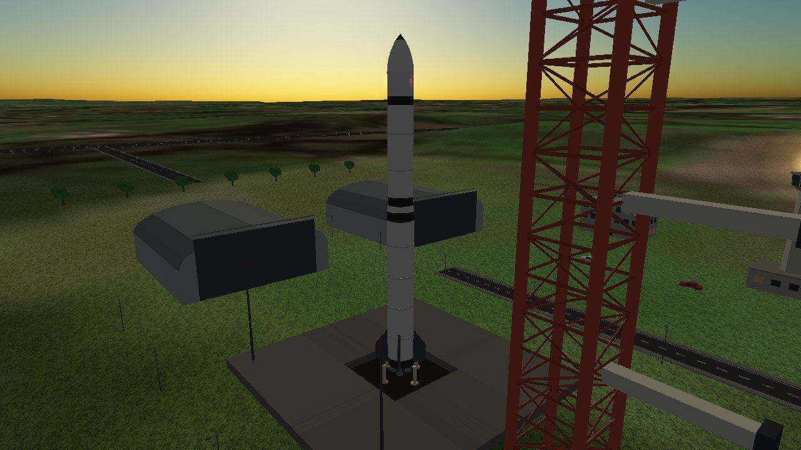Everything in this scene (pad, tower, hangars, runway) comes from one JSON file, `data/bases/chippenham.json`.

## Addon layout

An addon is a folder in `addons/`. Kosmos scans every folder for an `addon.json` on start-up:
    
    
    addons/
      myship/
        addon.json        manifest (required)
        ship.json         one or more ship definitions
        ascent.lua        optional autopilot script
        models/           optional OBJ/MTL meshes
        scenarios/        optional scenario JSON files
        bases/            optional base JSON files

The manifest names the addon and lists what it contributes:
    
    
    {
      "id": "myship",
      "name": "My Ship",
      "version": "0.1",
      "ships": ["ship.json"]
    }

An addon that adds instrument screens lists `mfds` instead (or as well):
    
    
    {"id": "mymfd", "mfds": [{"id": "fuel", "script": "fuel.lua", "short": "FUEL", "ships": ["myship"]}]}

Any `scenarios/` and `bases/` folders inside an addon are loaded automatically alongside the bundled ones.

## Launcher information

The launcher reads optional fields from `addon.json`: `description` (one line), `author`, `long_description` and `thumbnail` (an image path relative to the addon; otherwise `thumbs/addon.png` is used). A scenario may have `"thumbnail"` or a `thumbs/<scenario id>.png` beside its JSON. The launcher disables addons through `addons.json` in the user folder: `{"disabled": ["addon-id"]}`.

## Your first addon

Copy `addons/cvel-dragonfly` to `addons/myship`, change the manifest's `id` and `name`, and edit `ship.json`: change its top-level `"name"` and an engine's `thrust`. Then start it:
    
    
    ./kosmos --ship "My Ship" --orbit --orbit-alt 400

The ship appears in a 400 km orbit. Change a number, restart, and see the difference in the HUD: that is the whole workflow.

## ship.json

The top-level fields of a ship definition:

Field| Meaning  
---|---  
`name`| Display name and the name used with `--ship`  
`class`| Descriptive class: `launcher`, `tug`, `transfer`, `lander`, `station`, `shuttle`, `probe` or `aircraft`. `aircraft` turns on the atmospheric flight model.  
`orbital_only`, `crash_speed`| An orbit-only ship (the default for `transfer`, `tug`, `station` and `probe`) is wrecked if it touches the ground faster than `crash_speed` (default 5 m/s) with the engines off, and rests where it lands if slower. Set `"orbital_only": false` for a lander. Wrecks and resting ships are fixed to the ground and turn with the planet.  
`pad_turn`| Degrees added to the pad heading when the ship starts on a launch pad; turns a rocket with strap-on boosters so they clear the tower arms.  
`torque_accel`| | Angular acceleration from the reaction wheels (rad/s²)  
`max_rate`| Maximum rotation rate  
`rcs_thrust`| RCS translation thrust (N)  
`drag_area`| Reference area for atmospheric drag (m²); every ship feels it, not only aircraft  
`payload_bays`| Where a launcher carries cargo: a list of `{"name", "shape": "cylinder"|"box", "radius" or "size": [w, h, length], "length", "max_mass", "position"}` along the ship's z axis. KosmosMission checks payload ships against them A bay may add `"port"`, the launcher port name its payload docks to when KosmosMission spawns it (default "Payload").  
`payload_size`| How big this ship is as cargo: `{"diameter", "length"}` or `[width, height, length]` in metres (default: from the stage radius and lengths)  
`hit_sphere`| true to make weapons hit a ball of the stage radius instead of the bounding box (for round ships)  
`camera_distance`| Starting chase-camera distance (m)  
`camera_target`| `[x, y, z]` in the ship frame (metres, nose along −Z): the point the chase camera orbits and looks at. Unset, it is the centre of mass. On a staged rocket the point follows the stages still attached, so the camera stays on what is left (the Soyuz capsule, say) after the lower stages go.  
`horizontal`| For a rocket-class ship: true to rest level on its gear (roof up, nose along the heading) instead of standing on its tail. Ground vehicles are horizontal by default.  
`hybrid`| For an `aircraft` that also flies in space (the Deltaglider): it flies as an aircraft only in air of at least 0.1225 kg/m³ below the top of the atmosphere, and as a spacecraft everywhere else.  
`module`| A block for ships a link program (see the [SDK manual](https://github.com/daver64/Kosmos/blob/main/sdk/docs/MANUAL.md)) can claim with `kl_claim_ship`: `"addon"` names the program, `"max_force"` (N) and `"max_torque"` (N·m) cap what it may apply (default 20 × the ship's mass in kg). The block does not start the program.
`rcs_modes`, `pod_turn_rate`| `rcs_effects: false` hides the generic RCS puffs, which are drawn at the ends of the stage envelope. `rcs_modes` adds an RCS mode switch (`/controls/rcs-mode`: `rot`, `lin` or `off`; in `lin` W/S, A/D and Q/E translate). An engine with `"group": "pod"` is a swivelling pod: thrust from `/controls/pod-left` or `pod-right` (by the sign of its x position), direction from `pod-tilt-left` or `pod-tilt-right` (0 aft, 0.5 up, 1 forward) at `pod_turn_rate` rad/s (default 0.2). An engine with `"group": "rcs"` and an `"rcs_groups"` list (`left`, `right`, `up`, `down`, `forward`, `back`, `pitch-up`, `pitch-down`, `yaw-left`, `yaw-right`, `bank-left`, `bank-right`) is a reaction-control thruster; a ship with any replaces the generic `rcs_thrust` jets. Animations can read `pod-left` and `pod-right` (0 to 1); a button on property `/controls/pod-tilt` sets both pods.  
`thermal`, `hypersonic`, `parachutes`| Re-entry: `thermal` (nose radius, heat capacity, ablative shield) gives stagnation heating and burn-up; `hypersonic` blends a Newtonian aero model with trim at high speed; `parachutes` adds canopies (Delete deploys, Shift+Delete cuts); give one a `model` (OBJ) and `model_radius` to draw the canopy, scaled to `canopy_radius`, and it switches SAS off while a chute is out. Hardpoints also take `eject` and `eject_speed`. Equipment may name a `ship` class that is released as a real vessel (the ICBM warhead). See the `cvel-icbm` and `cvel-soyuz` addons.  
`parachutes[].arm_altitude`| Altitude in metres above which automatic deployment is armed; defaults to three times `auto_altitude`, at least 20 km. Manual deployment does not require arming.  
`hardpoints`, `locker`| `hardpoints`: places that carry releasable equipment, each with `name`, `equipment` (an equipment id), `position` (ship frame) and `count`. K drops from the first loaded one, Shift+K from the last. `locker`: equipment ids a person takes when leaving the ship or building. Equipment is defined in `<addon>/equipment/*.json` as one object or `{"equipment":[...]}` (see the `field-kit` addon): `id`, `name`, `kind` (`instrument`, `weapon`, `explosive`, `ordnance`), `standard`, and stats such as `damage`, `ammo`, `fuse`, `blast_radius`, `blast_damage`, `yield` and `blast_effect` (`mushroom`).  
`animation_controls`| Player-triggered animations such as a nose hatch: a list of `name`, `property`, `duration` (seconds) and optional `initial` (0 to 1). Each is listed under View > Animations and set with `/controls/anim/<property>` (0 or 1); it eases at the given duration and model animations read it through the same `property` (0 to 1). A panel `toggle` control on that property gives it a button.  
`retractable_gear`, `gear_time`| Landing gear that folds away (`L`, property `/controls/gear`), taking `gear_time` seconds (default 6) to move. Wheels and stage `gear` points carry load only while fully down; `{ship}/gear-position` (0 to 1) reports the travel.  
part `animations`| A simlib animation JSON, relative to the addon folder, loaded onto a part's `model`. Rotate, translate, spin and blend animations read named properties; `gear-position` is set every frame. A glTF model may instead carry a clip named `gear`, posed from gear-up (start) to gear-down (end).  
`script`| A Lua file in the addon folder, loaded when this ship becomes active (see [ship scripts](#shipscript))  
`transponder`| Docking transponder frequency  
`stages`| The stack of stages (required)  
`ports`| Docking ports  
`cockpit`, `cameras`| Instrument panel and extra viewpoints  
`surfaces`, `wheels`, `inertia`, `damping`| Aircraft only  
  
The ship frame is: **nose towards −Z, roof towards +Y, right-hand side +X**. All positions are in metres in that frame.

## Stages & engines

A ship is a stack of stages. Pressing `Space` fires the next stage and drops the spent one. Each stage has its own mass, fuel and engines:
    
    
    {
      "name": "Booster",
      "dry_mass": 12000,        // kg, structure only
      "propellant": 170000,     // kg of fuel (optional "fuel_start": 0 to 1 loads a part-filled tank)
      "z": 10,                  // where the stage sits along the ship
      "length": 24, "radius": 2.0,
      "separation_speed": 1.5,  // m/s kick when it is dropped
      "separation_dir": [0, 1, 0.3],  // optional: ship-frame direction of the kick (default straight back, [0, 0, 1])
      "engines": [
        {"position": [0, 0, 23.6], "direction": [0, 0, -1],
         "thrust": 3400000,     // N
         "isp": 310,            // seconds
         "plume": 26}           // size of the exhaust flame
      ],
      "gear": [[3.3, 0, 24.5], [-3.3, 0, 24.5]]   // landing points
    }

JSON does not allow comments. The `//` notes above are for this manual only; leave them out of your files.

Set `"with_next": true` on a stage to drop the following stage on the same press. Consecutive stages with this flag chain together; the final stage is never dropped by this mechanism.

For a symmetric booster pair represented by two stage parts, set `"radial_pair": true`. Their nonzero X/Y offsets must be equal and opposite; the stage's dry mass and remaining fuel are divided equally between two debris bodies, which receive `separation_speed` radially outward. Without it, the entire stage separates as one body using `separation_dir`.

Engine field| Meaning  
---|---  
`position`| Where the engine is, in the ship frame  
`direction`| Direction the thrust points _in_ the ship frame (usually the nose, `[0,0,-1]`)  
`thrust`| Vacuum thrust in newtons  
`isp`| Specific impulse in seconds; sets fuel consumption  
`plume`| Length of the visual exhaust flame in metres (default 10); it does not change thrust  
`plume_width`, `plume_glow`| Scale the flame's width and its brightness; 1 is the default for the engine's fuel  
`plume_density`, `plume_billow`| `plume_density` scales how many particles the flame spawns (raise it for a big engine that looks sparse); `plume_billow`, 0 to 1, is how much a hydrogen plume stays full and soft in vacuum instead of going tight and clean  
`isp_sl`| Sea-level specific impulse in seconds. When set, `isp` is the vacuum value, `thrust` is the vacuum thrust, and both fall with air pressure towards the sea-level values. 0 (default) keeps one Isp at every pressure.  
`air_breathing`| If true, thrust falls with air density (for aircraft); implied by `jet` and `scramjet`  
`type`| `rocket` (default), `solid`, `nuclear`, `jet`, `scramjet` or `hyperjump`. Picks the plume: a jet is invisible unless `"afterburner": true` and the throttle is above 80%; a scramjet is blue with shock diamonds; a nuclear rocket has no plume, just a soft neon blue-white glowing panel; a hydrogen engine gives a short, tight plume with shock diamonds in vacuum; a hyperjump drive makes no thrust or plume  
`range_ly`| Unused: jumps now go through portals. See [Quantum portals](#quantum)  
`fuel`| For liquid rockets: `kerosene` (yellow, billowy; the default), `hydrogen` (longer, tighter, blue-white), `methane` or `hypergolic`. Solid rockets use `solid` (short, fat, orange)  
`afterburner`| For a `jet`: show an afterburner plume (with diamonds) at high throttle  
  
Fuel use is set by thrust and Isp, so an efficient engine lets you carry less propellant for the same delta-v. Mass is the sum of every stage still attached.

Use the TWR figure on the HUD to tune a design: 1.2–2 is comfortable for launch from Earth; a lander should be above 1.0 relative to the body's gravity.

## Parts & models

A stage's `parts` list draws what you see. Each part is either a built-in prop, a profile of revolution, or an OBJ model.
    
    
    "parts": [
      {"prop": "stage",   "radius": 2.0, "length": 24, "z": 22, "colour": [236, 236, 240]},
      {"prop": "fins",    "radius": 2.0, "span": 1.9, "length": 5.5, "count": 4, "z": 22},
      {"prop": "engines", "radius": 2.0, "count": 4, "length": 1.6, "z": 23.6},
      {"profile": [[21.5, 0.0], [21.5, 0.28], [24.5, 0.28], [24.5, 0.0]], "colour": [200, 200, 205]},
      {"model": "models/mine.obj", "offset": [0, 0, 5]}
    ]

Form| Draws  
---|---  
`{"prop": NAME, ...}`| A built-in shape: `stage`, `fins`, `engines`, `fairing`, `adapter`, `csm`, `rv` (a slender re-entry cone) or `aeroplane`  
`{"profile": [[z, r], ...]}`| A lathe: a solid of revolution defined by (position, radius) pairs  
`{"model": "file.obj"}`| Your own OBJ/MTL mesh, relative to the addon folder  
  
A `model` part also takes `scale` (a number or `[x, y, z]`; a negative value mirrors it) and `rotate` (degrees about X, Y and Z), applied before `offset`. glTF/GLB, OBJ and AC3D are read; use `.glb` or `.obj` if you want to edit the mesh in Blender.

Models are double-sided by default. A model part may set `"single_sided": ["object_or_material_name"]` to cull back faces of the named mesh objects or materials.

For a ship with gear contacts, optional `"gear_rest_compression": 0.1` sets nominal spring compression in metres under the ship's weight at the local body's surface. Omit it for the default suspension; define the contact points to account for the compression and the visible feet.

Common part fields: `radius`, `top_radius`, `length`, `span`, `count`, `z`, `offset`, `colour` (`[r,g,b]`), `accent` and `emissive` (glow).

Lunar Salyut: an OBJ model for the hull plus built-in solar panels.

## Part kits

A kit is a reusable part: a folder with a `part.json` and a mesh. Instead of placing parts by hand, list kits in a stage and Kosmos stacks them nose-ward, working out the stage’s `z`, `length`, `radius`, mass and propellant, and adding each kit’s engines, lights and ports where it sits.
    
    
    "stack_z": 20,
    "stages": [
      {"name": "Booster",
       "kits": [
         {"kit": "booster_srb", "radial": 2.8, "count": 4, "angle": 45},
         "engine_2m", "tank_2m", "interstage_2m"]},
      {"name": "Upper stage", "kits": ["engine_2m", "tank_2m", "fairing_2m"]}
    ]

Kits are listed bottom first and each starts where the last one ended. `stack_z` (ship or stage level) sets where the first kit’s bottom sits on the ship’s Z axis. Stage fields you give yourself (`z`, `length`, `radius`, `gear`, `separation_speed`) win, and a stage’s own `dry_mass` is added to the kits’. Existing ships that do not use `kits` are unchanged.

Item field| Meaning  
---|---  
`kit`| The kit name; `"other_addon:name"` reaches into another addon. A plain string in the list is the same thing.  
`radial`, `count`, `angle`| Strap-on copies spaced evenly round the axis at `radial` metres from it, the first at `angle` degrees. They do not advance the stack, so list them where they should sit.  
`scale`, `gap`| Scale the whole kit; leave a gap in metres above it.  
  
Kit folders are searched in `<addon>/parts/`, then `addons/parts/` (shared by all addons), then `data/parts/`. `part.json`:
    
    
    {
     "model": "tank_2m.glb",       // mesh beside part.json
     "length": 12, "radius": 2.0,  // metres; how far the kit advances the stack
     "dry_mass": 5000, "propellant": 90000,
     "engines": [], "lights": [], "ports": [], "gear": [], "parts": []
    }

The mesh is drawn in the ship frame with its **bottom attach node at the origin and the nose along −Z** , so it spans `z = 0` to `z = -length`. Engines, lights, ports and gear use the same frame; they are the ordinary entries from a ship file, moved to the kit’s place in the stack. Extra `parts` (built-in props) may sit beside the mesh. Meshes are glTF, so Blender’s default export (Y up, −Z forward) needs no conversion. Samples are in `data/parts/` and `addons/kitdemo` (“Kit Demo”, run it with `--ship "Kit Demo"`).

### NASA stock parts

Kosmos ships models made from NASA’s 3D Resources (credits in `data/CREDITS-models.md`), each about 30 000 triangles or fewer. Six are kits you can list in a stage: `nasa_acrimsat`, `nasa_agena` (with its 71 kN engine), `nasa_lunar_module`, `nasa_mercury_capsule`, `nasa_pioneer10` and `nasa_viking_lander`. The lunar module kit defines no landing gear. Masses, engines and sizes are approximate. The rest are GLB-only props for bases: `nasa_astronaut`, `nasa_gantry`, `nasa_habitat_unit_1`, `nasa_habitat_unit_2`, `nasa_headquarters`, `nasa_mission_control`, `nasa_radome`, `nasa_exploration_vehicle` and `nasa_vab`, drawn at real size (the VAB is 218 m long, so give it a `scale` if you want it smaller). `tools/nasa_import.py` rebuilds them from a folder of NASA downloads.

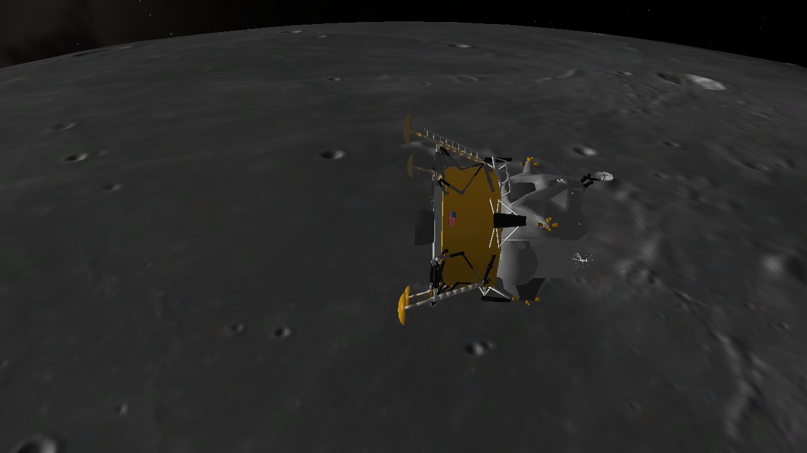The NASA Apollo Lunar Module kit in orbit round the Moon. 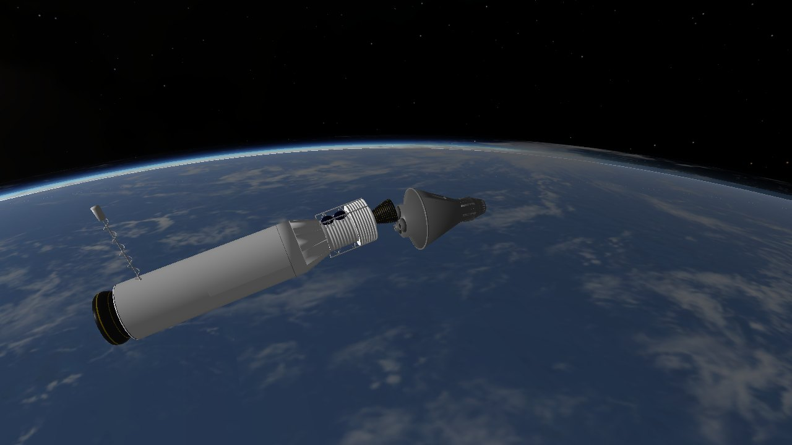Agena stage and Mercury capsule kits stacked as a ship, over Earth. 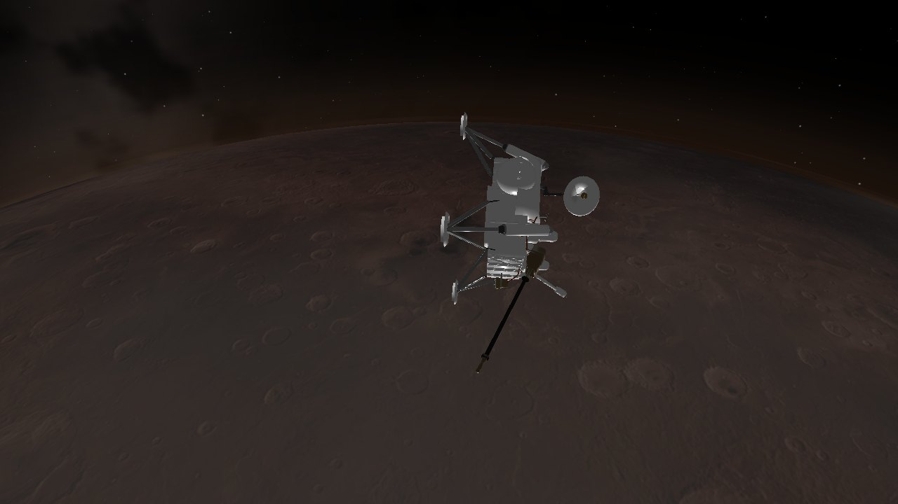The Viking lander kit above Mars. 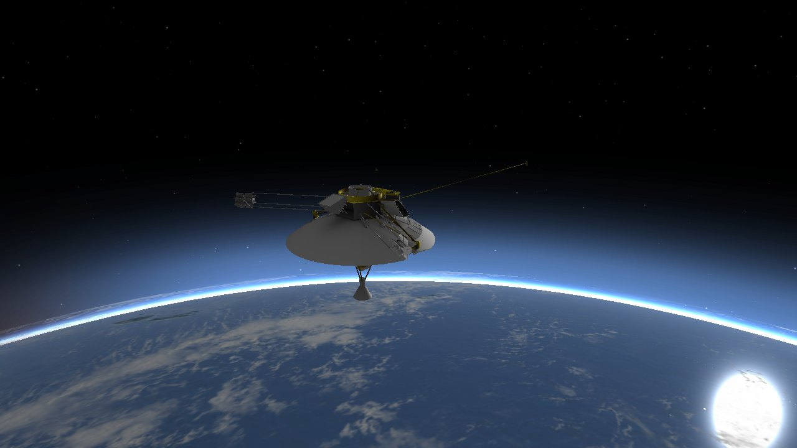The Pioneer 10 kit. 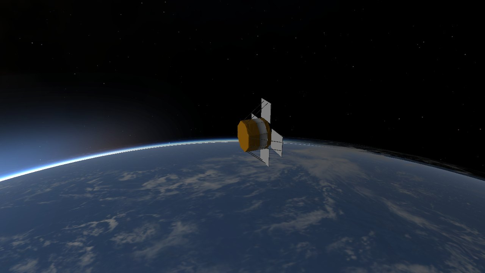The ACRIMSAT kit over Earth. 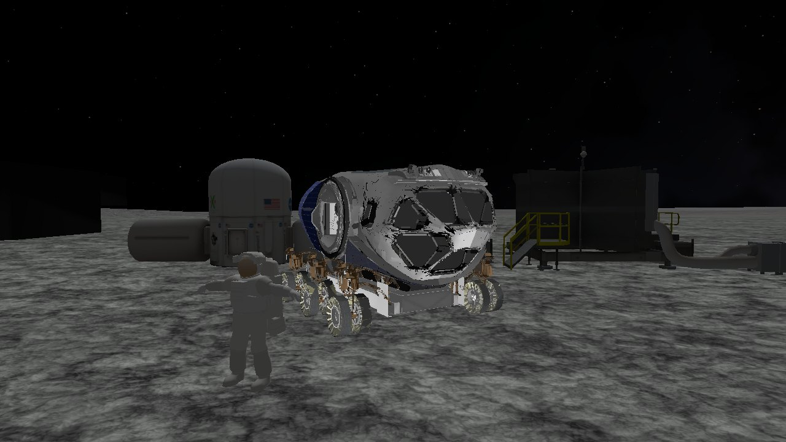Habitat units, the Space Exploration Vehicle and an astronaut, placed in a base as stock models. 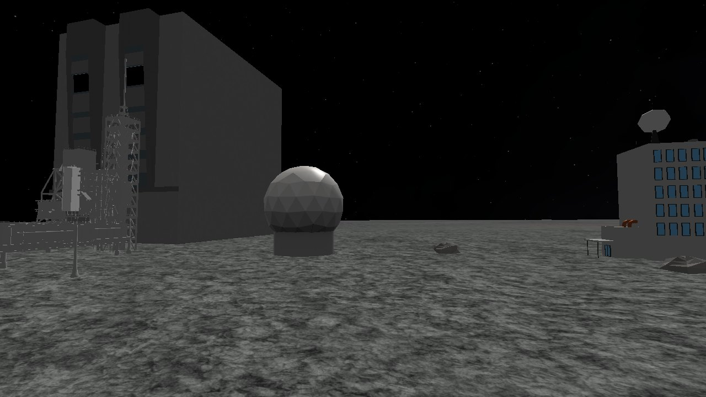Headquarters, a radome, a gantry and the Vehicle Assembly Building, stock models in a base.

## Editing in Blender

_KosmosCAD instead of Blender:_ the Part editor and the base editor have a **Mesh editor** choice. Pick KosmosCAD to open the part in the simple Kosmos-aware modeller (`kosmoscad --edit-mesh FILE`); Ctrl+S sends it back as .glb or .obj and closing resumes the sim. Everything below about pausing, saving and Cancel applies to both editors; Blender stays the more capable one. See [KosmosCAD](kosmoscad.md).

Open **Part editor** from the Windows menu (or start with `--part-editor`). It lists the flown ship’s meshes. Choose **Edit in Blender** and Kosmos pauses the simulation, starts Blender on the mesh, and waits.

_No Blender?_ [KosmosCAD](#kosmoscad), the 3D modeller that ships with Kosmos, edits the same OBJ models and places engines, gear and systems too ([manual and tutorial](kosmoscad.md)).

### A worked example

Here is the round trip on the tank of the Kit Demo rocket. The Blender pictures are renders of the mesh made with `tools/blender_render.py`; the Kosmos pictures are straight from the running sim.

  1. **Pick the mesh.** The Part editor lists every mesh of the flown ship. Press **Edit in Blender** beside `tank_2m.glb`. 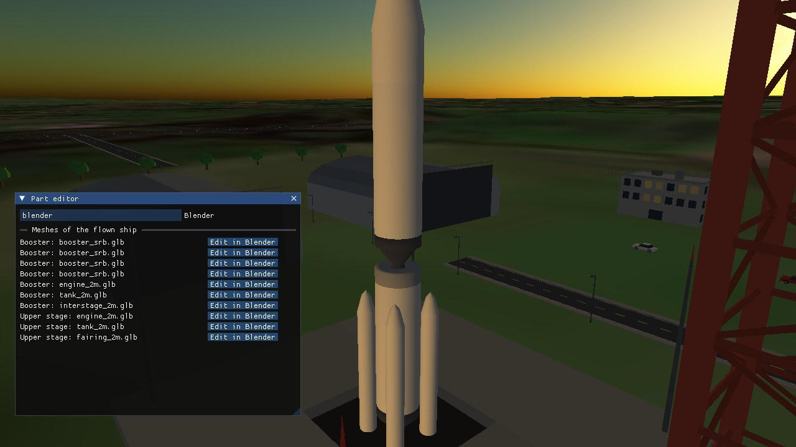The Part editor beside the rocket. The cream tank is the part we are about to edit.
  2. **It opens in Blender.** The simulation pauses and Blender starts on the mesh, vertex colours included. 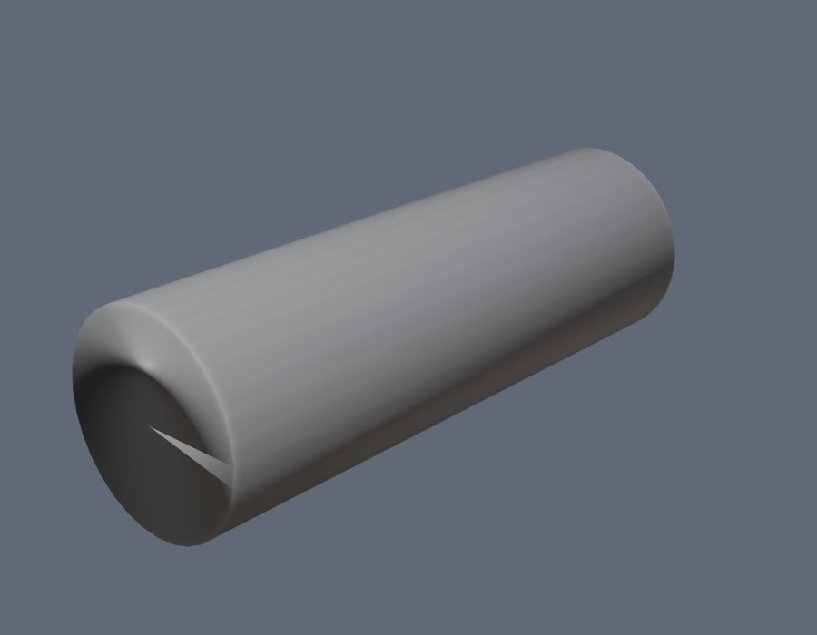The tank as Blender sees it, before any change.
  3. **Change it.** Edit by hand, or with a script: Blender runs headless too, so a change can be automated. `tools/blender_example_edit.py` widens the tank by 35% and paints it red: 
    
        blender -b --python tools/blender_example_edit.py -- addons/mymod/parts/tank_2m/tank_2m.glb

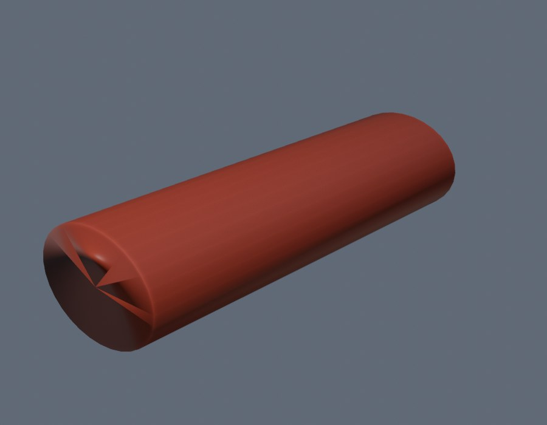The same mesh after the edit, saved back to the same file.
  4. **Save, and see it in Kosmos.** Saving (Ctrl+S, or File → Send to Kosmos) writes the file; Kosmos notices within a moment and swaps the mesh on the paused ship. Close Blender and the sim resumes. 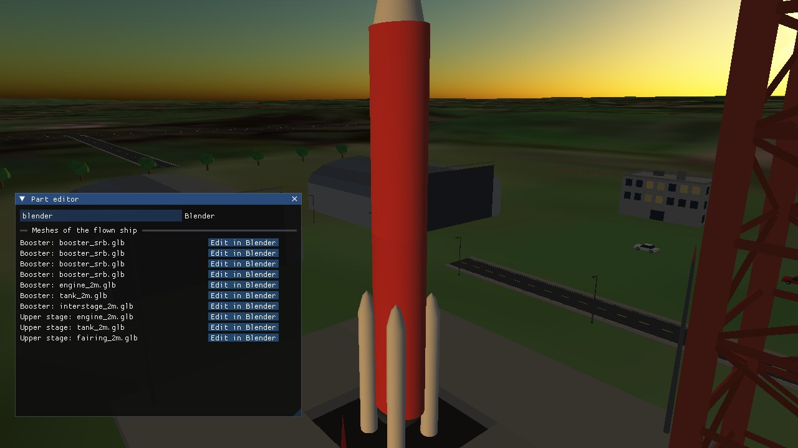Both tanks (every use of that mesh) now show the edit.

The Kosmos pictures were taken by running the edit script on the part file and then restarting the sim, rather than clicking through a live Blender session, but the file Kosmos loads is the same one a saved Blender session writes.

  1. Edit the mesh in Blender and save with **Ctrl+S** (or File → Send to Kosmos). The script writes the mesh back to the same file; Kosmos notices and reloads it, so you see the change on the paused ship.
  2. Close Blender to resume. **Resume, keep Blender open** carries on flying and you can keep editing. **Cancel and restore** puts the original back.

The original is kept as `name.glb.bak` beside the file, and Blender keeps a `name.glb.blend` there for Ctrl+S; delete them when you are done. Procedural parts (`prop` and `profile`) show **Convert + edit** : the part is exported to `models/` in the addon as a GLB with vertex colours (named after the ship, stage and part, and _reused_ if it already exists, so earlier edits are never overwritten) and swapped for the mesh on the running ship. The ship file is not changed until you press **Use in ship.json** , which replaces that part with `{"model": ..., "offset": ...}` and keeps the original as `ship.json.bak`; it takes effect on the next launch, and is refused for stages built from kits. Each session backs up the mesh first, so **Cancel and restore** only undoes that session. Edits are to the files on disk; a mesh outside the addon folder, or one shared by several ships, changes for all of them.

Set the Blender executable in the window (default `blender`, saved with the settings) or with `--blender PATH`. Only `.glb`, `.gltf` and `.obj` parts can be edited; convert AC3D or Orbiter `.msh` models first (see `tools/`). Any mesh that changes on disk is reloaded while Kosmos runs, whichever editor wrote it.

### Base objects

The **Base editor** ’s Objects tab has the same round trip. **Convert this object + edit** bakes a built-in prop (house, hangar, tower…) with its place, heading, scale and every copy of its row into a GLB, and replaces it with a `"model"` object. **Edit this model in Blender** does the same for an object that is already a model. To merge several props into one mesh, tick them under _Pick objects to join_ and press **Join picked + edit** : Blender opens with one scene object per prop (named `index_type`), so you can select them and press **Ctrl+J** , or edit them separately; everything in the file is exported back as one model.
    
    
    {"type": "model", "model": "models/chippenham_group0.glb", "x": 0, "z": 0, "y": 0, "heading": 0, "scale": 1}

A converted or joined model sits at the base origin with scale 1, so it appears exactly where the props were. In the model’s own frame **+Z is forward, +X is to the left and +Y is up** , in metres. `model` is a path relative to the base file, else to the `bases/` folder in your user folder (where the editor writes the GLBs, in `bases/models/`); the file is reloaded when it changes on disk. Saving the base keeps the model object; **Cancel and restore** brings back the original objects and the previous file. Only one Blender session runs at a time, and the rest of the part-editor notes above apply. `kosmos --export-base ID out.glb` writes all of a base’s built-in props as one GLB without the editor.

## Docking ports

List the ports a ship offers. Each has a position, an outward-facing `direction` and an `up` vector, so two ports can be lined up and checked for matching rotation:
    
    
    "ports": [
      {"name": "Fore", "position": [0, 0, -8.6], "direction": [0, 0, -1], "up": [0, 1, 0]},
      {"name": "Aft",  "position": [0, 0,  4.6], "direction": [0, 0,  1], "up": [0, 1, 0]}
    ]

On a staged ship a port may carry `"stage": N` so it leaves with that stage when it is dropped (the Soyuz TMA does this).

Set `"transponder": 123.4` at the top level so a docking MFD can tune the ship's beacon.

## Cockpits & cameras

Every ship has a cockpit camera. Without a `cockpit` block it sits at the front centre of the hull looking along the nose, and the head-up display (`H`) appears there. The `cockpit` block provides an eye position, optional `yaw`, `pitch` (degrees from straight ahead) and `fov`, and an instrument panel row. Each panel entry reads a property:
    
    
    "cockpit": {
      "eye": [0, 0.45, -2.2],
      "mfds": true,
      "mfd_left": "orbit", "mfd_right": "surface",
      "panel": [
        {"label": "ALT",  "property": "{ship}/altitude", "scale": 0.001, "format": "%.1f km"},
        {"label": "THR",  "property": "/controls/throttle", "scale": 100, "format": "%.0f %%"}
      ]
    }

`{ship}` expands to the property path of the ship being flown, `scale` multiplies the value and `format` is a C-style format. Set `"mfds": false` to remove the two MFDs. Add extra interior viewpoints (listed in the F2 window) with `cameras`:
    
    
    "cameras": [
      {"name": "Passenger cabin", "position": [0, 0.3, 0.5], "fov": 70},
      {"name": "Tail", "position": [0, 2.6, 7.2], "yaw": 180, "pitch": 5, "fov": 55}
    ]

### Instrument panels

A cockpit can carry a whole instrument panel, in the manner of Orbiter's 2D panels. Give the `cockpit` block a `layout` and a list of `instruments`; each instrument is an MFD mode (any mode from any addon) placed on a flat board in _panel units_. The same board is the 2D panel along the bottom of the screen and the instrument panel of the 3D cockpit, where its buttons are clicked with the mouse. With `instruments` present they replace the left and right MFD pair, and the readout row is not drawn.
    
    
    "cockpit": {
      "eye": [0, 0.9, -4.2],
      "layout": {"width": 1500, "height": 500, "image": "panel.png",
                 "size": 0.85, "position": [0, -0.15, -0.75], "tilt": 25},
      "instruments": [
        {"mode": "engine",  "x": 760, "y": 60,  "size": 290, "frame": true},
        {"mode": "asi",     "x": 30,  "y": 30,  "size": 210},
        {"mode": "adi",     "x": 250, "y": 30,  "size": 210}
      ]
    }

`width` and `height` give the board's size in panel units and `image` (optional, relative to the ship folder) a background bitmap stretched over it. `x`, `y` and `size` place the instrument's 400×400 drawing square. A `frame` instrument is a full MFD with bezel and buttons, which needs about 10% extra room around its square; without it the instrument is a bare gauge (a plain dark backing, no buttons). In the 3D cockpit `size` is the board's width in metres, `position` its centre relative to the eye (x right, y up, z back) and `tilt` its tilt back in degrees. The first two instruments are the ones `F6` to `F9` drive. Mode scripts receive a fifth `bare` argument in `draw(self, g, w, h, bare)`, true on a bare gauge, so they can leave out small text. The optional Skylark addon's panel is shown below.

Give the layout a `name` and add more 2D-only panels with a `panels` list; each has `name`, `width`, `height`, optional `image` and its own `instruments`. They appear under _View → 2D Panels_.
    
    
    "panels": [
      {"name": "Navigation", "width": 1100, "height": 500,
       "instruments": [{"mode": "orbit", "x": 60, "y": 60, "size": 290, "frame": true},
                       {"mode": "dg", "x": 790, "y": 30, "size": 260}]}
    ]

**Clickable controls.** A bitmap panel can have live switches and buttons drawn over it. Add a `controls` list to the `cockpit` block (for the main panel) or to an entry of `panels`. Each has a position and size in panel units (`x`, `y`, `w`, `h`) and a `type`:

type| Does  
---|---  
`button`| Sets `property` to `value` and lights while it matches. The value `level-horizon` sets sas to attitude hold with pitch 0 on the current heading.  
`toggle`| Flips `property` between 0 and 1 (the gear switch).  
`slider`| Dragged; sets `property` (throttle, hover, `/controls/pod-left`, `pod-tilt-left`...).  
`mfd`| Presses button `button` (0 to 14) of MFD `unit`, so the buttons printed on the bitmap work.  
`hud`| Sets the HUD mode through `/sim/hud-request`.  
  
The Deltaglider and Shuttle-A panels are worked examples.

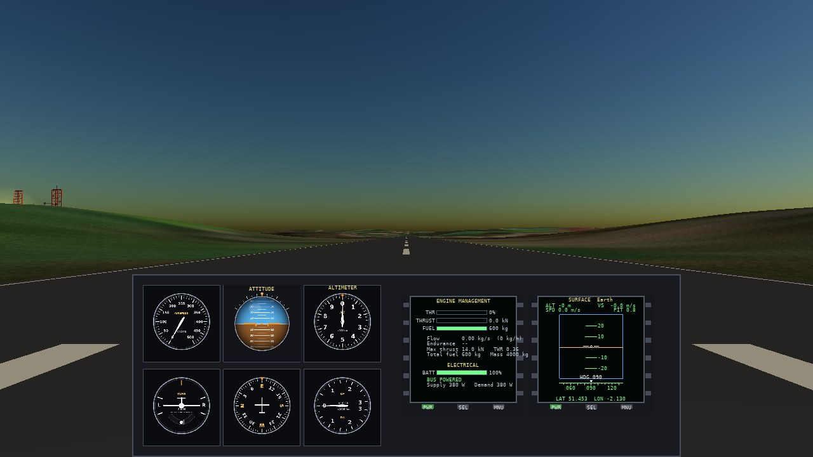The optional Skylark addon's flight-instruments panel: the six-pack plus engine and surface MFDs. 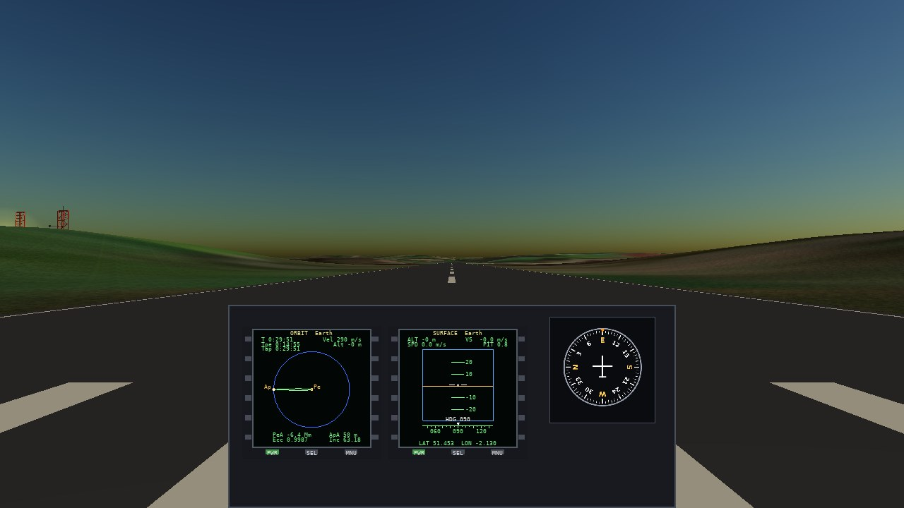Its Navigation panel, defined in the `panels` list.

## Ground vehicles

Set `"class": "ground"` for a wheeled vehicle. It rests level on its `wheels` and shows surface instruments. Mark the driven wheels `"drive": true` and give the vehicle `"ground": { "drive_force": 6000, "max_speed": 12 }`: the force (N) is shared by the driven wheels, fades to nothing at `max_speed` (m/s) and is limited by the grip of the wheels. The throttle runs from -1 (reverse) to 1, A/D steer the wheels that have `steer_deg` (use a negative angle for rear wheels that turn the other way) and the vehicle holds its brakes when the throttle is zero. The `"prop": "lunar_rover"` part draws the six-wheeled rover; see `addons/cvel-lunar-rover`.

## Aircraft

Set `"class": "aircraft"` and describe the airframe with `surfaces` (what makes lift and control), `wheels` (what it rolls on) and, optionally, `inertia` and `damping`.
    
    
    "surfaces": [
      {"control": "", "position": [0, 0, 0.15], "area": 10,
       "cl0": 0.3, "cl_alpha": 5.0, "cd0": 0.025, "induced_drag": 0.05, "stall_deg": 15},
      {"control": "aileron", "position": [4.2, 0, 0.3], "area": 1,
       "cl0": 0.3, "cl_alpha": 5.0, "cd0": 0.025, "induced_drag": 0.05,
       "stall_deg": 15, "gain_deg": 12},
      {"control": "rudder", "position": [0, 1.2, 6.5], "forward": [0, 0, -1], "up": [1, 0, 0],
       "area": 2.5, "cl_alpha": 3.5, "cd0": 0.015, "stall_deg": 16, "gain_deg": 15}
    ],
    "wheels": [
      {"position": [0, -2.1, -3.5], "steer_deg": 40, "rolling_resistance": 0.03},
      {"position": [1.8, -2.1, 1.0], "rolling_resistance": 0.03}
    ],
    "inertia": [14000, 20000, 12000],
    "damping": [0.8, 1.0, 0.8]

Surface field| Meaning  
---|---  
`control`| `""` for fixed, or `elevator` (pitch), `aileron` (roll), `rudder` (yaw) or `flaps`  
`position`| Centre of pressure, in the ship frame  
`area`| Area (m²)  
`cl0`, `cl_alpha`| Lift coefficient at zero angle of attack, and its slope per radian  
`cd0`, `induced_drag`| Zero-lift drag and the induced drag factor  
`stall_deg`| Angle of attack where lift collapses  
`gain_deg`| Deflection at full control input. Opposite signs on left and right ailerons give roll.  
`forward`, `up`| Orientation; a vertical fin uses `"up": [1, 0, 0]`  
  
Engines on an aircraft should set `"air_breathing": true`. The `"aeroplane"` prop draws a ready-made airliner mesh: `{"prop": "aeroplane", "span": 12, "offset": [0, -2.1, 0.3]}`. The Skylark shown below is an optional addon, not part of the bundled fleet.

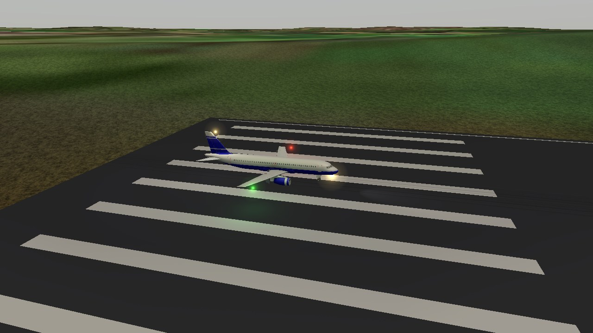The optional Skylark aircraft addon.

## Quantum portals

Jumps go through a portal ship, not a drive. `addons/cvel-portal` is the bundled one; the game puts one in orbit of every star at 0.43 times the distance of its outermost planet. A ship file marks itself as a portal with a `portal` object; the disc is a circle of that radius in the ship's XY plane, and the player crosses it along the ship's Z axis.
    
    
    "portal": { "radius": 180 }

  * The game looks the portal up by the ship name `Quantum Portal`, so an addon can replace its meshes by shipping a ship of that name.
  * A scenario ship whose `orbit` has `"portal_m": 1000` starts 1 km in front of the system's portal, facing it, with the portal's velocity. See `scenarios/CVEL/CVEL-ShuttleA/shuttle_a_portal.json`.
  * Test from the command line with `--test-dial N` (dial star N) or `--test-jump N` (jump at once). Players use _View → Quantum portal_ or the galaxy map; see the [Flight manual](manual.md#quantum).
  * A jump unloads the current system, builds the new one, disables `/autopilot/enabled` and sets `/sim/warp-index` to 0, and builds a fresh ship, so fuel and state are not carried over.

## Ship scripts

`/ships/ship[N]/main-max-thrust` is the available active-stage thrust controlled by the main throttle, in newtons; it excludes hover, pod and RCS engines and is zero if their propellant is exhausted. `max-thrust` remains the total maximum thrust of the active stage.

Set `"script": "ascent.lua"` and that file runs when the ship becomes the active one. Define a global `update(dt)` function; it is called every simulation step. Everything the script knows comes from `props.get` and everything it does is a `props.set`, so it can replace the player's hands:
    
    
    local ship = "/ships/ship[0]"
    
    function update(dt)
      if not props.get("/autopilot/enabled") then return end
    
      local alt = props.get(ship .. "/altitude")
      if alt > 80000 then
        props.set("/controls/throttle", 0)
      else
        props.set("/controls/target-pitch", 90 - alt / 1000)
        props.set("/controls/throttle", 1)
      end
      props.set("/autopilot/status", "Climbing")
    end

The `P` key toggles `/autopilot/enabled`. See `addons/kestrel/ascent.lua` for a complete ascent autopilot with several phases.

## Autopilots

A ship can bring its own engine sound: `"engine_sound": "sounds/engine.wav"` in `ship.json` (a path inside the ship’s folder) loops that file in place of the generic engine roar while the ship is flown, at a volume that follows the throttle. If the file will not load, the generic sound plays.

An autopilot is a ship script (see above) that writes the control properties. Kosmos ships two. Aircraft that have no `"script"` of their own load the default aircraft autopilot, `data/autopilot/aircraft.lua`; a ship that names a script (Kestrel's `ascent.lua`) uses that instead. To replace the default for one aircraft, give it your own `"script"`. `P`, the joystick `autopilot` action and the Autopilot menu all just toggle `/autopilot/enabled`; the script decides what to do with it. Any pitch, yaw or roll input clears it. Scripts should set `/autopilot/status` to a short text, which the HUD shows.

### The aircraft autopilot

The modes are flags under `/autopilot/ac/` and the targets are in SI units. The targets are captured from the aircraft when the autopilot engages, and the window or your own script can change them at any time.

Property| Meaning  
---|---  
`/autopilot/ac/hdg-hold` (bool, default true)| Hold `/autopilot/ac/heading` (degrees) with up to 25° of bank  
`/autopilot/ac/alt-hold` (bool, default true)| Hold `/autopilot/ac/altitude` (metres) with a climb rate of at most 5 m/s  
`/autopilot/ac/vs-hold` (bool)| Hold `/autopilot/ac/vs` (m/s) instead of an altitude  
`/autopilot/ac/spd-hold` (bool)| Autothrottle: hold `/autopilot/ac/speed` (m/s)  
`/autopilot/ac/nav` (bool)| Fly the localizer of the ILS tuned on receiver `/autopilot/ac/receiver` (0 or 1)  
`/autopilot/ac/appr` (bool)| As `nav`, and follow the glideslope  
  
It reads `/ships/ship[i]/{heading, altitude, speed, vertical-speed, roll, landed}` and `/nav/nav[n]/ils/{valid, course, localizer, glideslope, glide-angle}`, and writes `/controls/roll`, `/controls/pitch` and, with speed hold, `/controls/throttle`. The lateral loop turns heading error into a bank angle and the ailerons hold that bank; the vertical loop turns altitude error into a wanted climb rate and the elevator holds it, with a slow trim for the steady error. Copy the file as a starting point for a different aircraft: gains that suit an airliner may need softening for a light plane. The script is ignored on the ground.

### The ascent autopilot

Kestrel's `ascent.lua` reads `/autopilot/sc/target-altitude` (km, default 200) and `/autopilot/sc/heading` (degrees, default 90) every step, so they can be changed during the flight. It writes `/controls/throttle`, `/controls/sas` (`attitude`, `prograde`), `/controls/target-pitch`, `/controls/target-heading` and `/controls/stage`, and publishes its phase in `/autopilot/status`: Liftoff, Pitch kick, Gravity turn, Staging, Upper stage burn, Coasting to apoapsis, Circularising, In orbit. Give a launcher of your own a script like it, and the Spacecraft autopilot window will show an engage box and these two settings for it (it is offered for any ship whose ship.json has a `script`).

The attitude hold the window sets is the ship's SAS: `/controls/sas` is one of `off`, `stability`, `prograde`, `retrograde`, `radial-out`, `radial-in`, `normal`, `antinormal` or `attitude`, and `attitude` points the nose at `/controls/target-pitch` and `/controls/target-heading`.

### Starting with the autopilot on

A scenario file can set up the flown ship's cockpit:

Key| Meaning  
---|---  
`"throttle"`| Starting throttle, 0 to 1 (default 0)  
`"autopilot"`| `true` to start with `/autopilot/enabled` on  
`"mfd_left"`, `"mfd_right"`| MFD mode ids for the left and right units, e.g. `"hsi"` and `"vor"` (see [Writing an MFD](#mfdmods)); a mode the ship's regime hides is ignored. The ids are listed under [MFD mode ids](#mfdids)  
`"mfd_power"`| `{"left": true, "right": false}` powers each unit on or off; a side left out keeps the ship's default, and a unit that starts off is also left out of the see-through display  
`"mfd_display"`| `"panels"` (the dashboard or panel MFDs), `"hud"` (the transparent see-through MFDs) or `"off"`  
`"view"`| Starting camera: `"chase"`, `"cockpit"` (2D dashboard) or `"cockpit3d"`; a ship without a cockpit stays in chase view  
`"hud"`| Head-up display mode: `"off"`, `"orbit"`, `"surface"` or `"docking"` (a mode the ship's `cockpit.hud_modes` does not offer stays hidden)  
  
These instrument settings are applied once when the scenario starts, for the ship's default instrument layout; a ship started on one of its other 2D panels keeps that panel's instruments. For example, the stock Kestrel start has the Orbit MFD on the left and the right unit off: `"mfd_left": "orbit", "mfd_power": {"right": false}`. Surface on the left, Orbit on the right, see-through, with the orbit HUD: `"mfd_left": "surface", "mfd_right": "orbit", "mfd_display": "hud", "hud": "orbit"`.

An airborne start uses `"surface": {"base": "chippenham", "runway": 0, "along": -8047, "altitude": 1524, "speed": 103}`: the ship is placed on the runway's approach (negative `along` is metres before the threshold) at that height above the airfield and speed in m/s, with the gear up. This example requires the optional Skylark addon:
    
    
    {
     "name": "Earth: Skylark ILS approach, Chippenham",
     "date": "1964-10-14 12:00:00",
     "ships": [{"ship": "Skylark", "body": "Earth",
       "surface": {"base": "chippenham", "runway": 0, "along": -8047, "altitude": 1524, "speed": 103}}],
     "nav": [109.5, 113.4],
     "weather": "EGHQ 141200Z 24005KT 9999 FEW040 12/06 Q1015",
     "throttle": 0.7, "autopilot": true,
     "mfd_left": "hsi", "mfd_right": "vor"
    }

## Importing Orbiter meshes

Orbiter add-ons can be reused. Drop the add-on's files into `addons/NAME/orbiter/` and convert its meshes:
    
    
    python3 tools/msh_import.py addons/NAME

This converts every `.msh` under `orbiter/Meshes` to OBJ/MTL in `addons/NAME/models/`, changes DDS textures to PNG (needs Pillow), and mirrors the mesh from Orbiter's left-handed, nose +Z frame into Kosmos's nose −Z frame. Use it in a part: `{"model": "models/x.obj"}`.

To start a whole addon, run `python3 tools/orbiter_addon_import.py PATH --id my-addon`. It converts the meshes and, if the add-on includes its C++ source, drafts `ship.json` with the mass, propellant, engines (Z and Isp converted), docking ports and camera offset, marking what it could not find with `"TODO"`. `docs/importing-orbiter-addons.md` in the source tree lists the conventions and the finishing steps.

Orbiter keeps masses, thrust and fuel in compiled code, so you finish `ship.json` for an imported add-on by hand. `addons/cvel-ares` is the worked example (`./kosmos --ship "Ares Spider"`).

## Scenarios

_Tools → Scenario editor_ builds these files for you, and _File → Save scenario_ records a flight in progress. Files in `~/.config/kosmos/scenarios/` are loaded at start and replace a shipped scenario with the same id. That includes `default.json`, the scenario loaded when Kosmos runs with no arguments: copy it there and edit it to change the default start.

A scenario is a JSON file in `scenarios/`, or in `scenarios/` inside an addon. File names sort the list, so prefix with a number. Sub-folders become submenus in File > Open scenario (`01_Earth/` shows as “Earth”; the number sets the order). The menu re-reads the folders, so changes made outside Kosmos show up straight away.
    
    
    {
      "name": "Mars: high orbit",
      "description": "A spacecraft 9,000 km above Mars.",
      "active": 0,
      "ships": [
        {"ship": "CVEL Dragonfly", "body": "Mars",
         "orbit": {"altitude_km": 9000, "inclination": 20, "phase": 180}}
      ]
    }

Field| Meaning  
---|---  
`name`, `description`| Shown in the scenario list  
`active`| Index in `ships` of the ship you fly first  
`ships[].ship`| Ship name, as in its `ship.json`  
`ships[].skin`| Optional skin folder name, such as `MySkin`. Folders under the model's sibling `Skins/` directory contain DDS textures named after the original textures; `_norm` files are ignored. The scenario editor offers skins when available.
`ships[].body`| Body to start at  
`ships[].orbit`| `altitude_km`, `inclination` (degrees) and `phase` (degrees along the orbit). Add `apoapsis_km` for an ellipse: `altitude_km` is then the periapsis and `phase` the true anomaly. `"toward": "Moon"` lays that ellipse in the Moon’s orbital plane with its apoapsis aimed where the Moon will be on arrival, which gives a translunar trajectory  
`fuel_pod`| Ship JSON flag: when docked, this ship tops up its partners’ tanks. Mode property `/dock/transfer`: `auto`, `off`, `give` or `take` (View > Fuel transfer)  
`ships[].dock`| Start docked: `{"to": 0, "port": 1, "own_port": 0}` joins this ship to an _earlier_ ship in the list (`to` is its index) through that ship’s port and this ship’s port. Give the ship the same `orbit` or `surface` as the one it docks to; it is moved onto the port at the start. `U` in flight releases it (see `shuttle_a_cargo_orbit`)  
`ships[].orbit.escape_to`, `escape_days`| Start on the departure hyperbola of a transfer to the named planet instead of in a closed orbit: `altitude_km` is the periapsis and `phase` the angle past it. `escape_days` is the flight time in days for a Lambert transfer that arrives then; 0 (default) is a Hohmann transfer.  
`ships[].surface`| Start on the ground instead of in orbit  
`ships[].state`, `ships[].flight_state`| From 0.50, optional exact saved-flight state; see below. Normal authored scenarios can omit both.  
`date` or `mjd`| Optional start date at the top level: `"date": "1969-07-16 13:32:00"` (GMT) or `"mjd": 40418.5639`. The planets, the Moon and the home planet’s orientation are set for that moment (see `apollo11_saturn_v_t_minus_5`); without it the system starts on its default date  
`system`| Optional star system the scenario belongs to, by name (`"system": "Sirius"`); empty or missing means Sol. Starting the scenario jumps there first, and the scenario editor records the current system when it saves. The bundled ones sit in `scenarios/Default/<Star>/`.  
`enter_building`| Optional name of a base building to start inside on foot, looking at its panel (the `mare_quarters_on_foot` scenario does this)  
`nav`| Optional list of radio frequencies to pre-tune (NAV1, NAV2), at the top level of the scenario  
`target`| Optional ship or body name to set as the target, at the top level of the scenario  
  
Saved scenarios from 0.50 can include `state` alongside an `orbit` or `surface` placement: `r` and `v` are position (metres) and velocity (metres per second) relative to the named body, `q` is the orientation quaternion in `[w, x, y, z]` order, and optional `omega` is angular velocity. `flight_state` records stage propellant, RCS fuel, gear, animations, health, mission time and systems. It must match the installed ship's stage, animation and systems layout or the saved flight is rejected. Explicit scenario systems overrides are applied after that state. The scenario editor clears the exact placement when placement is edited, and clears saved flight state if the ship is changed. From 0.51 Earth-communications attitude hold is resumed; other autopilots, active burns and some transient state are not resumed; complex docking networks may lose links.

From 0.51 an undocked orbiting ship can specify `"point_at": "Earth"` beside its `orbit` to point its nose (-Z) at a named body initially. This cannot be combined with exact `state` or portal placement. To keep the active ship tracking Earth, add `"set": {"/controls/sas": "earth-communications"}` to the scenario. It does not change the navigation target or simulate a radio link; attitude control is suspended on rails.

### Surface starts

Use `"surface"` with `latitude`, `longitude` and `heading` to stand a ship on a body, or `"pad"` for a launch pad:
    
    
    {"ship": "Ares Spider", "body": "Moon",
     "surface": {"latitude": 0.67, "longitude": 23.47, "heading": 90}}

Stand a ship on a base with `"surface": {"base": "mysite"}`. Optional extras: `"runway": 0`, `"reverse": true`, `"along": METRES` (distance past the threshold), and `"altitude"` with `"speed"` to start in the air. The `deltaglider_chippenham` scenario starts on a runway.

Check yours with `./kosmos --list-scenarios`, run it with `--scenario ID`, and cycle through all with `F10`.

## Bases

You do not have to write base files by hand. _Tools → Base editor_ edits any loaded base with live feedback and saves JSON in this format to `~/.config/kosmos/bases/`. See the [manual](manual.md#editors).

A base is a built-up site on a body's surface: a launch complex, an airfield, a lunar outpost. Put files in `data/bases/` or an addon's `bases/` folder. The terrain is levelled around the centre (`flat_radius`, easing back over `blend`) and the objects stand on it.
    
    
    {"bases": [{
      "id": "mysite", "name": "My Site", "icao": "EGMS", "body": "Earth",
      "latitude": 51.4, "longitude": -2.1, "heading": 90,
      "flat_radius": 300, "blend": 200,
      "pad": {"x": 70, "z": 0, "heading": 0},
      "runways": [{"name": "Runway 1", "x": 560, "z": 0, "length": 1500, "width": 45,
        "ils": [{"frequency": 109.5}, {"frequency": 109.9, "reverse": true}]}],
      "navaids": [
        {"type": "vtol", "name": "Pad", "frequency": 92.3},
        {"type": "vor", "x": 20, "z": -170, "frequency": 113.4},
        {"type": "ndb", "x": 200, "z": -200, "frequency": 0.341}
      ],
      "cameras": [{"name": "Control tower", "x": 60, "y": 28, "z": -120, "fov": 40}],
      "objects": [
        {"type": "hangar", "x": 140, "z": -60, "heading": 270, "width": 36, "depth": 40, "height": 14},
        {"type": "street_lamp", "count": 6, "x": 20, "z": -35, "step_x": 25}
      ]
    }]}

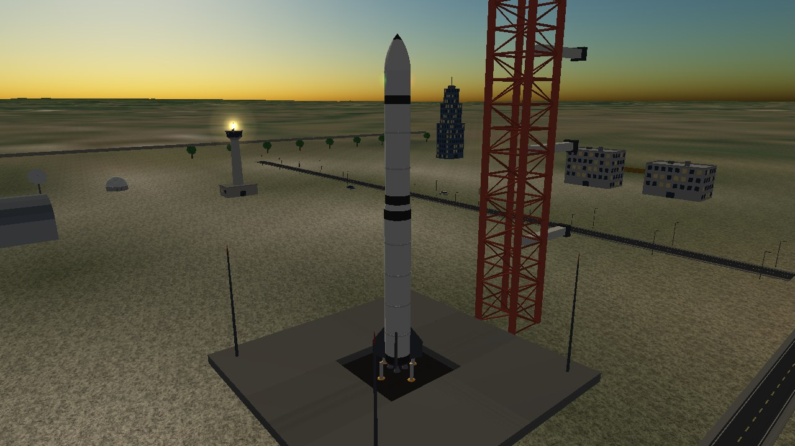Twickenham spaceport: tower, hangars and a pad, all from objects in one JSON file.

### Coordinates

Coordinates are metres in the _base frame_ : `x` is to the right of the base heading, `z` is along it, and `y` lifts a prop off the ground. `heading` turns a prop, `scale` scales it, and `count` with `step_x`/`step_z` lays out a row.

The `pad` block also takes an optional `deck`: the height in metres of the surface a ship stands on, for pads built from a `model` prop (a launch mobile platform, say). Without it, a ship stands on the ground, or on a `launch_pad` or `landing_pad` object.

### Object types

Optional overrides: `size`, `width`, `depth`, `height`, `length`, `radius`, `number`, `seed`, and `colour`/`colour2` as `[r,g,b]`.

Group| Types  
---|---  
Buildings| `house`, `office`, `skyscraper`, `hangar`, `control_tower`, `water_tower`, `radar`, `domed_radar`  
Site furniture| `wall`, `fence`, `road`, `street_lamp`, `barrel`, `crate`, `container`, `tank`, `car`  
Landscape| `conifer`, `tree`, `bush`, `rock`, `rock_cluster`  
Launch| `launch_tower`, `launch_pad`, `saturn_v`, `rocket_stage`  
Space hardware| `spaceship`, `aeroplane`, `station_module`, `solar_array`, `solar_windmill`, `antenna_dish`, `satellite`, `skylab`  
  
### Stock models in a base

A `model` object also finds the shipped meshes under `data/`, so `{"type": "model", "model": "parts/nasa_vab/nasa_vab.glb", "x": -60, "z": 60, "scale": 0.25}` works in any base. The Base editor’s Objects tab has a **Stock model** list with an **Add** button. Choosing **Edit in Blender** on a stock model works on a copy in your `bases/models/` folder, never the shipped file.

### Terrain meshes

A base can set a mesh into the ground, so its surface is the terrain: ships land on it, wheels run over it and walkers stand on it. Add `terrain_meshes` to the base: `{"file": "terrain/gale-crater.stl", "x": 1160, "z": -560, "scale": 40, "vscale": 1.5, "y": -128, "blend": 300}`. The file is an `.stl`, `.obj`, `.glb` or `.gltf`, found beside the base file, in the model folders or from the game folder. Kosmos reads the topmost surface seen from above into a grid (up to 2048 samples across), so this is a height map: overhangs, tunnels and caves are not solid.

Key| Meaning  
---|---  
`x`, `z`, `heading`| Where the middle of the mesh stands in the base frame, and its turn in degrees.  
`scale`, `vscale`| Metres per mesh unit sideways, and a further multiplier for heights.  
`y`| Metres the mesh’s lowest point stands above the natural ground at the base centre.  
`blend`| Metres inside the rim over which the mesh eases into the natural ground (default 20).  
`up`| `"z"` (STL, CAD, the default for STL) or `"y"` (glTF, OBJ, the default for those).  
`texture`| `"auto"` (default) paints the ground with the mesh’s own textures or vertex colours when it has them, and with the terrain’s usual colouring when not; `"mesh"` is the same; `"terrain"` ignores the mesh’s textures so the terrain’s own colouring shows (use it if they clash).  
`image`| A picture draped over the footprint seen from above, for meshes with no texture of their own (STL has none).  
  
The base is levelled into the mesh as usual (the ground at its centre becomes the base height), so put the centre where the ground is flat enough. Rocks and plants keep off the footprint. Mesh textures are read from the file’s base-colour texture (glTF, OBJ) per vertex and painted at the terrain’s resolution, not shown as a separate model. The Gale Crater base uses `terrain/gale-crater.stl`, a scan of the crater and its mound; the Gale rover scenario drives across it.

### Base cameras

Entries in `cameras` appear in the F2 window. They follow the flown ship while it is nearby or above the local horizon (otherwise they look at the pad), unless `"track": false`, which uses `yaw` and `pitch` (degrees from the base heading) instead.

## Lights

On a ship the player can switch navigation lights and other lamps on and off separately (Y and Shift+Y, or the View menu), so give landing and nose lights `"navigation": false` if they are not spots. See `/controls/lighting/nav` and `lamps` in the [property reference](#props).

Ships and bases can carry lamps, drawn with simlib's local-light system: they light nearby models and show as glowing bulbs. Add a `"lights"` array to `ship.json` (ship frame: nose along -Z, +X right, +Y up) or to a base (base frame: x right, z forward, y up, in metres).
    
    
    "lights": [
      {"position": [-4.3, 0, 0.3], "colour": [255, 40, 30], "intensity": 1.4, "range": 26, "glow": 0.3},
      {"position": [0, 2.1, 14], "pattern": "strobe", "period": 1.6, "intensity": 4, "range": 50},
      {"position": [-30, 46, 20], "colour": [255, 248, 235], "intensity": 30, "range": 120,
       "inner": 5, "outer": 17, "aim": "ship", "aim_point": [0, 30, 0]}
    ]

Key| Meaning  
---|---  
`position`| `[x, y, z]` in the owner's frame (or separate `x`, `y`, `z`).  
`count`, `step_x/y/z`| Repeat the lamp `count` times, offset by the step each time; handy for runway edge lights.  
`colour`, `intensity`, `range`| RGB 0-255, brightness (about 1-5 for small nav lights, 6 for street lamps, 30 for floodlights) and reach in metres.  
`inner`, `outer`| Cone angles in degrees. Leave `outer` out (or 0) for a point light; set it for a spotlight.  
`direction`| Spotlight direction `[x, y, z]` (default straight down).  
`aim_point`, `aim`| Bases only. `aim_point` points a spot at a point; `"aim": "ship"` points it at the nearest ship within 400 m, falling back to `aim_point`. This is how tower floodlights follow a rocket.  
`pattern`, `period`, `phase`| `steady` (default), `strobe` (two sharp flashes), `beacon` (slow pulse) or `blink` (on/off). `period` is in seconds, `phase` is 0-1.  
`glow`| Size of the visible bulb in metres (default 0.4); 0 hides it. Use `intensity` 0 with a glow for a bulb that lights nothing, which is cheap for long rows.  
`navigation`| Ship lamps only: marks a running light or strobe, drawn dimmer with a smaller glow. Defaults to true for point lamps and false for spots (landing lights); set it explicitly to override.  
`always`| Base lamps come on at dusk by default; `always` keeps one lit in daylight (beacons). Ship lamps are always on unless you set `"always": false`.  
`stage`| Ships only. The lamp goes out when that stage (0-based) is jettisoned. If omitted it belongs to the stage whose body it sits on.  
  
Only the 16 lamps nearest the camera light the scene; the rest still draw their glow. Lamps are bright only in the dark, so test with `--earth-turn DEG` (turns the home planet to move the Sun) and `--hide-info`. The base editor keeps `lights` when it saves.

## Equipment & ordnance

Things a person carries or a ship drops are equipment, defined in `<addon>/equipment/*.json` (the stock set is the `field-kit` addon: tricorder, geo scanner, theodolite, pistol, plasma rifle, demolition charges, bombs). A file is one object or `{"equipment": [...]}`. Each item has an `id`, `name`, `kind` (`instrument`, `weapon`, `explosive` or `ordnance`), `mass`, `standard` (true to be in every pack) and `shapes` (boxes and cylinders for the model in hand), plus stats such as `damage`, `ammo`, `fuse`, `blast_radius`, `blast_damage`, `yield` and `blast_effect` (`mushroom`). A ship carries ordnance on `hardpoints` and lists what a person takes when leaving it in `locker`; see the [ship.json](#ship) table. The CVEL Sentinel ICBM addon is an example.

## Key actions

An addon can add bindable keys with a `keys.json` next to `addon.json`. Each action sets a bool property in the property tree, which ship scripts, Lua and instruments can read; players see the actions under _View > Keyboard_ and can rebind them.
    
    
    {"actions": [
      {"id": "spot.toggle", "label": "Toggle spotlight", "group": "My addon",
       "key": "letter_b", "shift": false, "ctrl": false, "alt": false, "property": "/controls/spot", "mode": "toggle"},
      {"id": "spot.flash", "label": "Flash", "key": "letter_n", "property": "/controls/flash", "mode": "hold"}
    ]}

`id` must be unique and `property` is required. `mode` is `toggle` (flips the property on each press) or `hold` (true while the key is down). `key` is optional and uses simlib's key names (`letter_b`, `digit_3`, `f7`, `keypad_5`, `arrow_up` and so on); leave it out to ship the action unbound. Addon actions apply everywhere, so a key already used by a built-in action is taken from it when the player binds it.

## Native addons

Most addons need nothing in this section. An addon can also include a separate native program (C, C++, Python or anything that can open a socket) that reads and controls the simulation, defines keys, spawns ships, releases ordnance, gives equipment and draws an MFD page. It runs outside Kosmos and talks to it over a local, loopback-only connection called **KosmosLink** , so a crash cannot take the game down, and the player has to allow it in _View > Native addons_ before it can do anything.

The addon declares its program in a `native` block of `addon.json`:
    
    
    "native": {
      "run": { "linux": "bin/my-addon", "windows": "bin/my-addon.exe" },
      "capabilities": ["read", "draw", "keys"],
      "autostart": true,
      "restart": true
    }

`capabilities` is the most the addon may ever hold: `read`, `controls`, `write`, `spawn`, `draw`, `keys`, `world` (change the weather, place and remove ships), `ui` (windows and notices), `vessel` (own a ship's controls, apply forces) and `draw3d` (lines, markers and labels in the 3D view). The player grants them per addon. Everything else (the client library, a C++ wrapper, a Python client, examples, an addon template, a mock server, the protocol and the full reference) is in the separate [Kosmos SDK](https://github.com/daver64/Kosmos/releases) download, documented in the [SDK manual](https://github.com/daver64/Kosmos/blob/main/sdk/docs/MANUAL.md). For a larger worked example, the SDK includes `kosmosmap`, a C++ GTK 3 moving map (Linux) that the game also ships as an addon.

## Navaids

The nav displays show a short ident rather than the full name. A base's optional `"icao"` (four letters; made up from the id when missing) gives its beacons idents such as `EGMS VOR` and `EGMS ILS 1R`. A navaid in `navaids.json` can set its own `"ident"`; otherwise its name is shown.

Type| Where| Notes  
---|---|---  
`vtol`| Base `navaids`| Pad beacon for the VTOL MFD  
`vor`| Base `navaids`| VHF bearing station; frequencies around 108–118 MHz  
`ndb`| Base `navaids`| Frequency below 1 MHz; tuned on the ADF MFD  
`ils`| Per runway, `ils` array| One entry per landing direction. `glide` sets the angle (default 3°); `"reverse": true` is the opposite end.  
  
A runway's ILS puts a localizer and glideslope at the touchdown zone. Free-standing navaids not tied to a base live in `data/navaids.json`, with `body`, `latitude`, `longitude`, `frequency` and optional `heading`/`glide`:
    
    
    {"type": "vor", "id": "cape-vor", "name": "Cape VOR", "body": "Earth",
     "latitude": 28.52, "longitude": -80.68, "frequency": 112.40}

## Bodies & solar systems

`data/sol.json` defines the solar system. Each entry in `bodies` is a star, planet or moon:
    
    
    {"name": "Mars", "kind": "planet", "parent": "Sun",
     "gm": 4.282837e13, "radius": 3389500.0, "spin": 7.0882e-05,
     "terrain": "orbiter", "colour": [190, 105, 70],
     "atmosphere": {"density": 0.02, "scale_height": 11100.0, "colour": [210, 150, 110]},
     "orbit": {"a_au": 1.523679, "e": 0.0934, "i": 1.85, "raan": 49.558, "argp": 286.502, "m0": 19.373}}

Field| Meaning  
---|---  
`kind`| `star`, `planet` or `moon`  
`parent`| Body it orbits (omit for the central star)  
`gm`| Gravitational parameter, m³/s²  
`radius`| Radius in metres  
`spin`| Rotation rate in rad/s (a negative value spins backwards); `synchronous` keeps one face towards the parent  
`colour`| Fallback colour used before a texture loads  
`atmosphere`| `density` (kg/m³ at the surface), `scale_height` (m) and haze `colour`; optional `clouds` `{"cover": 0-1, "height": m, "colour": [r,g,b]}` adds a generated cloud layer seen from orbit  
`orbit`| Elements: `a_au` or `a_km`, `e`, `i`, `raan`, `argp`, `m0` (degrees)  
`terrain`| `"orbiter"` or `"earth"` to use elevation data (otherwise the surface is generated)  
`style`| Gives the body a procedural look and, for rocky types, generated terrain: `type` (`mercury`, `venus`, `earth`, `mars`, `gas`), `seed`, `ocean` (0-1), `ice` (0-1), `relief` (multiplier), `tint` `[r,g,b]` in 0-1, and for gas giants `bands` and `contrast`. See [Virtual worlds](#virtual).  
`detail`, `detail_tile`, `detail_strength`| A seamless brightness map (a file in `data/textures/`) laid over the ground imagery near the surface, its repeat size in metres (default 128) and its strength (default 0.9)  
`real_world`, `imagery`, `fallback_texture`| `"real_world": true` marks an authored real planet (Earth in Sol): its land cover, houses, airfield PAPI lights, soil readout and stock cloud layer. `"imagery": "celestia"` uses the legacy tiled imagery under `import/` when no `tiles` pack is named. `"fallback_texture": "moon"` draws the procedural Moon texture when the body has no image. Land cover for any body is picked up from `data/landclass/<system>/<body>` if present; real weather stations from `data/weather/<body>_stations.json`, and measured climates from `data/weather/bodies.json`.  
`pole`, `meridian`| Real orientation, for a start date: `"pole": {"ra": 317.7, "dec": 52.9}` is the spin axis (J2000 right ascension and declination, degrees); `"meridian": {"w0": 190.1, "rate": 350.9, "node_ra": 317.7}` is the prime-meridian angle W = `w0` \+ `rate` × days since J2000 (degrees, degrees per day), measured from the node of the equator at right ascension `node_ra`  
`gravity_j2`, `gravity_reference_radius`| From 0.50, optional dimensionless J2 coefficient and reference radius in metres. When the F3 nonspherical-gravity option is enabled and no harmonic model is provided, the correction is applied about the body's spin axis during integrated physics; rails and time skips omit it. Both default to zero.  
`gravity_model`, `gravity_frame`| From 0.51, an optional fully normalized harmonic model JSON path relative to the system file overrides J2. The optional frame specifies pole `ra`, `dec`, prime-meridian `w0` (degrees) and `rate` (degrees/day); `ra_rate` and `dec_rate` are degrees/century. `node_ra` defaults to the pole right ascension plus 90 degrees; the special `lunar_libration` and `mercury_libration` flags add those bodies' periodic terms, and the lunar option uses the instantaneous node. Without a frame the field follows the body's spin frame. Models contain degree, reference radius, GM and triangular cosine and sine coefficient arrays. Rails and time skips omit the field; orbital predictions remain approximate.  
`epoch_rates`| Secular rates in degrees per day (`raan`, `argp`, `mean_longitude`) used only to carry J2000 orbit elements to a scenario's start date  
`minor`| true marks a small body (an asteroid): the maptrue marks a small body (an asteroid): it is listed apart from the major worldsrsquo;s focus cycling skips it  
`texture`, `tilt`, `rings`| Image name, axial tilt (degrees) and ring `inner`/`outer` radii  
  
Planets with a VSOP87 data file in `data/vsop87/` start at their true position for the Julian date `epoch_jd` (default J2000, 2451545.0) and then follow a Kepler orbit. Others use the orbit elements you give. `belt` describes a generated asteroid belt (`count`, `seed`, `a_min`/`a_max`, `e_max`, `i_max`, `radius_min`/`radius_max` for the rocks’ sizes in metres, default 3000 to 40000, `name`, `parent`).

A star may have a `parent` too, which makes a binary companion (Sirius B is a white dwarf orbiting Sirius). Other star systems are files in `data/systems/`, named after the star in lower case with dashes (`proxima-centauri.json`) and using this same format plus top-level `name` and `home` (the planet you start at). A file there replaces the procedurally generated system for that star; the star must also exist in the catalogue in `galaxy.cpp`.

Because each system is a JSON file, you can build a fictional system: give it a new star, a few planets and a moon, and swap it in for `sol.json` to explore it.

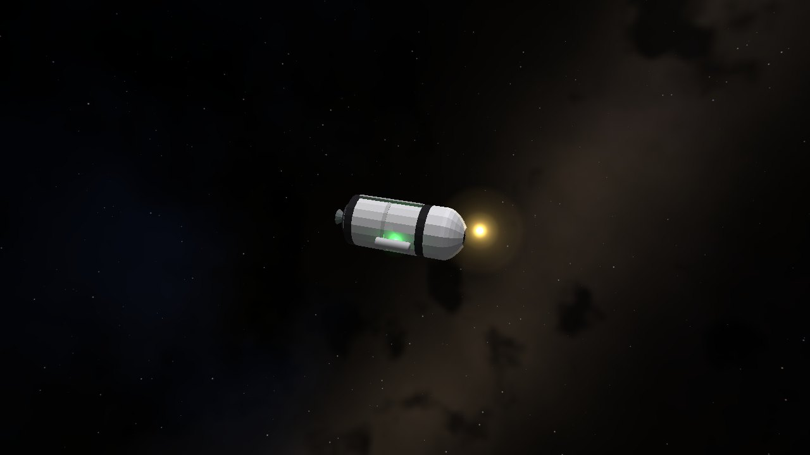Mars: defined by the entry above, with Orbiter elevation and imagery.

## Textures & terrain

A body may have `"mesh": "bodies/vesta.glb"` (a glTF under `data/`) to be drawn as that shape instead of a sphere. Model it with a mean radius of 1 centred on the origin, with UVs the surface image can use; Kosmos scales it by `radius`. Gravity, collision and terrain still treat the body as a sphere, so the mesh is for viewing from space. Vesta uses this.

Surface images are equirectangular (2:1), with north at the top and 180°W at the left, and use the body's lower-case name. Put a custom image for an existing body in `data/textures-hires/<body>.<ext>` (`.dds`, `.png`, `.jpg` or `.jpeg`) to override the bundled map without changing it. New bodies can use `data/textures/<body>.<ext>`. Image lookup checks `data/textures-hires/`, optional `import/celestia/hires/<body>/`, `data/textures-generated/`, then `data/textures/`. Normal maps are named `<body>_normal` and checked in `data/textures-hires/`, `import/celestia/hires/<body>_normal/`, then `data/textures/`; `--no-relief` disables normal-map relief. `tools/gen_textures.py` generates test maps up to 16384×8192 as block-compressed DDS. DDS files are uploaded to the GPU still compressed, so a 16k Earth costs about 90 MB of VRAM rather than about 1.5 GB for a PNG.

Keep original source collections separate from runtime images. Put Celestia sources under `import/celestia/`; `tools/celestia_import.py` targets `data/textures/` by default and refuses to overwrite existing files unless `--force` is supplied. Pass `--out data/textures-hires` to use separate overrides instead; create the output directory first. Check each image's terms before redistributing it. Organize moon sources under `import/celestia/moons/<planet>/<Moon>/`. Kosmos does not scan that moon-source tree at runtime, so stitch a desired `.ctx` map with `tools/ctx_import.py` into a runtime texture folder. Earth is the exception: when its Celestia tile sources are present under `import/celestia/hires/earth/`, they stream directly; specular and normal tile sets are optional.

Orbiter's high-resolution `Surf.tree` archives can be converted to an orbital-view image:
    
    
    python3 tools/orbiter_import.py "import/orbiter/Orbiter 2016 High Res: Earth/Surf.tree" --body earth --level 8

The converted image goes to `data/textures-hires/`. For close-up terrain, bodies with `"terrain": "orbiter"` read elevation and imagery tiles directly from matching folders in `import/orbiter/` (`Elev.tree` and `Surf.tree`). When a Celestia or installed surface map has finer texels at a location, terrain uses it for colour while Orbiter continues to supply elevation. Earth switches from terrain mesh to its whole-body image or streamed tiles above 300 km; other bodies scale that transition by radius.

Celestia moon sources, large Celestia hi-res packs, Orbiter data and optional installed overrides are not shipped. See `data/textures/README.txt` and `data/textures/TEXTURE_SOURCES.md` for source organization and import details.

## Scenery clutter

Near the ground Kosmos scatters trees, rocks and buildings over the terrain. What it scatters depends on the kind of world:

World| Scatter  
---|---  
Earth| Conifers, broadleaf trees, shrubs, houses, a few office blocks and stones, placed by the real land cover (forest, scrub, farmland, towns, bare ground). Level ground at every base, plus a 120 m margin, is kept clear.  
An invented or authored world with `"terrain": "earth"` (or style type `earth`) that is not Earth| Procedural alien plants: tall segmented spires, umbrella trees, rosettes of fronds and clusters of bulbs, coloured from a palette picked from the world's name, plus stones. There is no land cover, so groves and scrub come from noise. Bases keep the same clear margin as on Earth.  
Mercury, the Moon, Mars, moons and any other rocky body with thin or no air| Lots of rocks, rock clusters and boulders, running right through a base (no clear margin). Only a handful of human structures (pressure domes, habitat tubes, containers, tanks, a rover) stand in a ring around each base, just outside its levelled ground.  
Venus and other thick-aired bodies| Boulders only.  
Gas and ice giants| Nothing.  
  
Clutter is built on demand within 6 km of the ground, and only within 50 km of a base, or within 50 km of your ship while it is below 5 km. Far items turn into billboards, so the cost is small (about half a millisecond of CPU per frame; `--perf` prints it). It is switched on in _Settings (F3)_ and thinned or thickened with _Scatter density_ ; `--no-clutter` turns it off.

The Earth land cover is the EarthEnv consensus land-cover set (30 arc-second, about 1 km). The game ships it as `data/landclass/sol/earth/landclass.kavlc.gz` (about 26 MB), which it unpacks beside itself on first use into a 4-bit-per-cell raster (about 380 MB) that is memory mapped, so only the parts in view are read. Without it Earth falls back to noise. Developers can rebuild the cache from the twelve `consensus_full_class_N.tif` rasters in `import/landclass/sol/earth/` (the game does this on first use if the cache is missing); `scripts/pack-landclass.sh` makes the `.gz` and `scripts/pack-devdata.sh` bundles the raw rasters (and, with `--hires`, the hi-res textures) for other developers. None of that is in git, and the rasters are not shipped.

## Virtual worlds & huge textures

A _virtual world_ is a planet or moon that has no shipped image or elevation data: Kosmos invents it from a handful of numbers. Every generated star system is made this way (tens of thousands of worlds), and you can give any body in your own system file the same treatment with a `style` (see [Bodies & solar systems](#bodies)):
    
    
    {"name": "Ember", "kind": "planet", "parent": "Sun", "gm": 3.2e14, "radius": 5.2e6,
     "atmosphere": {"density": 0.9, "scale_height": 9000.0, "colour": [200, 150, 110],
                    "clouds": {"cover": 0.2, "height": 18000.0, "colour": [235, 215, 200]}},
     "style": {"type": "mars", "seed": 42, "ice": 0.1, "relief": 1.3, "tint": [0.75, 0.4, 0.25]},
     "orbit": {"a_au": 1.2, "e": 0.03, "i": 1.0, "raan": 0, "argp": 0, "m0": 0}}

The same `style` always gives the same planet, so a world you publish looks the same on every machine. Cloud `cover` runs from 0 (clear) to 1 (overcast); generated Earth-like worlds use 0.25 to 0.6, Venus-like 0.6 to 0.72 and Mars-like 0.05 to 0.2.

### Where the pixels come from

  * **Far view.** The picture of the world seen from space is one equirectangular image, generated the first time the system is entered and cached as a PNG under `~/.cache/kosmos/planets` (`$XDG_CACHE_HOME/kosmos/planets`, or `%LOCALAPPDATA%\kosmos\cache\planets`). The file name holds every style parameter and the width, so changing a style creates a new image and nothing is overwritten.
  * **Close view.** The terrain asks the generator for the height and colour of each patch of ground, at any detail, so the ground never goes blurry however close you fly. There is no stored image to run out of resolution.
  * **Clouds.** Earth-, Venus- and Mars-like worlds carry a generated cloud layer, a 2048×1024 image kept in memory only.

An explicit image always wins. A `data/textures-hires/<body>.png` or `data/textures/<body>.png` named after the body replaces the generated far view, and a body with a `texture` field uses that file.

### Choosing a resolution

The player picks the far-view width in _Edit → Performance settings → World texture_ (Automatic, 2048, 4096, 8192, 16384), through the `/sim/settings/world-texture` property, or with `--world-texture WIDTH`. It applies at once. Each width is generated once per world and kept, so the cost is disk space and, while it is showing, video memory:

Width| Image| Generation (about)| PNG in the cache| Video memory  
---|---|---|---|---  
1024 / 2048 (automatic)| 2k × 1k| under a second| 2 to 8 MB| 8 to 11 MB  
4096| 4k × 2k| 2 s| about 35 MB| 45 MB  
8192| 8k × 4k| 6 s| about 135 MB| 180 MB  
16384| 16k × 8k| 25 s or more| about 540 MB| 720 MB  
  
The figures are for a Mars-like world measured here; smooth oceans compress better and busy rock worse, and PNG sizes are an estimate above 8192. `--max-texture N` still caps the size Kosmos will load: a setting above it is generated but not shown, so raise it too.

**Think before choosing a large size for everything.** A system has 5 to 20 worlds. At 8192 that is up to 2.7 GB of cache for one system, and a flight through ten systems can fill a disk. Because every width you try stays in the cache, switching between sizes while testing multiplies it. Use a large width for the worlds you actually visit, then clean up. A few gigabytes is fine; doing 10,000 planets at 64k × 32k (4 GB of tiles each) is not.

### planetbake: big maps, many layers

For large or multi-layer output use **planetbake** , a separate program next to KosmosMap (`addons/planetbake/bin`; the window is in the Linux and Windows game packages) whose source is in the [SDK](https://github.com/daver64/Kosmos/blob/main/sdk/docs/MANUAL.md), with ready-made Linux and Windows programs. It bakes a generated world into colour, height, normal, specular, night-lights and cloud maps as PNG or DDS (BC1, BC3 or uncompressed, with mip chains), as single images up to 16384 wide or as resumable tile pyramids up to 65536 wide. It has a GTK 3 window with a 1024×512 preview and a button per layer, and a command line. It uses the game's own generator, so the maps match what Kosmos draws, and never more than 4 threads. `--gen-world` and `--bake-planet` print the planetbake command line for the world you name.

planetbake can also **open an existing pack** (`--open DIR`): fill missing tiles, levels and layers from pictures, folders (Celestia or Orbiter textures) or NASA datasets, click a tile to edit it in your graphics program (Krita by default; `--set-editor` changes it) and lock tiles, layers or the pack with `--lock` so baking and filling leave them alone. See `sdk/planetbake/README.md` in the SDK.
    
    
    planetbake --type earth --seed 7 --width 8192 --out maps --name earth7
    planetbake --type mars --seed 3 --width 16384 --format dds --layers colour,normal,specular --out mars
    planetbake --type earth --seed 7 --width 65536 --tiles --estimate

### High-resolution bake

For ground colour that is stored rather than computed, or for maps to open in other tools, pre-generate a tile set for one world:
    
    
    kosmos --system 294 --bake-planet "Noranth 294 e" --bake-width 16384
    kosmos --system 294 --bake-planet "Noranth 294 e" --bake-width 65536 --bake-estimate   # print the size only
    kosmos --system 294 --bake-planet "Noranth 294 e" --bake-width 65536 --bake-lazy       # nothing up front

`--system` takes the star number from `--stars`; a name that is not a generated rocky body prints the candidates. The tiles use Celestia’s virtual-texture layout (512-pixel `levelN/tx_COLUMN_ROW.png` tiles and a `tiles.ctx` descriptor) under `<cache>/tiles/`, and the terrain uses them wherever they are at least as fine as its cell. Closer than the finest tile the generator carries on. An interrupted bake resumes, skipping tiles already on disk.

`--bake-width`| Map| Tiles| Disk (about)| Time, 16 threads (about)  
---|---|---|---|---  
4096| 4k × 2k| 42| 16 MB| seconds  
8192| 8k × 4k| 170| 65 MB| seconds  
16384| 16k × 8k| 682| 260 MB| under a minute  
32768| 32k × 16k| 2,730| 1 GB| a few minutes  
65536| 64k × 32k| 10,922| 4 GB| 10 minutes or more  
  
Sizes grow four-fold with each doubling, and include the lower levels. **Lazy baking** (`--bake-lazy`) writes a marker and nothing else: the terrain makes each tile the first time you fly over it, so only the ground you visit costs disk, and a second visit reads the tile instead of recomputing it. A lazy world can be completed later with a normal `--bake-planet`.

### Cleaning up

Everything under the cache folder is reproducible. Delete `planets/*.png` to drop the far-view images, `planets/tiles/` to drop bakes, or the whole folder. Kosmos makes what it needs again on the next visit. Nothing in the cache is ever included in a package.

## Weather

Weather is a set of stations that each hold one line of text, a METAR, as the US National Weather Service (NOAA) issues them. The simulation blends the nearest stations at each place. The code is in `src/weather.cpp` (METAR encoder and decoder, station field, noise) and `src/weather_system.cpp` (per-frame sampling, live download, properties).

### Stations

  * Every body with an atmosphere gets **64 procedural stations** , evenly spread over the sphere. Their identifiers are four letters, NOAA style, derived from the body and station index. Each station's METAR is regenerated every ten minutes from simplex noise, seeded per body, so the weather is repeatable for a given date.
  * **Earth** uses 64 real airports from `data/weather/earth_stations.json`, chosen to cover the world: `{"stations": [{"id": "EFHK", "latitude": 60.327, "longitude": 24.957, "elevation": 56.0}, ...]}`. Add or remove entries to change the coverage. Stations with no observation get a procedural one.
  * **Live** weather (setting `weather-source` = `live`) downloads the current METARs for those stations from aviationweather.gov, at most once an hour, and caches them in `weather/earth.txt` in the user folder, as a `#<fetch time>` header line followed by one METAR line per station (each starts with its station id), so it is reused after a restart without downloading again. It applies them only while the simulated date is within three hours of the real one. Linux uses libcurl; Windows uses WinHTTP and needs nothing bundled.

### METAR format

`encode_metar` writes and `decode_metar` reads: station, `DDHHMMZ`, wind (`dddff[Ggg]KT` or `MPS`, `VRB`), visibility (metres, `nSM`, `CAVOK`), present weather (`-`/`+` intensity, `RA`, `SN`, `DZ`, `TS`, `FG`, `BR`, `HZ` and so on), cloud layers (`FEW`, `SCT`, `BKN`, `OVC`, `VV` with the base in hundreds of feet), temperature and dew point (`M` for minus) and pressure (`Q` hPa or `A` inHg). Remarks after `RMK` are ignored. `decode_metar` returns false when there is no station and time group. `weather_test` (build target `weather_test`) covers the encoder, decoder and field.

### Properties

Property| Meaning  
---|---  
`/environment/wind-east`, `wind-north`| Wind velocity, m/s, the direction the air moves toward  
`/environment/wind-speed`, `wind-from`| Speed (m/s) and the bearing it blows from  
`/environment/rain`| 0 dry to 1 heavy  
`/environment/wetness`| Ground wetness, 0–1; soaks quickly and dries over about half an hour of simulated time  
`/environment/thunder`| 0 none to 1 a thunderstorm overhead; drives the lightning  
`/environment/cloud-cover`, `cloud-base`, `cloud-top`| Cover 0–1, base and top in metres above the ground (clouds only appear below 100 km)  
`/environment/visibility`| Metres  
`/environment/temperature`, `pressure`| °C and hPa at the surface  
`/environment/station`, `metar`, `station-distance`| Nearest station, its METAR line and the distance to it  
`/environment/live`| True when the nearest station's METAR is a real observation  
`/environment/metar-valid`| Whether the custom METAR in the settings could be read  
`/sim/settings/weather`, `weather-rain`| Weather on or off, rain drawing on or off  
`/sim/settings/weather-source`| `procedural` or `live`  
`/sim/settings/weather-preset`| `auto`, a preset id (`clear`, `scattered`, `overcast`, `rain`, `fog`, `storm`) or `custom`  
`/sim/settings/weather-metar`| The line used when the preset is `custom`  
`/sim/weather-force`| A METAR that wins over everything else; a scenario's `"weather"` sets it  
  
The presets are METARs for the station KOSM, listed in `src/weather_system.cpp`. Settings persist in the user settings file as `weather`, `weather-rain`, `weather-source`, `weather-preset` and `weather-metar`, and the launcher reads and writes the same keys.

### Weather in scenarios and on other worlds

A scenario's `"weather": "<METAR line>"` fixes the weather everywhere, for example `"EGTC 011200Z 27022G38KT 2500 +RA BKN006 OVC012 09/08 Q0994"` for a stormy runway scenario. Without it the preset, then the procedural or live weather applies. `data/weather/bodies.json` may override a body's climate by name, e.g. `{"Mars": {"mean_wind": 20, "cloudiness": 0.1}}`. Keys: `mean_wind`, `wind_variation` (m/s), `cloudiness`, `rain_chance` (0–1), `mean_temperature`, `temperature_range` (°C), `pressure`, `pressure_variation` (hPa), `cloud_base`, `cloud_depth` (m) and `rain` (false for dust or snow-free worlds). A body not listed gets a guess from its atmosphere density and surface temperature.

### Using it from a ship or script

Wind is applied by the simulation to every ship as air velocity at the ship's position, so an aircraft's airspeed and a rocket's drag both include it. A script reads the properties above; for example a landing aid can print `props.get("/environment/wind-from")` and `wind-speed`. Write `/sim/weather-force` from Lua to change the weather during a flight.

### Lightning

When `/environment/thunder` is above zero, `src/lightning.cpp` picks a strike every 3–13 seconds (divided by the thunder level), draws the bolt as a ring of additive quads from cloud to ground, lights the sky with a brief full-screen flash, and plays thunder after a delay of about three seconds per kilometre of distance.

## Lua & the property tree

Scripts run in a sandboxed Lua state with a global `props` table. Limits stop a runaway script from hanging the simulator: a maximum number of VM instructions per call and a memory cap.

Call| Does  
---|---  
`props.get(path)`| Returns a bool, number or string, or `nil` if the property does not exist  
`props.set(path, value)`| Writes a value, creating the property if needed  
`props.exists(path)`| True if the property exists  
`props.children(path)`| A list of child names  
`props.node(path)`| A node object with `value`, `set`, `path`, `name`, `child`, `children` and `on_change`  
`props.listen(path, fn)`| Call `fn(path, value)` whenever the value changes; returns an id  
`props.unlisten(id)`| Stop listening  
`print(...)`| Writes to the log and the F11 console  
  
Property paths look like `/controls/throttle`. Repeated children use an index: `/ships/ship[0]/altitude`. Values are booleans, numbers or strings.
    
    
    -- Warn when fuel is low
    props.listen("/ships/ship[0]/stage-fuel", function(path, value)
      if value < 100 then print("Low fuel: " .. value .. " kg") end
    end)

## Property reference

### Controls (read by the simulator)

Path| Meaning  
---|---  
`/controls/throttle`| 0–1  
`/controls/pitch`, `yaw`, `roll`| −1 to 1 (rewritten each frame from the keyboard)  
`/controls/rcs-x`, `rcs-y`, `rcs-z`| RCS translation  
`/controls/brake`, `flaps`| Aircraft  
`/controls/sas`| SAS mode name: stability, prograde, retrograde, radial-out, radial-in, normal, antinormal, off  
`/controls/target-pitch`, `target-heading`| Attitude targets for scripted flight  
`/controls/stage`| Set true to fire the next stage (resets itself)  
`/controls/lighting/nav`, `lamps`| Bool, default true. Switch every ship's navigation lights and strobes (`nav`) and its other lamps such as landing and nose lights (`lamps`); the Y and Shift+Y keys and the View menu set them. A light is navigation unless it is a spot or sets `"navigation": false`  
  
### Simulation

Path| Meaning  
---|---  
`/sim/paused`| Pause the simulation  
`/sim/warp-index`, `/sim/warp`| Time-warp level (0–10) and the resulting factor  
`/sim/active-ship`| Index of the flown ship  
`/sim/target`| Target ship or body name  
`/sim/settings/*`| `labels`, `ship-labels`, `help-text`, `orbit-line`, `sound`, `volume`  
`/autopilot/enabled`, `/autopilot/status`| Autopilot switch and a status string  
`/dock/undock`| Set true to undock  
`/target/*`| Distance, relative speed, closing speed, inclination, node times and phase angle for the target  
`/galaxy/*`| Current star and the nearest stars  
  
### Ships

Each ship publishes under `/ships/ship[N]/`, with `/ships/count` giving how many there are.

Property| Meaning  
---|---  
`name`, `soi`| Ship name and the body whose sphere of influence it is in  
`stage`, `stage-count`| Current stage and total stages  
`crashed`, `landed`, `on-rails`| State flags  
`altitude`, `speed`, `orbital-speed`, `vertical-speed`| Metres and m/s  
`pitch`, `heading`| Degrees  
`latitude`, `longitude`, `body-radius`| Where you are over the body  
`mass`, `thrust`, `twr`, `acceleration-g`| Propulsion and loads  
`stage-fuel`, `total-fuel`| Propellant remaining (kg)  
`alpha`, `sideslip`, `dynamic-pressure`, `flight-path`| Aerodynamic state  
`orbit/apoapsis`, `periapsis`, `eccentricity`, `inclination`| Orbit shape  
`orbit/semi-major-axis`, `raan`, `arg-periapsis`, `true-anomaly`, `period`| More elements  
`orbit/time-to-apoapsis`, `time-to-periapsis`, `orbit/bound`| Timing and whether the orbit is closed  
`position/x|y|z`, `velocity/x|y|z`| State vector  
  
The fastest way to find a property is to filter for it in the `F4` browser. It shows live values.

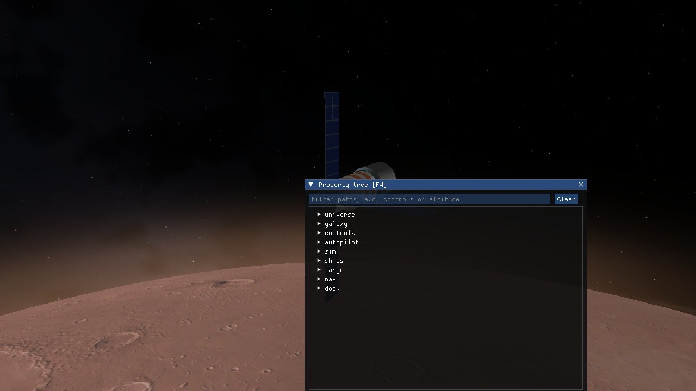The F4 browser is the live property reference.

## ShipEdit: editing ships and stacks

**ShipEdit** (`addons/shipedit`, Linux) is a GTK 3 editor for `ship.json`. Choose an addon and a ship and it loads it. The tree on the left is Ship > Stage > parts, engines and gear; the form on the right edits the selected node, and every node has a _Raw JSON_ box for anything the form does not show. Keys the editor does not know about (cockpit, systems, animations, scripts) are written back untouched.

  * **Stacks:** add, delete, duplicate and reorder stages; _Auto-pack_ stacks each stage against the one before it. Changing a stage's Z moves its parts, engines and gear with it unless you untick the box.
  * **Meshes:** _\+ Part > Model file_ picks an OBJ or GLB (a file from outside the addon is copied into `models/` on save, with its .mtl and textures), or add a generated prop (stage, adapter, engines, fins, fairing and so on).
  * **Numbers:** a table shows each stage's dry and propellant mass, thrust, Isp, delta-v and thrust-to-weight; a problem list flags missing models, a stage with no mass, engines outside their stage and a ship name that clashes with the source.
  * **Save** writes the ship back into its addon, after copying the whole addon to `shipedit-backups/<id>-<time>/` next to the addons folder (queued models are copied in; `addon.json` is left alone).
  * **Save as new addon** writes a new folder instead: a copy of the source addon with the edited ship, a new id and name, and queued models. The source is left alone. Other ships and MFDs in the source addon are copied too, so give the ship a new name. _Launch in Kosmos_ starts the game with the saved ship.
  * Offset, Rotate and Position fields have a nudge slider under each axis, and one drag is a single undo step.
  * The preview is drawn in software (cairo), so it needs no OpenGL. Drag orbits, middle or right drag (or Shift+drag) pans, the wheel zooms at the pointer, and the View buttons snap to Front, Back, Left, Right, Top, Bottom or Iso (Fit resets pan and zoom); very large meshes are thinned while you drag. `shipedit --addon ID [--ship FILE] --shot out.png [--yaw D --pitch D]` renders it to a PNG without a window.

## KosmosCAD: modelling ships

KosmosCAD (`addons/kosmoscad/bin/kosmoscad`, Linux and Windows) is a 3D modeller for ship meshes. Run `kosmoscad ship.json` or press **Model in KosmosCAD** in ShipEdit. All four views (Top, Front, Side, perspective) are OpenGL. The full guide, with a tutorial, is the [KosmosCAD manual](kosmoscad.md). **File > Close file** (Ctrl+W) clears the editor. Opening a JSON file that is not a `ship.json` (no `"stages"` list) shows a warning, and a ship with no OBJ model opens with a warning that only its engines, gear and systems can be edited.

  * **Modes and tools:** Object, Vertex, Edge and Face modes; click or drag a box to select; Move, Rotate and Scale gizmos; undo and redo.
  * **Shapes:** box, cylinder, cone, sphere, torus, plane; sketch a polygon in a view and extrude, loft or lathe it.
  * **Editing:** extrude, inset, split edge, weld, flip and delete faces, mirror, boolean union, subtract and intersect.
  * **Materials and UVs:** assign a material per face. The object name is the part name Kosmos animates (written as an `o` line; files without one fall back to the `usemtl` material name, and animations may use either). Project UVs from the panel, press Z until a view is textured to see the images, and U opens the UV editor, where you drag the image around (move, rotate, scale) and the UVs of the selected faces follow.
  * **Equipment:** engines, gear, tanks, ISRU, reactors and pressure vessels are markers you drag in the views and fill in through a property form; they are written back into `ship.json`.
  * **Files:** `.kmodel` scenes, OBJ+MTL export, and `ship.json` (the old file is kept as `ship.json.bak`). `kosmoscad FILE --shot out.png --size 1280x800` renders a picture without interaction.

### A worked example: modifying a shipped ship

This walks through changing an existing ship (copy of the Deltaglider), then flying it. For modelling from nothing, see the tutorial in the [KosmosCAD manual](kosmoscad.md#tutorial).

  1. **Copy the addon.** Copy `addons/cvel-deltaglider` to `addons/my-glider`, then edit `addon.json` (a new `id` and `name`) and the ship's `"name"` in `ship.json`, so the copy does not clash with the original.
  2. **Open it.** Run `addons/kosmoscad/bin/kosmoscad addons/my-glider/ship.json` (or press _Model in KosmosCAD_ in ShipEdit after saving). The OBJ parts appear in the four views; the engines, gear, docking ports and systems appear as small markers with arrows. Click the Perspective view and press `F` to frame everything. The Scene window (`F2`) lists every object and marker; the views fill the main window and the panels are floating tool windows.
  3. **Look around.** Wheel zooms, middle or right drag orbits (perspective) or pans (Top, Front, Side). `Space` maximises the active view, `Z` toggles wireframe in it.
  4. **Move a marker.** Click an engine marker in a view (Object mode, `1`) and press `W` for the Move tool. Drag a coloured arrow to slide it along one axis; the other three views follow. The Properties window (`F3`) shows its position and its JSON properties (thrust, Isp and so on), which you can edit and apply.
  5. **Edit the hull.** Click a hull object, press `4` for Face mode, and click or box-select a few faces. _Inset_ then _Extrude_ (with a negative distance) to sink a panel, or _Extrude_ forwards to lengthen a nose. `Ctrl+Z` undoes each step.
  6. **Cut a hole.** Add a Box (_Add > Box_), move and scale it so it overlaps the hull, select the hull first and the box second (Shift+click), then press _Subtract_. The hull keeps the result, with the box carved out.
  7. **Make a part animatable.** Model the door or gear leg as its own object (_Add_ a shape, or _Duplicate_ one) and type the part name (for example `bay_door`) in the Name box of the object properties. Kosmos names animated parts by the object (`o`) name, so the animation JSON can refer to `bay_door`. An object may use several materials.
  8. **Add equipment.** _Add > Equipment_ offers engines, gear, ports, tanks, reactors, ISRU units, life-support and pressure vessels. Drag the new marker into place and fill in its properties; the type decides which `ship.json` section it is written to.
  9. **Save.** _File > Save to ship.json_ (`Ctrl+Shift+S`) writes the meshes to the ship's `models/` folder, rewrites `ship.json` and keeps the old one as `ship.json.bak`. Keys the editor does not know about (cockpit, animations, scripts) are kept as they were. _File > Close file_ (`Ctrl+W`) then clears the editor.
  10. **Fly it.** Start Kosmos with `./kosmos --ship "My Glider" --orbit` (or pick it in the scenario list). If something is wrong, compare with `ship.json.bak`.

**Good to know.** Only OBJ parts are shown and edited; a part that uses a GLB model or a generated prop is kept in `ship.json` untouched. Texture images are not previewed in the views, but a material's texture path is saved and copied beside the OBJ. A boolean wants closed meshes; if the result looks wrong, use _Weld_ and _Flip normals_ first. All keys are listed in the [KosmosCAD manual](kosmoscad.md#keys).

## Writing an MFD

### MFD mode ids

The ids a scenario's `mfd_left` / `mfd_right`, a ship's `cockpit.mfd_left` and a panel instrument's `mode` take, with the label each mode shows. A _space_ mode is hidden on atmosphere-only ships (aircraft) and an _atmosphere_ mode on space-only ships; ship-specific modes are offered only on their ships.

Addon| Id| Label| Domain  
---|---|---|---  
stockmfd| `orbit`| Orbit| space  
stockmfd| `surface`| Surface| any  
stockmfd| `map`| Map| space  
stockmfd| `attitude`| RCS Attitude| any  
stockmfd| `ascent`| Ascent Profile| space  
stockmfd| `align`| Align Planes| space  
stockmfd| `sync`| Sync Orbit| space  
stockmfd| `transfer`| Transfer| space  
stockmfd| `orbitcomp`| OrbitComp| space  
stockmfd| `comnav`| COM/NAV| any  
stockmfd| `vor`| VOR/ILS| any  
stockmfd| `vtol`| VTOL| any  
stockmfd| `adf`| ADF| any  
stockmfd| `hsi`| HSI| any  
stockmfd| `docking`| Docking| space  
stockmfd| `fuel`| Fuel| any  
stockmfd| `instrument`| Instruments| any  
stockmfd| `systems`| Systems| any  
stockmfd| `radar-altimeter`| Radar Altimeter| any  
stockmfd| `ares_ascent`, `dg_ascent`, `shuttle_ascent`| Ares Ascent, Deltaglider Ascent, Shuttle-A Ascent| any; restricted to their ships and variants  
instruments| `adi`| Attitude Indicator| any  
instruments| `altimeter`| Altimeter| any  
instruments| `asi`| Airspeed| atmosphere  
instruments| `vsi`| Vertical Speed| atmosphere  
instruments| `dg`| Heading| atmosphere  
instruments| `turn`| Turn Coordinator| atmosphere  
instruments| `engine`| Engine| any  
cvel-deltaglider| `dg_aoa`, `dg_slip`, `dg_slope`| DG angle of attack, DG slip angle, DG Slope| any  
cvel-icbm| `icbm-target`| ICBM Targeting| any  
cvel-shuttle-a| `shuttlea_levels`| Engine levels| any  
  
The label is the `name` a mode's Lua file returns, and the id is its `id` in the addon's `mfds` array.

**Publishing a burn for File → Set time.** A mode that plans a burn can let _File → Set time to T-5:00 before burn_ skip to it. Each time it draws it sets `/plan/<mode>/at` (the absolute sim time the burn _ignites_ , i.e. `/sim/time` \+ time to burn centre − half the burn length), `/plan/<mode>/label` and `/plan/<mode>/stamp` set to `/sim/frame`; at the start of a draw it sets the stamp to `-1`, so a closed mode or one with no plan is ignored (a stamp more than 5 frames old counts as stale). Transfer and OrbitComp do this today; the sim uses the newest, and falls back to its own Hohmann estimate when neither is showing a plan. `/sim/settings/burn-lead-min` (default 5) is the lead in minutes.

Scripts can read every body's `/universe/bodies/body[i]/{x,y,z,vx,vy,vz,parent}` (universe frame). OrbitComp also accepts `/orbitcomp/page` (1-3) with `/orbitcomp/node-mode`, `time`, `prograde`, `radial` and `normal`, applied once; handy with `--set` for screenshots.

**HUD modes.** `H` cycles the head-up display through the modes in `cockpit.hud_modes`, an array drawn from `"orbit"`, `"surface"` and `"docking"`. If it is omitted, aircraft get `["surface"]` (airspeed, altitude, heading tape and pitch ladder) and every other ship gets all three. A spaceplane would set all three.

**Reverse thrust.** `"reverse_throttle": true` at the top level of `ship.json` lets the main throttle go negative (to -1), firing linear thrusters in reverse. The Deltaglider uses it.

The Dynamic Camera can be tuned per ship with `cockpit.head_motion`: `enabled` (default true), `strength` (1), `frequency` in Hz (3.8), `damping` ratio (0.55) and `max` offset in metres (0.15).

MFD modes are Lua files listed in an addon's `mfds` array. An entry may carry `"name"` (overrides the script's mode name), `"short"` (a code of up to 7 letters for the compact mode list) and `"ships"` (addon folder names; when present the mode is offered only on those ships); it may also carry `"domain": "space"` or `"atmosphere"`; the default `"any"` always shows. Ships hide the other regime's modes from the mode list and from their panels: `cockpit.mfd_filter` is `"auto"` (default: class `aircraft` hides `space` modes, any other ship hides `atmosphere` modes), `"atmosphere"`, `"space"`, or `"none"` to offer everything (for a spaceplane, say). `cockpit.mfd_hide` is a list of mode ids the ship never offers, whatever the filter says. `cockpit.vc_gauges` entries (`part`, `image`, `controls`) redraw a VC part's texture each frame with `needle`/`bar`/`number` controls, positioned in image pixels; `vc_animations` entries may use `move` (a ship-frame offset) to slide a part, and a hotspot with `outline_active` is outlined in red while its control is selected. Panel controls and `vc_hotspots` entries can set `label`, the tooltip shown when the mouse hovers over them (Settings > Cockpit tooltips). The stock Orbit, Map, Ascent, Align, Sync, Transfer, OrbitComp and Docking modes are `space`; Airspeed, VSI, Turn and Heading are `atmosphere`. A script returns a table:
    
    
    return {
      name = "Fuel",
      buttons = { "RESET", "", "", "", "", "", "", "", "", "", "", "" },  -- 12 labels, left column then right
    
      init   = function(self) self.peak = 0 end,
      update = function(self, dt) end,
    
      draw = function(self, g, w, h)
        local fuel = props.get("/ships/ship[" .. props.get("/sim/active-ship") .. "]/total-fuel")
        self.peak = math.max(self.peak, fuel)
        g:colour(120, 255, 140)
        g:text(200, 14, "FUEL", 1)
        g:rect(60, 100, 340, 140)
        g:fillrect(60, 100, 60 + 280 * fuel / math.max(1, self.peak), 140)
      end,
    
      button = function(self, i)    -- i is 1-based
        if i == 1 then self.peak = 0 end
      end,
    }

Drawing call| Does  
---|---  
`g:colour(r, g, b)`| Set the drawing colour  
`g:line`, `g:rect`, `g:fillrect`| Lines and rectangles  
`g:circle`, `g:disc`, `g:tri`| Circles, filled circles and triangles  
`g:arc(cx, cy, r, deg0, deg1)`| Arc  
`g:text(x, y, s, align)`| Text; align 0 left, 1 centre, 2 right  
`g:image(file, cx, cy, w, h, angle, sx, sy, sw, sh)`| A bitmap from the mode's own folder (PNG, with alpha), centred at cx, cy and scaled to w×h. `angle` turns it clockwise about its centre, in degrees. The optional `sx, sy, sw, sh` pick a pixel region of the file, which is how a scrolling strip like an attitude ball is cut. Images are cached, and later ones draw over earlier ones.  
  
Bitmap instruments, such as the attitude indicator and altimeter in `addons/instruments`, are built from `g:image` calls over PNG files; `tools/make_instrument_bitmaps.py` draws the placeholder art, and any file can be replaced with finished artwork of the same size. The ship property `{ship}/roll` (degrees, right wing down positive) is there for such instruments.

The drawing surface is a 400×400 box regardless of the on-screen size, so one script works in the panel, the heads-up display and the 3D cockpit. Each MFD gets its own `self` table. The stock modes in `addons/stockmfd` (Orbit, Surface, Map, HSI, ADF and others) are good examples to copy.

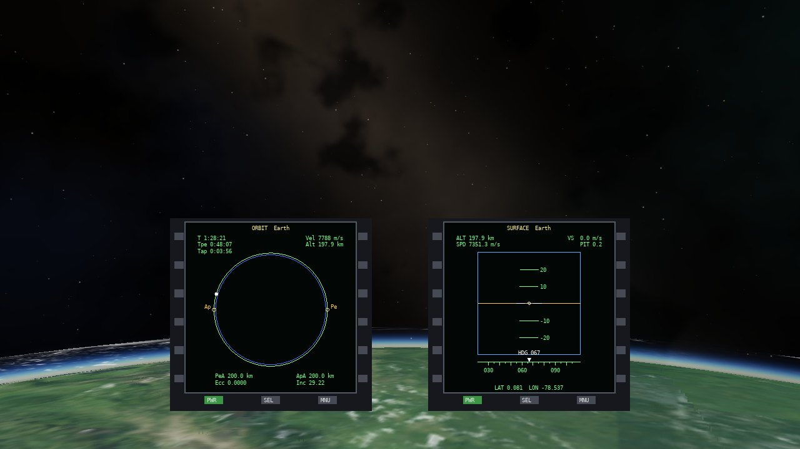Orbit and Surface: both are just Lua files in `addons/stockmfd`.

## Using the console for development

Press `F11` to open the Lua console. It is the quickest way to try a script without restarting: edit, press `Ctrl`+`Enter` and see the result. A script can be triggered manually, every frame, on a timer or when a property changes, and gets `event`, `dt`, `event_path` and `event_value` globals. Errors mark the line in the editor. Saved scripts go to `~/.config/kosmos/scripts/`.

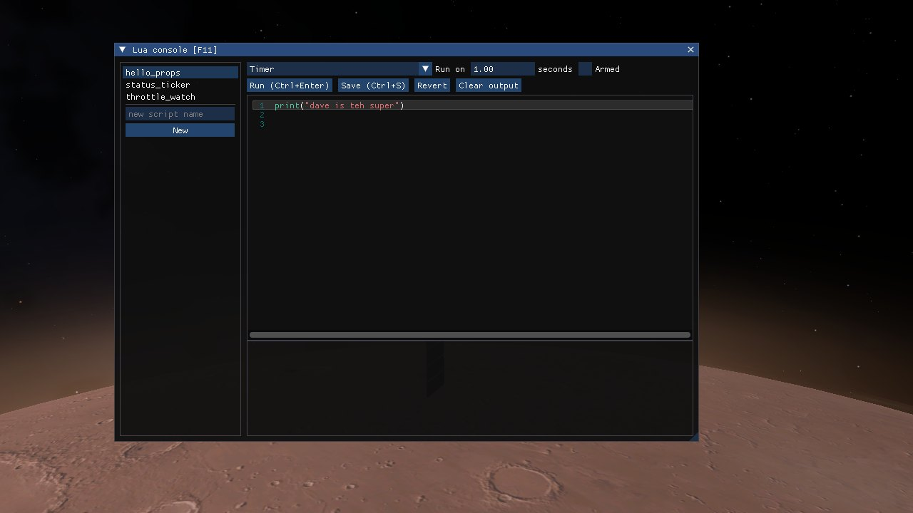The Lua console.

The script folders are scanned when Kosmos starts; a user script with the same name as a shipped one replaces it.

## Testing & screenshots

Kosmos has a headless mode that flies a scenario without a window and prints a report each few seconds:
    
    
    ./kosmos --scenario proton_k_baikonur --selftest 700 --autopilot
    ./kosmos --scenario ares_spider_gale_crater --selftest-vessel-ascent --selftest 1

The first command flies a scenario; the second runs the vessel-ascent regression checks. The flight report ends with the final altitude, apsides, whether the ship crashed and which body's sphere of influence it is in. Tests may also depend on weather, addon configuration and the selected scenario.

To take a screenshot at a chosen camera angle:
    
    
    ./kosmos --scenario ares_spider_mars_orbit --shot mars.png --shot-at 4 \
             --cam-distance 60 --cam-pitch 1.4 --cam-yaw 0

Chase-camera yaw and pitch are in radians and distance is in metres. Add `--base-cam id:index` to look through a base camera, or `--camera-window`, `--settings-window`, `--property-window` and `--lua-window` to capture the tool windows. `--cam-fov DEGREES` sets the field of view (default 50), `--cam-antisun` points the camera away from the star, and `--quantum` opens the Quantum navigation window. To visit a star in a test, use `--system NAME --ship "CVEL Dragonfly" --orbit-body NAME --orbit-alt 1.495978707e8` (1 AU above the surface); `--orbit-body auto` picks the arrival world the quantum drive would.

## Ship systems & pressure vessels

A ship’s power, consumables and cabins are data. Add a `"systems"` list (equipment) and a `"vessels"` list (pressure vessels) to a `ship.json`, or to a part kit’s `part.json` (kit entries are merged into the ship, and their stage is set to the kit’s stage). Nothing here needs code. A ship with neither key has no systems and behaves exactly as before.
    
    
    "systems": [
      {"type": "battery", "name": "Batteries", "capacity_wh": 8000, "max_w": 3000, "charge": 1.0},
      {"type": "solar", "name": "Solar wings", "area_m2": 30, "efficiency": 0.28, "facing": [0, 1, 0]},
      {"type": "rtg", "watts": 300, "half_life_years": 87.7},
      {"type": "fission", "watts": 40000, "fuel_kg": 50},
      {"type": "fuel_cell", "watts": 3000},
      {"type": "tank", "gas": "oxygen", "capacity_kg": 20, "kg": 20},
      {"type": "tank", "gas": "nitrogen", "capacity_kg": 12},
      {"type": "tank", "gas": "water", "capacity_kg": 30},
      {"type": "regulator", "name": "Cabin regulator", "vessel": "Cabin"},
      {"type": "scrubber", "name": "CO2 scrubber", "vessel": "Cabin", "kg_per_day": 4, "sorbent_kg": 30},
      {"type": "load", "name": "Avionics", "watts": 400, "priority": 0}
    ],
    "vessels": [
      {"name": "Cabin", "position": [0, 0, -2], "size": [3, 3, 3.5], "crew": 2,
       "pressure_kpa": 101.3, "o2_fraction": 0.21}
    ]

### Components

Every entry needs a `type`. These keys work on all of them:

Key| Meaning  
---|---  
`name`| Label shown in the window (defaults to the type).  
`stage`| Stage index or stage name that carries the item. It is lost when that stage separates. Default: the top stage, so equipment in a capsule survives staging.  
`watts`| Power drawn (loads) or produced (RTG, reactors, fuel cell).  
`priority`| For powered items: 0 is shed last, higher numbers go first. Default 1; regulators and scrubbers default to 0.  
`enabled`| Switch the item on or off at the start. Electrolysers, ISRU plants and refineries default to off, everything else on.  
`wear_hours`| Hours of running before the item wears out and drops off the bus. 0 (default) never wears. The properties `component[N]/wear` (0–1), `failed`, `powered` and the switch `enabled` are under `{ship}/systems/`; writing 1 to `{ship}/systems/repair` resets every wear.  
`type`| Keys| Notes  
---|---|---  
`battery`| `capacity_wh` (1000), `charge` 0–1 (1), `max_w`| Charge and discharge limit; default is capacity per hour. Several batteries add up.  
`solar`| `area_m2`, `efficiency` (0.28), `facing` (ship frame, default +Y), `tracking` (default false), `deployment_control`, `deployment_threshold` (default 1)| Output = area × efficiency × 1361 W/m² × stellar luminosity in solar units ÷ distance in AU squared, multiplied by the facing cosine (or 1 for tracking), zero in planetary or lunar eclipse. Optional `deployment_control` names an `animation_controls` property; output is zero until its position reaches `deployment_threshold` (greater than 0 and at most 1). Fixed `facing` describes the deployed panel, not its animated orientation. Without a deployment control the array is always available.  
`rtg`| `watts`, `half_life_years` (87.7), `age_years`| Decays as 0.5age/half-life with mission time.  
`fission`, `fusion`| `watts` (rated), `fuel_kg` (10)| Dispatched on demand up to the rated power. Fuel burns at 8.2×1013 J/kg with 30% efficiency. Fusion uses deuterium.  
`fuel_cell`| `watts`| Dispatched on demand; consumes hydrogen and oxygen tanks (7.2×107 J per kg of hydrogen) and fills water.  
`tank`| `gas`: `oxygen`, `nitrogen`, `water`, `hydrogen` or `deuterium`; `capacity_kg` (10), `kg` (full)| Several tanks of one gas pool together.  
`electrolyser`| `watts`| Splits water into oxygen (8/9) and hydrogen (1/9) at 2×107 J/kg. Off by default: set `"enabled": true`.  
`regulator`| `vessel`, `watts` (20)| Refills oxygen and nitrogen from the tanks, up to 0.02 kg/s, to the vessel’s `pressure_kpa` and `o2_fraction`.  
`scrubber`| `vessel`, `kg_per_day` (6), `sorbent_kg` (unlimited), `watts` (60)| Removes CO2 until the sorbent is used up.  
`load`| `watts`, `priority`| A plain consumer such as avionics or lighting.  
`isru`| `watts`, `kg_per_day`| Regolith processing: while powered it adds water to the water tanks. Off by default. With `"site": true` (for a ship's own miner) it only works while the ship is landed, the yield scales with the water the body offers (0 for Venus or Io, 1 for Europa or Earth; other bodies are guessed from density and distance from the star), and `n2_kg_per_day` adds nitrogen from the body's air (Earth, Titan) and `regen_kg_per_day` restores CO2 scrubber sorbent.  
`refinery`| `watts`, `kg_per_day`| Turns water from the water tanks into main propellant while the active stage's tank has room. It leaves a quarter of the water tank for the crew. Off by default.  
`comms`| `watts`| A transmitter that is a load; its `powered` property is the link state.  
  
Regulators and scrubbers name a `vessel`; if omitted they serve the first vessel.

### Vessels

Key| Meaning  
---|---  
`name`| Referred to by regulators, scrubbers, scenarios and tagged meshes (default `Cabin`).  
`position`, `size`| Centre and full size of the box in the ship frame, metres. The box is mapped onto a unit cube for the gas grid, so it can be any shape. Volume is the product of the size.  
`crew`| Number of people breathing in it. A vessel with no crew has no hazard and no health.  
`pressure_kpa`, `o2_fraction`, `co2_kpa`, `temperature_k`| Starting atmosphere. Defaults: 101.3 kPa, 0.21, 0, 294 K. Temperature is fixed.  
`crew_at`| List of `[x, y, z]` in the unit cube (0–1). Crew breathe and exhale at these places, spread evenly. Default is the centre.  
`vents`| List of `{"at": [x,y,z], "area_cm2": n}`: permanent leaks at a place on the hull. Use for a ship that starts holed; scenarios can do the same with `leak_cm2`.  
`stage`| As for components.  
  

### Mining, supply pods and variants

A ship can make its own supplies. Give it an `isru` component with `"site": true` (mines water only while landed), an `electrolyser` (water to oxygen and hydrogen), a `refinery` (water to main propellant) and the tanks they fill; the F1 Ship systems window and `/ships/ship[N]/systems/processing` switch the lot on. These are power loads, so a ship that mines far from the Sun wants a `fission` source: the CVEL Deltaglider (Nuclear) is the stock Deltaglider plus `{"type": "fission", "name": "Fission reactor", "watts": 8000, "fuel_kg": 10}` and 1200 kg more stage `dry_mass`.

A variant of an existing ship is its own addon directory with its own `ship.json` that points at the parent’s assets with `../parent-addon/...` paths (`model`, `animations`, `vc_model`, panel `image`s). The nuclear Deltaglider and the Shuttle-AQ are built this way. Copy the parent’s file again if the parent changes.

A ship file with `"life_pod": true` is a supply pod: while docked to a ship, it tops up that ship’s oxygen, nitrogen and water tanks and CO2 sorbent from its own tanks and scrubber, 1 kg/s, unless `/dock/transfer` is off. See `addons/cvel-shuttle-a/lifepod.json`; list as many in a scenario as the ship has ports. Scenarios `nuclear_deltaglider_gale`, `shuttle_a_life_pods_orbit` and `shuttle_a_tranquility_miner` show all three.

### Tagged meshes

Instead of typing a box, you can model it. Name objects in a part’s model like this and Kosmos reads their bounds when the ship loads:

Name starts with| Gives  
---|---  
`vessel_NAME`| The pressure vessel called NAME (a bare `vessel` is called Cabin). The box is the object’s bounding box, placed with the part’s `offset`, `rotate` and `scale`.  
`crew_*`| A crew position at the object’s centre, in the vessel that contains it. Crew breathe and exhale there.  
`vent_*`| A vent position at the object’s centre. It starts closed; it marks where a leak opened later (a scenario’s `leak_cm2`, the window button, or `breach-cm2`) shows up in the gas grid.  
  
In OBJ files the object is the `o` name (files with no `o` lines use the `usemtl` material name), so give the object that name. In GLB/glTF use the node (mesh) name. The tagged objects are never drawn, so you can make them any shape. Crew count, pressure and the rest come from a `"vessels"` entry with the same name; if the JSON gives no `crew` number, the number of crew markers is used. If a vessel exists in both places the mesh supplies the box and positions and the JSON the numbers.

### In scenarios

A scenario can fix the weather everywhere with `"weather": "EGTC 011200Z 27022G38KT 2500 +RA BKN006 OVC012 09/08 Q0994"`, any METAR line; without it the normal procedural or live weather applies. `data/weather/bodies.json` may override a body's climate by name, e.g. `{"Mars": {"mean_wind": 20, "cloudiness": 0.1}}`. Keys: `mean_wind`, `wind_variation` (m/s), `cloudiness`, `rain_chance` (0–1), `mean_temperature`, `temperature_range` (°C), `pressure`, `pressure_variation` (hPa), `cloud_base`, `cloud_depth` (m) and `rain` (false for dust or snow-free worlds).

A scenario takes `"fullscreen": true` to start in full screen, `"life_support": "off"|"warn"|"fatal"` and each ship may carry `"systems"` overrides, as fractions or plain numbers:
    
    
    "ships": [{ "ship": "Kestrel", ...,
      "systems": { "leak_cm2": 2, "battery": 0.5, "tanks": { "oxygen": 0.4, "water": 1.0 } } }]

`leak_cm2` opens a leak in the first vessel at the start; `battery` is the starting charge 0–1; `tanks` maps a gas to the fraction of capacity left. The scenario editor has fields for all of these.

### Property tree and Lua

Everything is published under `/ships/ship[N]/systems/`:

Path| Meaning  
---|---  
`present`, `life-support`| The ship has systems; the mode name.  
`alarm`, `crew-lost`| Current alarm text (empty when fine); true once the crew has died.  
`bus/powered`| False when any load is being shed.  
`bus/instruments`| False when the bus has no electricity at all; MFDs and lights go dark.  
`bus/supply-w`, `bus/demand-w`| Fixed-source supply and total demand.  
`battery/wh`, `battery/percent`| Stored energy.  
`tank/oxygen-kg`| Also `nitrogen`, `water`, `hydrogen`, `deuterium`.  
`vessel-count`| Number of vessels.  
`vessel[i]/name`, `hazard`| Name; empty or `O2 LOW`, `O2 HIGH`, `CO2 HIGH`, `LOW PRESSURE`.  
`vessel[i]/pressure-kpa`, `ppo2-kpa`, `ppco2-kpa`| Total pressure and partial pressures.  
`vessel[i]/health`, `leak-rate`| Crew health 0–1; leak decay constant in 1/s.  
`vessel[i]/breach-cm2`| Write-only: setting an area opens a leak of that size. It reads back as 0.  
      
    
    -- open a 5 cm2 hole in the first cabin of the active ship
    local base = "/ships/ship[" .. props.get("/sim/active-ship") .. "]/systems/"
    props.set(base .. "vessel[0]/breach-cm2", 5)
    if props.get(base .. "alarm") ~= "" then print(props.get(base .. "alarm")) end

The Systems MFD, `addons/stockmfd/systems.lua`, is a short example of an MFD built from these properties.

Use `./kosmos --check-data` after editing a ship or scenario, and `--scenario NAME --systems-window --life-support fatal` to try one.

## Science instruments

A `ship.json` can list instruments that the Instruments MFD drives:
    
    
    "instruments": [
      {"id": "nac", "type": "visual", "name": "Narrow-angle camera",
       "load": "Imaging cameras", "position": [0,0,0], "direction": [1,0,0],
       "fov": 0.5, "slew": 3, "max_slew": 180, "sun_limit": 20,
       "resolution": 800, "frames": 400}
    ]

`type` is `visual`, `ir`, `uv`, `radar` or `spectrometer`. `load` names a switchable systems load that powers it. `fov` and the slew limits are in degrees (slew in degrees per second), `sun_limit` is the boresight-to-sun angle under which the shutter closes, `resolution` is the saved picture size and `frames` the film or storage count. Lua reads `/ships/ship[N]/instruments/instrument[i]/*` and `/sim/instrument/*`; a mode can draw the live view with `g:image("live:instrument", cx, cy, w, h)`.

## Ship weapons & shields

Any ship can carry energy weapons: beams, pulses, bolts and flak, drawn as additive neon with sparks, a flash and a light where they hit. Define weapons in `<addon>/weapons/*.json` (one object, or a list under `"weapons"`) and mount them in `ship.json`.
    
    
    { "id": "neon-beam", "name": "Neon beam", "fire": "beam",
      "ship_damage": 0.05, "range": 8000, "duration": 1.5, "cooldown": 2,
      "impact": "plasma", "impact_scale": 1.5,
      "look": { "colour": [255,120,20], "core": [255,245,220],
                "width": 0.25, "glow": 5, "sparkle": 0.6, "light": 6, "light_range": 300 } }

  * `fire`: `pulse` (an instant ray with a fading streak), `beam` (one pulse per trigger pull: it flares, then fades to nothing over `duration` seconds, then recharges for `cooldown` seconds, default 2; held down it repeats; `ship_damage` is per second at full strength), `bolt` (a projectile of speed `speed`), `volley` (`count` bolts, `interval` seconds apart, from one trigger pull; `rate` is volleys per second) or `flak` (`count` small bolts spread over `cone` that burst into sparks after `lifetime` seconds).
  * `rate` (shots per second), `spread`, `range` (m), `duration` (pulse streak life, or a beam pulse’s length), `ship_damage` (fraction of a ship’s health per hit), `impact` (`spark`, `plasma` or `explosion`) and `impact_scale`.
  * `look`: `colour` and `core` (RGB), `width` (m), `glow` (halo size as a multiple of the width), `length` (bolt streak, m), `sparkle` (0–1), `light` and `light_range` (the light it casts).

    
    
    "weapons": [ { "name": "Nose beam", "weapon": "neon-beam", "group": "primary",
                   "position": [0,-0.3,-9.5], "direction": [0,0,-1] } ],
    "shield": { "capacity": 0.5, "recharge": 0.05, "delay": 4, "colour": [90,170,255] }

Mounts are in the ship frame. `group` is `primary` (keypad `1`) or `secondary` (keypad `7`), or any name you drive yourself. A shot hits terrain, buildings and ships. A shield soaks hits first (its `capacity` is in fractions of the hull, it recharges after `delay` quiet seconds) and flashes in its colour; only the rest reaches the hull. Shields do not stop bombs. The `field-kit` addon supplies four tiers of each, in increasing effect: `beam-red`, `beam-yellow`, `beam-green`, `beam-violet` and `spark-red`, `spark-yellow`, `spark-green`, `spark-violet`; any ship can mount them. The sparkle weapons are volleys of six small bright bolts. The Deltaglider is fitted with them, plus a shield.

Fire any ship’s weapons by property: `/ships/ship[N]/weapons/<group>/fire` (0 or 1), and for the flown ship `/controls/weapons/<group>/fire`. Scripts and scenarios use the same properties, so ships can shoot each other. `/ships/ship[N]/shield` and `health` read the shield level and hull health (0–1). Native and Python programs pull a trigger with KosmosLink’s `fire` request (`kl_fire`, which needs the `spawn` permission) and can read the shield and health; see the [SDK manual](https://github.com/daver64/Kosmos/blob/main/sdk/docs/MANUAL.md). Beams hum with a deep whump as they fire and volleys zap like a plasma rifle; both sounds are made in the game, fall off with distance and follow the sound setting. At most four weapon lights are used at once, sharing the scene’s 16 light slots; change the number in Settings (_Weapon lights_).

## Buildings

A building is a fixed, enterable ship. Write a ship file with `"class": "building"`, list it in the addon’s `addon.json` as `"buildings": ["habitat.json"]` and place it from a base object:

A building's panel (its _interface_) uses the same `layout` as a ship cockpit. The block may be called `"interface"` instead of `"cockpit"`. `layout.image` gives a background bitmap, drawn under the controls in the 2D panel and on the board in 3D. For the 3D view, `position` (relative to the eye), `size` (board width in metres) and `tilt` place the board; the Gale habitat uses `[0, -0.1, -1.5]`, 1.8 and 12. Inside a building, `C` cycles chase, 2D panel and 3D, and 3D controls are clicked with the mouse.
    
    
    { "type": "building", "building": "Gale habitat", "x": -48, "z": 22, "heading": 40 }

It has no engines. It is pinned to the ground when the scenario loads, and V and boarding ignore it. An upright building has its roof on −Z and its base at +Z (a stage of length L puts the ground at z = L/2); use a lathe `profile` part for a dome or silo. Extra keys: `door` (a point in the ship frame, at ground level just outside the door; required to be enterable), `door_radius` (metres, default 4). Standing within `door_radius` of the door on foot and pressing Enter goes inside; the player sees `cockpit.controls` as a 2D panel (set `cockpit.layout` width and height) and looks out of `cockpit.eye`, with yaw 0 facing the door side.

A panel needs no artwork. Each control has `x`, `y`, `w`, `h` and an optional `label`, and one of these types: `toggle` (flips `property` 0/1), `button` (sets `property` to `value`), `label` (text), `readout` (`property` printed with `format` times `scale`), `gauge` (a bar from 0 to `max`; `alarm` turns it red when low) and `lamp` (lit when `property` > 0.5, or equal to `value`; `alarm` lights it red). `{ship}` in a property stands for the building’s own ship, for example `{ship}/systems/component[2]/enabled`. Each building has its own power system; give it batteries and solar panels, or share nothing. See `addons/gale-base/` for four complete examples. `--enter-building TEXT` starts a scenario inside the first building whose name contains TEXT.

### Walkable interiors

Give a building an `"interior"` block and the player can walk inside it in first person. The inside is a grid of square cells (`cell`, default 0.5 m), written as text floor plans in `levels` (one list of rows per storey; a single list is one level). Characters: `#` wall, `.` floor, `D` open doorway, `d` sliding door, `W` window (wall with a glazed opening from about 0.9 m to 2.1 m; solid to walk into), `A` airlock hatch (the way in from outside; the first one on the bottom level is used), space for nothing. `height` is the clear height in cells (default 6). `ground_z` is the ground level in the ship frame (default the `door` z, or 0); for a stage of length L it is L/2. The plan is centred on the building; `origin` shifts it. A hatch needs a floor cell beside it, and the door position is worked out from it when the file has no `door`. Doorways should be one to two cells wide: a person is 0.44 m across. Walls collide from both sides, and a building with an interior needs no dome or other parts (use `"parts": []`). Enter at the hatch to go in and out.
    
    
    "interior": { "cell": 0.5, "height": 6, "ground_z": 3.0,
      "levels": [[ "########", "#......#", "#......D", "###AA###" ]] }

See `addons/outpost-base/mare_quarters.json`. Add `"panels": [{ "pos": [1.75, 1.55, 0.5], "facing": "+z", "width": 1.4 }]` to the interior to mount the building’s own `cockpit` control panel on a wall (`pos` is the board’s centre in metres, `facing` the way it faces into the room). Face it within 2.5 m and press Enter to use it; Enter again returns to walking. 

**Lights and meshes.** `"lights": [{ "pos": [2.0, 2.75, 1.25], "colour": [1, 0.95, 0.85], "intensity": 1.5, "range": 7 }]` places point lights (`pos` in interior metres; the last three fields are optional). They light the inside while you are in the building and go out when its bus is unpowered, leaving a dim emergency glow. `"mesh": "walls.obj"` (a file beside the ship.json; any format Kosmos loads) is drawn instead of the generated walls and glass. Model it in interior coordinates (metres, x along a plan row, z down the rows, y up, origin at the plan’s top-left floor corner) and keep the plan as the collision and room layout, so the plan’s walls should sit where your model’s do.

**Doors and pressure.** `d` in a plan is a sliding door (two cells wide, like `D`, but it opens as a person comes within 1.5 m and shuts behind them). Closed doors, walls and the hatch divide the interior into rooms; name them with `"rooms": [{ "name": "Hab", "at": [10, 3] }]`, where `at` is a plan cell (column, row). A room whose name matches one of the building’s `vessels` uses that vessel’s air. An open door joins the air of the rooms on its sides, and it stays locked while their pressures differ by more than 5 kPa. `"airlock": "Airlock"` names the room behind the hatch: Enter at the hatch depressurises it (about 25 s, the doors to it locked) before letting the player out, and it is repressurised on re-entry. Give that vessel its own `regulator` component, appended to the end of `systems` so existing component indices do not change.

## Common mistakes

Symptom| Likely cause  
---|---  
The ship does not appear in the list| The addon has no `addon.json`, the `ships` array has the wrong file name, or the JSON has a syntax error. Check the log on stderr.  
Thrust seems to push the wrong way| The ship nose is −Z. An engine at the tail pointing forward has `"direction": [0, 0, -1]`.  
An imported mesh is back to front or mirrored| Convert it with `tools/msh_import.py`, which handles Orbiter's coordinate system.  
Ship tips over on the ground| The `gear` points (or `wheels`) are missing or are not below the centre of mass.  
An aircraft will not rotate or climbs wildly| Check `area`, `cl_alpha` and the elevator's `gain_deg` sign.  
A base object floats or sinks| Objects stand on the levelled ground. Make `flat_radius` big enough to contain the site, and use `y` only to lift things.  
A property write has no effect| The property is tied to a live value, or the keyboard overwrites it every frame (pitch, yaw, roll, RCS, brake).  
Comments in JSON break loading| JSON has no comments. Remove them.
